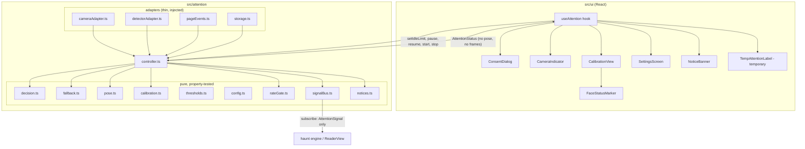
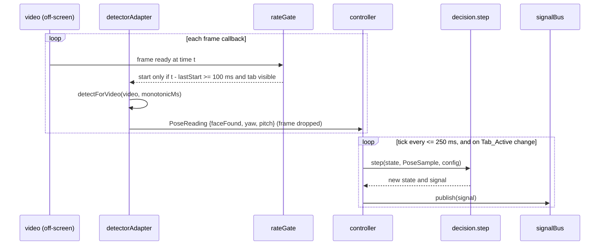
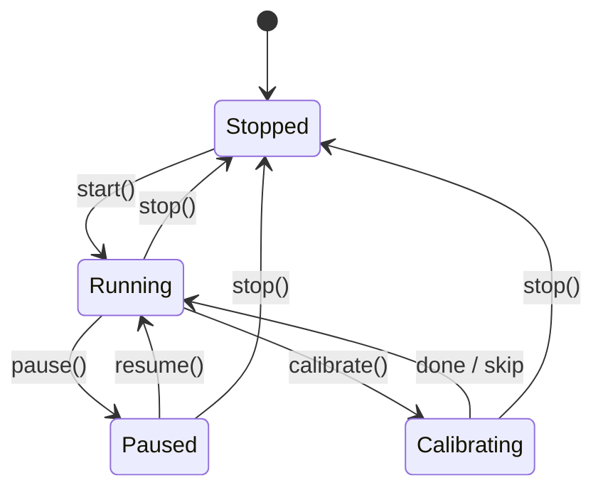

# Design Document

## Overview

The attention module (`src/attention/`) answers one question for the rest of the app: is the reader facing the screen? Its only output is an `AttentionSignal`, which is `present` or `away` plus a millisecond timestamp. Nothing else (pose, landmarks, frames) leaves the module.

The design splits the module into three layers:

1. **Pure logic** (no DOM, camera, clock, storage, or timers): the Decision_Function, the fallback decision function, pose extraction from a transformation matrix, calibration maths, threshold/setting validation, the detection rate gate, and the signal bus. All of it is property-tested with fast-check.
2. **Controller**: a small orchestrator that owns the mode (Camera_Mode, Fallback_Mode, Paused_State, calibrating), feeds samples to the pure functions, and publishes the result. It receives every side-effecting dependency (clock, camera, detector, page events, storage) as an injected port, so it can be tested with fakes.
3. **Adapters and UI**: thin wrappers around `getUserMedia`, MediaPipe Face Landmarker, and `document`/`window` listeners, plus React components in `src/ui/` (consent dialog, camera indicator, calibration view, settings screen, notice banner, temporary label).

### Research findings (MediaPipe, via Context7)

Fetched from the MediaPipe Face Landmarker documentation (Context7 library `/websites/developers_google_edge_mediapipe`, source [Face Landmarker guide](https://developers.google.com/edge/mediapipe/solutions/vision/face_landmarker)).

Confirmed in the docs:

- Import `FilesetResolver` and `FaceLandmarker` from `@mediapipe/tasks-vision`. Create with `FilesetResolver.forVisionTasks(<wasm base path string>)` then `FaceLandmarker.createFromOptions(vision, options)`.
- Options on web: `baseOptions.modelAssetPath`, `baseOptions.delegate` (the sample uses `"GPU"`), `runningMode` (`IMAGE` or `VIDEO` on web, default `IMAGE`), `numFaces` (default 1; temporal smoothing applies when 1), `minFaceDetectionConfidence`, `minFacePresenceConfidence`, `minTrackingConfidence` (all default 0.5), `outputFaceBlendshapes`, `outputFacialTransformationMatrixes` (both default `false`).
- `detectForVideo(videoElement, timestampMs)` is synchronous and needs monotonic timestamps. The live-camera sample uses `getUserMedia`, a `<video>` element, and a loop that skips frames where `video.currentTime` has not changed.
- Result fields: `faceLandmarks` (478 normalized landmarks per face, one array per face), `faceBlendshapes`, and `facialTransformationMatrixes` (a 4x4 canonical-face-to-observed-face pose matrix, returned only when `outputFacialTransformationMatrixes` is `true`). An empty `faceLandmarks` array means no face was found (inferred from the per-face array shape; the docs do not state it in one sentence).
- Tasks are expensive to create, should be created once, and released with `close()` on web.

**Head pose decision.** The docs give two routes: the facial transformation matrix output option, or geometry computed from the 478 landmarks. This design uses the **transformation matrix** (`outputFacialTransformationMatrixes: true`), because it is documented as a pose output and avoids inventing a landmark-geometry heuristic. Blendshapes stay off (`outputFaceBlendshapes: false`) to save work.

**Not confirmed in the docs. Do not assume; verify in the first implementation task:**

| Unconfirmed item | How the design copes |
| --- | --- |
| Runtime JS type of each matrix entry. The docs' example shows nested 4x4 arrays, but the TypeScript type is not shown. | `detectorAdapter.ts` reads the matrix through one function, `readMatrix4`, that is checked against the installed package's `.d.ts` and a spike. Everything downstream takes plain `number[]` of length 16, row-major. |
| Axis orientation and sign convention of the canonical face, and whether the rotation includes scale. | `pose.ts` normalizes the three rotation columns and uses a stated convention (see Data Models). Thresholds compare the absolute difference from a Baseline recorded in the same convention, so a consistent sign flip on an axis does not matter. A swapped axis or a 180 degree flip would matter, so a manual spike (look left, right, up, down) must confirm yaw and pitch before the adapter is accepted. |
| Whether `delegate: "CPU"` is a valid value and `detectForVideo` accepts a detached `<video>`. | The adapter tries `"GPU"` (documented), and on creation failure retries once with `"CPU"` if the `.d.ts` allows it; otherwise it reports detector failure. The video element is kept off-screen; if a browser will not play a detached element, the adapter mounts it with `display: none`. |
| Whether `forVisionTasks` accepts a same-origin relative path. | The docs show a URL string. A same-origin path such as `/mediapipe/wasm` is expected to work and is checked in the spike. |
| License of the `face_landmarker.task` model file. | Check the model card before committing the file (see Dependencies). |

### Dependencies and licenses

| Item | License | Notes |
| --- | --- | --- |
| `@mediapipe/tasks-vision` (npm, current version 1.2.3 at the time of writing) | Apache-2.0 (from `npm view`) | Pin the exact version. About 31 MB unpacked, mostly wasm. Loaded with dynamic `import()` only when the camera starts, so the reading view's first paint is unaffected (Req 9.4). |
| `face_landmarker.task` model file | Not confirmed. Read the model card before committing. | Served from `public/models/` (same origin). |
| fast-check, Vitest, React | Already in the project | No new test dependencies. |

No other dependency is added. The wasm runtime files are copied from `node_modules/@mediapipe/tasks-vision/wasm` into `public/mediapipe/wasm/` by a small `scripts/copy-mediapipe.mjs` run from `postinstall`, so the runtime and model are both served from the app's own origin (Req 7.4). A Vitest smoke test asserts that no source file contains a `cdn.jsdelivr.net` or `storage.googleapis.com` string.

### Design decisions

- **Return_Time and `present`.** `present` is emitted on the first Facing_Sample after `away` (Req 4.5 asks for that sample's timestamp). Latency is bounded by the sampling interval, so the adapter ticks at least every `min(Return_Time, 250 ms)`. Return_Time is therefore the upper bound the adapter must meet, and it is a `DecisionConfig` field (default 1000 ms; greater than 0 and at most 1000, and a value at or below 0 or non-finite gives 1000).
- **Heartbeat samples.** The pure function only sees samples, so the controller emits a tick sample at least every 250 ms that repeats the latest pose with a fresh timestamp and current Tab_Active. Repeated samples are harmless (Property 7).
- **Tab_Active changes feed a sample immediately** (Req 4.19), including while detection is stopped.
- **Calibration freezes the signal.** The requirements do not say what the signal does during the 5 s look-away phase. The design keeps the signal at `present` during Calibration (the controller treats it as an internal hold, separate from the public `pause()`), so a haunt cannot start while the reader is following instructions. Flag for review.
- **Thresholds are baseline-relative.** Calibration records the median looking-at-page yaw and pitch as the Baseline (the reader's own centre, so an off-centre webcam does not shift anything) and derives one limit per axis. A sample is beyond when `|yaw - baselineYaw| > yawLimit` or `|pitch - baselinePitch| > pitchLimit` (strict). A turn to either side counts equally, and the separation tested in Requirement 3.4 is the same quantity, `|median away - baseline|` per axis. The limit derivation is specified under Calibration below.
- **No camera image, text-only face status.** The camera feed is never rendered (Req 3.15, 7.6). The Calibration screen instead shows a `Face_Status_Marker`, an icon plus the text "Face detected" or "No face detected", fed only by a boolean `faceFound` in `AttentionStatus` (no pose values, landmarks, or frames). It updates within 500 ms, does not rely on colour, and is announced through a polite live region (Req 3.13, 3.14).
- **UI status is separate from the signal.** The signal interface carries only `{ value, timestamp }`. A second, non-signal `AttentionStatus` store (mode, camera on, camera available, calibration progress, notice) feeds the UI. It contains no pose or frame data (Req 5.7).

## Architecture



### Data flow, Camera_Mode



### Data flow, Fallback_Mode

The page-event adapter reports visibility, focus, and input events. The controller turns them into `FallbackSample {t, tabActive, lastInputT}` on each tick and on each event, and calls `stepFallback`. The camera adapter is never created in this mode.

### Controller states



`Running` has an orthogonal `mode`: `camera` or `fallback`. Camera loss, denial, detector failure, and the camera-off control move `mode` to `fallback`. The Settings_Screen can move it back to `camera`.

## Components and Interfaces

### File layout

```
src/attention/
  types.ts            shared types (AttentionSignal, PoseSample, Thresholds, ...)
  config.ts           defaults, clampDebounce, clampIdleLimit, clampReturnTime
  decision.ts         initialDecisionState, stepDecision, decide        (pure)
  fallback.ts         initialFallbackState, stepFallback, decideFallback (pure)
  pose.ts             poseFromMatrix16                                   (pure)
  calibration.ts      computeThresholds, CalibrationOutcome              (pure)
  thresholds.ts       isValidThresholds, parseThresholds, serialize      (pure)
  rateGate.ts         canStartDetection                                  (pure)
  signalBus.ts        createSignalBus                                    (pure, no timers)
  notices.ts          noticeGate reducer: one notice per cause per Session (pure)
  storage.ts          load/save camera choice, thresholds, debounce      (localStorage)
  controller.ts       createAttention(ports): orchestration
  cameraAdapter.ts    getUserMedia, track stop, track-ended events
  detectorAdapter.ts  lazy-load MediaPipe, detectForVideo, close
  pageEvents.ts       visibility, focus, idle-input listeners
  index.ts            public API + haunt-engine contract comment (Req 10.4)
  __tests__/          *.prop.test.ts and *.unit.test.ts
src/ui/
  useAttention.ts         hook: starts/stops the controller, exposes status and commands
  ConsentDialog.tsx/.css
  CameraIndicator.tsx/.css
  CalibrationView.tsx/.css   (+ useCalibration.ts)
  FaceStatusMarker.tsx/.css  text + icon from a boolean, polite live region
  SettingsScreen.tsx/.css
  NoticeBanner.tsx/.css
  TempAttentionLabel.tsx     temporary, removed when the haunt engine consumes the signal
public/models/face_landmarker.task
public/mediapipe/wasm/*          copied by scripts/copy-mediapipe.mjs
```

Every file stays under 200 lines; components stay under 200 lines (project rule). `index.ts` is the only import path other modules may use, and it exports no pose, landmark, or frame type.

### Core types (`types.ts`)

```ts
export type AttentionValue = 'present' | 'away';
export interface AttentionSignal { readonly value: AttentionValue; readonly timestamp: number } // ms

export interface PoseSample {
  readonly t: number;            // ms, monotonic clock supplied by the adapter
  readonly faceFound: boolean;
  readonly yaw: number;          // degrees
  readonly pitch: number;        // degrees
  readonly tabActive: boolean;   // visible AND focused
}
/** Baseline-relative. Valid when all four are finite and both limits are > 0. */
export interface Thresholds {
  readonly baselineYaw: number;    // degrees, median looking-at-page yaw (default 0)
  readonly baselinePitch: number;  // degrees, median looking-at-page pitch (default 0)
  readonly yawLimit: number;       // degrees, > 0 (default 25)
  readonly pitchLimit: number;     // degrees, > 0 (default 20)
}
export interface DecisionConfig {
  readonly thresholds: Thresholds;   // default baseline 0/0, limits 25 / 20
  readonly debounceMs: number;       // clamped to [500, 5000], default 1500
  readonly returnMs: number;         // greater than 0 and at most 1000; at or below 0 or non-finite gives 1000
}
```

### Decision_Function (`decision.ts`)

```ts
export interface DecisionState {
  readonly signal: AttentionSignal;
  readonly lastT: number | null;          // latest accepted sample time
  readonly awayRunStart: number | null;   // t of the first sample of the current Away run
}
export function initialDecisionState(startT: number, from?: AttentionSignal): DecisionState;
export function isAwaySample(s: PoseSample, th: Thresholds): boolean;
export function stepDecision(state: DecisionState, s: PoseSample, cfg: DecisionConfig): DecisionState;
/** Fold over a sequence. Empty sequence returns { value: 'present', timestamp: startT }. */
export function decide(samples: readonly PoseSample[], cfg: Partial<DecisionConfig>, startT?: number): AttentionSignal;
```

Rules inside `stepDecision`:

1. Ignore the sample if `t` is not finite or `t < state.lastT` (Req 4.13). Equal `t` is accepted and is idempotent.
2. `isAwaySample` is true when `!tabActive`, or `!faceFound`, or `yaw` or `pitch` is non-finite (Req 4.12), or `|yaw - baselineYaw| > yawLimit`, or `|pitch - baselinePitch| > pitchLimit` (strict, either side of the Baseline, Req 4.18). A difference exactly equal to a limit is Facing.
3. On an Away sample: `awayRunStart ??= t`. If the signal is `present` and `t - awayRunStart > debounceMs`, the signal becomes `{ away, t }` (Req 4.3).
4. On a Facing sample: `awayRunStart = null`. If the signal is `away`, it becomes `{ present, t }`, so the timestamp is that of the first Facing sample (Req 4.5).
5. `decide` normalizes `cfg` through `config.ts` (defaults, clamping), so out-of-range debounce uses the nearest bound (Req 4.10, 4.11) and a missing or invalid Thresholds object uses `DEFAULT_THRESHOLDS`, including the 0/0 Baseline (Req 4.17).

Eye gaze is not an input (Req 4.2): the `PoseSample` type has no such field.

### Fallback decision function (`fallback.ts`)

```ts
export interface FallbackSample {
  readonly t: number;
  readonly tabActive: boolean;     // visible AND focused
  readonly lastInputT: number;     // time of last keyboard/pointer/touch/scroll input
}
export interface FallbackConfig { readonly debounceMs: number; readonly idleLimitMs: number }
export interface FallbackState {
  readonly signal: AttentionSignal;
  readonly lastT: number | null;
  readonly inactiveRunStart: number | null;  // start of current hidden/unfocused run
}
export function initialFallbackState(startT: number, from?: AttentionSignal): FallbackState;
export function stepFallback(state: FallbackState, s: FallbackSample, cfg: FallbackConfig): FallbackState;
export function decideFallback(samples: readonly FallbackSample[], cfg: Partial<FallbackConfig>, startT?: number): AttentionSignal;
```

Rules: a sample is away-by-tab when `!tabActive` and the inactive run has lasted longer than `debounceMs`. It is away-by-idle when `t - lastInputT > idleLimitMs` (strict, immediate, no extra debounce). The signal becomes `away` if either holds. Once `away`, it becomes `present` only at the first sample whose tab is active and whose input is within the idle limit, so input after an idle `away` (which raises `lastInputT`) or a return to the tab yields `present` at the first such sample, and a hidden-tab sample never returns the signal to `present`, even within the debounce time (Req 6.4). Samples with earlier `t` are ignored, as in the Decision_Function. The idle limit in `FallbackConfig` has already been clamped by `config.clampIdleLimit`.

### Config helpers (`config.ts`)

```ts
export const DEFAULT_THRESHOLDS: Thresholds;          // { baselineYaw: 0, baselinePitch: 0, yawLimit: 25, pitchLimit: 20 }
export function isBeyond(yaw: number, pitch: number, th: Thresholds): boolean; // strict, baseline-relative
export const DEFAULT_DEBOUNCE_MS = 1500;
export const DEFAULT_RETURN_MS = 1000;
export const MIN_IDLE_LIMIT_MS = 60_000;
export function clampDebounce(ms: number): number;    // [500, 5000]; non-finite -> default
export function clampIdleLimit(ms: number, previous: number): number; // non-finite -> previous; else max(ms, 60 000)
```

### Signal bus (`signalBus.ts`)

```ts
export type Unsubscribe = () => void;
export interface SignalBus {
  subscribe(cb: (s: AttentionSignal) => void): Unsubscribe; // delivers current signal once, to this subscriber only
  publish(next: AttentionSignal): void;                      // no-op if value unchanged; clamps timestamp up to current
  current(): AttentionSignal;
  clear(): void;                                             // drop all subscribers
}
export function createSignalBus(initial: AttentionSignal): SignalBus;
```

The bus is the single place that guarantees Req 5: it notifies only on value change, never decreases timestamps, isolates subscriber exceptions with `try/catch` around each callback (value stays unchanged, others still notified, Req 5.11), delivers the current value to a new subscriber exactly once (Req 5.4), and honors unsubscribe. Subscribe delivery is synchronous, which is within the 100 ms bound.

### Public API (`index.ts`)

```ts
export interface Attention {
  subscribe(cb: (s: AttentionSignal) => void): Unsubscribe;   // the single-signal interface
  start(): void;          // begins a Session: signal = { present, now }; applies recorded choice
  stop(): void;           // ends Session: stops camera, clears timers and subscribers
  pause(): void;          // Paused_State; no-op if not running or already paused
  resume(): void;         // resets away accumulator and idle time; no-op if not paused
  setIdleLimit(ms: number): void;   // clamp: max(ms, 60 000); non-finite ignored
}
export interface AttentionControls {           // UI-only surface, never carries pose or frames
  getStatus(): AttentionStatus;
  subscribeStatus(cb: (s: AttentionStatus) => void): Unsubscribe;
  chooseCamera(on: boolean): void;             // consent dialog buttons
  setCameraOn(on: boolean): Promise<void>;     // indicator off control and settings
  startCalibration(): void;
  cancelCalibration(): void;
  setDebounce(ms: number): void;               // clamped, persisted
}
export function createAttention(ports?: Partial<AttentionPorts>): Attention & AttentionControls;
```

The comment block at the top of `index.ts` states that the haunt engine must treat every `present` signal as a reset to haunt level 0 (Req 10.4).

```ts
export type AttentionMode = 'camera' | 'fallback';
export interface AttentionStatus {
  readonly mode: AttentionMode;
  readonly paused: boolean;
  readonly cameraOn: boolean;                 // true only while tracks are live
  readonly cameraAvailable: boolean;          // false after denial
  readonly faceFound: boolean;                // latest detection found a face; false when the camera is off. Boolean only, feeds Face_Status_Marker
  readonly choice: 'unanswered' | 'camera' | 'no-camera';
  readonly needsCalibrationOffer: boolean;
  readonly calibration: CalibrationProgress | null;
  readonly notice: Notice | null;
  readonly cameraOffError: string | null;     // Req 2.7
}
export interface CalibrationProgress {
  readonly phase: 'idle' | 'look-at-page' | 'look-away' | 'done' | 'failed-no-face' | 'failed-too-close';
  readonly secondsLeft: number;
  readonly message: string;
}
export interface Notice { readonly kind: 'denied' | 'camera-lost' | 'detector-failed' | 'cameraOffFailed'; readonly text: string }
```

### Injected ports (`AttentionPorts`)

```ts
export interface AttentionPorts {
  now(): number;                                   // monotonic ms (performance.timeOrigin + performance.now())
  setInterval(fn: () => void, ms: number): number;
  clearInterval(id: number): void;
  camera: { open(): Promise<CameraHandle>; };      // rejects with { name: 'NotAllowedError' | ... }
  detector: { create(): Promise<Detector> };
  page: PageEvents;                                // visibility, focus, input
  store: AttentionStore;                           // storage.ts functions
}
export interface CameraHandle { stop(): void /* may throw */; onEnded(cb: () => void): void; video: HTMLVideoElement }
export interface Detector { detect(video: HTMLVideoElement, t: number): PoseReading; close(): void }
export interface PoseReading { faceFound: boolean; yaw: number; pitch: number }  // internal to the module
```

`PoseReading` and `CameraHandle` are not re-exported from `index.ts`.

### Adapters

**Camera adapter (`cameraAdapter.ts`).** Calls `navigator.mediaDevices.getUserMedia({ video: { facingMode: 'user' }, audio: false })`. It maps rejection by error name: `NotAllowedError` and `SecurityError` become `denied`; anything else becomes `unavailable`. It listens for `ended` on each track and for `devicechange` is not used. `stop()` stops every track; if a `stop()` throws, it rethrows so the controller can show the Req 2.7 error. The `<video>` element is `muted`, `playsInline`, never inserted into a visible container.

**Detector adapter (`detectorAdapter.ts`).** On `create()`: dynamic `import('@mediapipe/tasks-vision')`, `FilesetResolver.forVisionTasks('/mediapipe/wasm')`, then `FaceLandmarker.createFromOptions` with `baseOptions: { modelAssetPath: '/models/face_landmarker.task', delegate: 'GPU' }`, `runningMode: 'VIDEO'`, `numFaces: 1`, `outputFaceBlendshapes: false`, `outputFacialTransformationMatrixes: true`. `detect(video, t)` calls `detectForVideo(video, t)` with a strictly increasing `t` (the adapter bumps `t` by 1 if needed). It returns `faceFound: false` when `faceLandmarks` is empty or no matrix is present; otherwise it reads the first matrix via `readMatrix4` and calls `poseFromMatrix16`. Landmarks and the result object are never stored; the function returns only `PoseReading`. `close()` calls the documented `close()`.

**Detection loop.** The controller drives detection with `requestVideoFrameCallback` when the browser has it and `requestAnimationFrame` otherwise (the docs' sample uses `requestAnimationFrame`). Each callback asks `canStartDetection(now, lastStart, tabVisible)`; if false, it skips and reschedules. When the tab is hidden the loop stops scheduling and restarts on `visibilitychange` within 200 ms (Req 11.2, 11.3); on restart the controller sets `faceFound = false` for its latest reading until the first new detection completes.

**Rate gate (`rateGate.ts`).**

```ts
export const MIN_DETECTION_GAP_MS = 100;
export function canStartDetection(nowMs: number, lastStartMs: number | null, tabVisible: boolean): boolean;
// true only when tabVisible and (lastStartMs === null or nowMs - lastStartMs >= 100)
```

**Page-event adapter (`pageEvents.ts`).** Listens for `visibilitychange`, `window` `focus`/`blur`, and passive `keydown`, `pointerdown`, `pointermove`, `touchstart`, `wheel`, `scroll` input events. It exposes `{ tabActive(): boolean; lastInputT(): number; onChange(cb): Unsubscribe; dispose(): void }`. `tabActive = document.visibilityState === 'visible' && document.hasFocus()`. Input listeners only record a timestamp (no payload is kept).

### Controller behavior (`controller.ts`)

- `start()`: creates the bus with `{ present, now() }` (Req 5.5), reads the camera choice. `unanswered` sets status so the UI shows the consent dialog and nothing else happens until `chooseCamera`. `camera` enters Camera_Mode; `no-camera` enters Fallback_Mode.
- `chooseCamera(true)`: saves `camera`, then `openCamera()`. `chooseCamera(false)`: saves `no-camera`, enters Fallback_Mode, never touches `camera.open`.
- `openCamera()`: `camera.open()` and `detector.create()` run in parallel; they never block the reading view. On success: mode `camera`, status `cameraOn: true` (indicator appears), start tick and detection loop. On rejection: `denied` goes through `notices` (one notice, no retry this Session, `cameraAvailable: false`); other errors use `camera-lost`. Either way, fall back within 1000 ms.
- Face status: each completed detection sets `status.faceFound` to `reading.faceFound`, and the status is republished only when that boolean changes. Detections start at most 100 ms apart and at least every ~100 to 250 ms while the tab is visible, so a change reaches the Face_Status_Marker well inside 500 ms. `faceFound` is set to `false` when the camera stops, when detection pauses for a hidden tab (until the first new detection completes), and in Fallback_Mode. Only the boolean is copied; yaw, pitch, and landmarks never enter `AttentionStatus`.
- Tick (`setInterval` every 250 ms) and page-event callback: build a sample from the current mode, run the matching step function, then `bus.publish(state.signal)`. While `paused`, no sample is stepped.
- `pause()`: if not running or already paused, return. Set `paused`. If the current signal is `away`, publish `{ present, now() }` immediately (Req 8.3). While paused the bus receives no `away`.
- `resume()`: if not paused, return. Reset the Decision state with `initialDecisionState(now(), bus.current())` (and the fallback state likewise), set the idle origin to `now()`, clear `paused`. No time from before or during the pause carries over (Req 8.4, 8.9).
- `setIdleLimit(ms)`: stores `clampIdleLimit(ms, previous)`. The controller never reads book data.
- `setCameraOn(false)`: stop tracks, close detector, switch to Fallback_Mode while keeping the last signal (`initialFallbackState(now, bus.current())`). If `stop()` throws, keep `cameraOn: true` and set `cameraOffError` (Req 2.7). `setCameraOn(true)` re-runs `openCamera()` and is the only way to retry after denial.
- `stop()`: leaves Paused_State, stops tracks, closes detector, clears the interval, removes page listeners, calls `bus.clear()`. Idempotent.
- Camera `ended` event, detector exception, or detection returning an error: `fallBack(cause)` stops all tracks, closes the detector, removes the indicator by setting `cameraOn: false`, raises one notice via `notices`, and switches to Fallback_Mode; reading position is outside the module's state so it is unchanged.

### Notice gate (`notices.ts`)

```ts
export interface NoticeGateState { readonly shown: ReadonlySet<Notice['kind']> }
export function raiseNotice(state: NoticeGateState, kind: Notice['kind']): { state: NoticeGateState; notice: Notice | null };
```

At most one notice per `kind` per Session; a later notice of the same kind returns `null`. The gate resets in `start()`. The wording for each kind lives here so the UI has no strings to keep in sync.

## Data Models

### Pose from the transformation matrix (`pose.ts`)

```ts
/** m: 16 numbers, row-major 4x4. Returns degrees, or faceFound:false for any non-finite or degenerate input. */
export function poseFromMatrix16(m: readonly number[]): PoseReading;
```

Convention (subject to the spike described in Overview): take the upper-left 3x3 `R` with entries `R[row][col]`, normalize each column to unit length (removes any scale), and use `R = Ry(yaw) · Rx(pitch)`:

- `pitch = asin(clamp(-R[1][2], -1, 1))`
- `yaw = atan2(R[0][2], R[2][2])`

Both are converted to degrees. Yaw and pitch each lie in [-180, 180] and [-90, 90]. Non-finite entries, a zero-length column, or fewer than 16 numbers return `faceFound: false`. The Baseline is recorded from this same function, so a consistent sign convention cancels in `yaw - baselineYaw`.

### Calibration (`calibration.ts`)

```ts
export interface PoseAngles { readonly yaw: number; readonly pitch: number }
export type CalibrationOutcome =
  | { kind: 'success'; thresholds: Thresholds }
  | { kind: 'no-face' }        // fewer than 10 face-found samples in the look-at-page phase
  | { kind: 'too-close' };     // median away is < 20 degrees from the Baseline on both yaw and pitch
export const MIN_FACING_SAMPLES = 10;
export const MIN_SEPARATION_DEG = 20;
export const MIN_LIMIT_DEG = 10;         // lower bound of the clamp on a derived limit
export function median(xs: readonly number[]): number;   // mean of the two middle values for even counts
export function deriveLimit(separationDeg: number, defaultLimit: number): number;
export function computeThresholds(facing: readonly PoseAngles[], away: readonly PoseAngles[], previous: Thresholds): CalibrationOutcome;
```

The caller passes only samples with a face found; `computeThresholds` also drops any non-finite angle defensively. Angles are signed. Medians are taken per axis over the signed values (for an even count, the mean of the two middle values), so a turn to either side is measured from the same Baseline.

**Derivation (pure, Req 3.4, 3.5, 3.7):**

1. If fewer than 10 facing samples remain, return `no-face`.
2. `baselineYaw = median(facing yaw)`, `baselinePitch = median(facing pitch)`. `awayYaw = median(away yaw)`, `awayPitch = median(away pitch)`.
3. Separation per axis: `dy = |awayYaw - baselineYaw|`, `dp = |awayPitch - baselinePitch|`. If the away set is empty, or both `dy < 20` and `dp < 20`, return `too-close`.
4. Limit per axis, with `D` the default limit for that axis (25 yaw, 20 pitch):
   - If the axis separated (`d >= 20`): `limit = clamp(d / 2, 10, D)`, which is `deriveLimit(d, D)`. A 20 degree turn gives a limit of 10.
   - If the axis did not separate (`d < 20`): `limit = D` (fall back to the default limit on that axis).
5. Return `success` with `{ baselineYaw, baselinePitch, yawLimit, pitchLimit }`.

**Why this derivation.**

- *Away median is beyond, with margin.* On a separated axis `limit <= d / 2 < d`, so `|away - baseline| > limit` strictly, and the margin `d - limit` is at least `d / 2`, so at least 10 degrees. Requirement 3.5's "median looking-away sample is beyond" therefore holds for every input that passes the 20 degree test, including when only one axis separates, because the check is "either axis beyond".
- *Baseline is within.* The facing median is the Baseline, so its difference is 0, which is at most any limit greater than 0.
- *Never looser than default.* `min(.., D)` stops Calibration from making the reader more tolerant than the Default_Thresholds. A reader who turns far away (`d > 2D`) gets exactly the default limit.
- *Floor of 10 degrees.* Head-pose noise from the matrix is a few degrees, so a tight limit would flag jitter as looking away. The 20 degree separation test means `d / 2 >= 10` on every separated axis, so the lower bound of the clamp never raises a limit above `d / 2`. It is kept as a guard that holds the limit at 10 or more if the constants change. Both defaults (25 and 20) are above 10, so the clamp range is never empty.
- *Midpoint when the away turn is modest.* A reader who turns 20 degrees gets a limit of 10, so their own look-away is caught. The limit is tighter than the default whenever `d / 2 < D`. The cost is a tighter limit for that reader, which is what their Calibration data says they need.
- *Cost of the 20 degree test.* A reader whose look-away turn is under 20 degrees on both axes fails Calibration (`too-close`) and keeps the previous Thresholds or the defaults, even though their turn is real. This is a deliberate trade: below 20 degrees the median away sample is too close to head-pose noise and to ordinary reading movement to separate reliably, and a wrong limit would produce false haunts. The reader is offered a repeat, and can turn further the second time.
- *Finite and positive.* Inputs are finite after filtering, `d / 2` and `D` are finite, and the clamp result is at least 10, so greater than 0.

The returned Thresholds always pass `isValidThresholds`. Samples exist only inside the controller's calibration run and are discarded when it ends or is cancelled (Req 3.9). During the run the controller also feeds `status.faceFound` so the Face_Status_Marker can show whether a face is currently seen.

### Thresholds and settings storage (`thresholds.ts`, `storage.ts`)

Follows the pattern in `src/reader/storage.ts`: one constant key per value, `try/catch` around every `localStorage` call, validation on load, and `null` for anything missing or invalid. Only metadata is written. No pose, landmark, or frame is ever written (Req 7.2, 7.3).

| Key | Value | Validation on load |
| --- | --- | --- |
| `rod_attention_choice` | `'camera'` or `'no-camera'` | Exactly one of the two strings; otherwise `null` (unanswered) |
| `rod_attention_thresholds` | JSON `{ "v": 2, "baselineYaw": n, "baselinePitch": n, "yawLimit": n, "pitchLimit": n }` | Parses, `v === 2`, all four are finite numbers, and `yawLimit > 0` and `pitchLimit > 0`; otherwise `null`. An older `v: 1` value (absolute limits only) is invalid and falls back to the defaults. |
| `rod_attention_debounce` | decimal string of ms | Finite number; then clamped to `[500, 5000]` |

```ts
export function isValidThresholds(v: unknown): v is Thresholds;   // four finite numbers, both limits > 0
export function serializeThresholds(t: Thresholds): string;
export function parseThresholds(raw: string | null): Thresholds | null;   // inverse of serialize
export function loadChoice(): 'camera' | 'no-camera' | null;
export function saveChoice(c: 'camera' | 'no-camera'): boolean;           // false if the write failed
export function loadThresholds(): Thresholds | null;
export function saveThresholds(t: Thresholds): boolean;
export function loadDebounce(): number | null;
export function saveDebounce(ms: number): boolean;
```

- If `loadChoice` returns `null` for any reason, including unreadable storage, the controller treats the choice as unanswered and shows the consent dialog (Req 1.8). If `saveChoice` returns `false`, the choice is still applied in memory for the Session, so the reader can continue; the dialog will reappear next Session.
- If `loadThresholds` returns `null`, the controller uses `DEFAULT_THRESHOLDS`, shows no error, and sets `needsCalibrationOffer` so Calibration is offered the next time the camera is turned on (Req 3.11).
- Thresholds are replaced only by a `success` outcome (Req 3.4, 3.8).

### Clocks

All timestamps in the module come from one injected monotonic clock, `performance.timeOrigin + performance.now()`, so `detectForVideo` timestamps and signal timestamps are monotonic and comparable.

## UI Components

All UI is hand-written React with plain CSS using the variables in `src/ui/theme.css` (`--bg`, `--surface`, `--text`, `--text-dim`, `--accent`, `--danger`, `--shadow`); no colors are hard-coded. Interface labels use the system UI font; headings use Cormorant Garamond. Every control has a visible focus ring in `--accent`, an accessible name, and keyboard operation. Each component stays under 200 lines. Text keeps at least 4.5:1 contrast against `--bg` or `--surface`; the contrast of each text/background pair is checked when the CSS is written. These components sit outside the reading column and never overlay the current paragraph. Motion is limited to a fade of about 200 ms, removed under `prefers-reduced-motion`. Nothing flashes and no sound is played.

`useAttention.ts` creates the controller once (module-level singleton created lazily), calls `start()` when the reading view mounts and `stop()` when it unmounts, and subscribes to `AttentionStatus` with `useSyncExternalStore`. It does not subscribe to the signal itself except in `TempAttentionLabel`. It also calls `setIdleLimit(3 * suggestedSecs * 1000)` from `ReaderView` whenever the suggested time changes (the controller clamps it to at least 60 s).

| Component | Shown when | Behavior |
| --- | --- | --- |
| `ConsentDialog` | `status.choice === 'unanswered'` after `start()` | `role="dialog"`, `aria-modal`, labelled by its heading. Three sentences: the camera only tells whether you are facing the screen; processing stays on this device; no picture is stored or sent. Two buttons: "Turn on camera" and "Read without camera". On open, focus moves to the first button and Tab/Shift+Tab wrap inside the dialog (own small focus trap); on close, focus returns to the element focused before it opened (Req 1.9, 1.10). Buttons call `chooseCamera(true/false)`. |
| `CameraIndicator` | `status.cameraOn` | Rendered inside the top bar in `ReaderView`. A small dot icon (inline SVG, `currentColor`) with text "Camera on" and a button "Turn camera off". Stays at opacity 1 when the bar fades (the bar's fade rule gets an exception for `.camera-indicator`). Renders within 500 ms because it follows `cameraOn` directly. Also shown while paused and while the tab is hidden (Req 2.2, 8.11, 11.4). Rendered by a shared layout element so it also appears on the Calibration screen (Req 7.8). |
| `NoticeBanner` | `status.notice` or `status.cameraOffError` | Single `role="status"` line with the notice text and a "Dismiss" button. Reuses the visual style of `ErrorBanner`. Notice texts, for example: "Camera access was not allowed. Reading continues without the camera." and "Face detection stopped. Reading continues." |
| `CalibrationView` | `status.calibration` not `null` | Full-screen panel (inside the same dialog focus trap). Text-only: current phase ("Look at the page"), seconds left, a result message, and the `FaceStatusMarker`. Buttons: "Start calibration", "Skip", "Try again", "Repeat calibration". No video, frame, yaw, pitch, or landmark value is rendered (Req 3.15). The countdown comes from the controller (`secondsLeft`), not from component timers. The phase text is in an `aria-live="polite"` region. |
| `FaceStatusMarker` | Inside `CalibrationView` whenever the Calibration screen is open | Props: one boolean, `faceFound`, taken from `status.faceFound`. Renders an inline SVG icon (a face outline with a tick when found, with a slash when not found, `currentColor`, `aria-hidden`) next to the text "Face detected" or "No face detected", so the state is never colour-only. The wrapper is a persistent `role="status"` element (implicit `aria-live="polite"`) whose text changes when the boolean changes, so screen readers announce it politely (Req 3.14). It re-renders directly from `status.faceFound`, which the controller updates on each change, so it follows a change within 500 ms (Req 3.13). Text uses `--text`; the icon uses `--accent` when found and `--text-dim` when not found, and both meet 4.5:1 against `--surface`, checked when the CSS is written. It receives no pose values, landmarks, or frames. |
| `SettingsScreen` | Opened from a "Settings" button in the top bar | Camera on/off switch (`role="switch"`, labelled "Camera"), "Recalibrate" button, debounce slider (500 to 5000 ms). When `cameraAvailable` is `false` the switch is disabled and labelled "Camera unavailable". |
| `TempAttentionLabel` | Always, until the haunt engine exists | A small fixed label: "Attention: present" or "Attention: away" fed by `attention.subscribe`. It is a temporary development aid (the note for the task list asks for it), marked with a `// TEMPORARY` comment, and removed by the haunts spec. |

### How the pieces connect

1. `ReaderView` mounts, `useAttention` calls `start()`. The view renders at once; the detector and camera load afterwards.
2. `status.choice === 'unanswered'` shows `ConsentDialog`. Its buttons call `chooseCamera`, which stores the choice and either opens the camera or enters Fallback_Mode.
3. When the camera is on, `CameraIndicator` appears. Its off control calls `setCameraOn(false)`.
4. On the first successful camera start with no stored Thresholds, the controller sets `needsCalibrationOffer`; the UI shows `CalibrationView` in its offer state with "Start calibration" and "Skip" (Req 3.1). These come after the core path is working (see Task Ordering).
5. `SettingsScreen` calls `setCameraOn`, `startCalibration`, `setDebounce`.
6. The haunt engine (a later spec) will call `attention.subscribe`; until then only `TempAttentionLabel` does.

## Task Ordering Note

The task list derived from this design must follow the "Note for the Task List" in requirements.md. Build and verify the core signal end to end first, in this order:

1. Decision_Function (`types`, `config`, `decision`, with its property tests).
2. Camera adapter (and `pose.ts`, `detectorAdapter`, `rateGate`, the MediaPipe spike that confirms the unconfirmed items in the Overview, and the same-origin asset copy).
3. Fallback_Mode (`fallback`, `pageEvents`, `signalBus`, controller wiring, `pause`/`resume`/`setIdleLimit`).
4. Camera_Consent_Dialog (and `storage.ts` choice handling).
5. Camera_Indicator (and `NoticeBanner`, error paths).
6. Wiring into the reading view with the temporary on-screen `present` / `away` label.

Only after that path works: Calibration (`calibration.ts`, `thresholds.ts` storage, `CalibrationView`) and then the Settings_Screen (camera switch, Recalibrate, debounce).

## Correctness Properties

*A property is a characteristic or behavior that should hold true across all valid executions of a system-essentially, a formal statement about what the system should do. Properties serve as the bridge between human-readable specifications and machine-verifiable correctness guarantees.*

Redundancy review: criteria 4.4, 4.15, 10.1, and 10.5 share one generator and one claim, so they are one property. Criteria 4.5, 4.7, 10.2, 10.3, and 5.9 are one "return and persistence" property. Criteria 4.3, 4.16, and 11.5 are one "long run yields away" property. Criteria 4.6 and 4.13 are one timestamp property. Criteria 4.10, 4.11, and 6.10 to 6.12 are one config-clamp property. Criterion 4.18 is split into the strict boundary (Property 8) and the either-side symmetry (Property 21), because they fail for different reasons. Criteria 3.13 to 3.15 share one controller property (Property 22). Criteria 5.1 to 5.5, 5.8, 5.10, and 5.11 are one bus property. Criteria 8.2, 8.9, and 8.10 are one pause property. UI, lifecycle, and wiring criteria are covered by example tests (see Testing Strategy).

### Property 1: Decision_Function is deterministic and always valid

For any sequence of Pose_Samples (including empty sequences and samples with non-finite angles), any valid Thresholds, and any debounce and return times, `decide` returns the same result on repeated calls, does not mutate its inputs, and returns a value that is exactly `present` or `away`; for the empty sequence it returns `present`.

**Validates: Requirements 4.1, 4.8, 4.14**

### Property 2: A long Away run yields away at the right timestamp

For any sequence in which a continuous run of Away_Samples (no face, out-of-threshold pose, or Tab_Active false, with a face found and in-range angles allowed in the Tab_Active-false case) starts when the signal is `present` and lasts longer than the debounce time, `away` is returned, and the `away` timestamp is that of the first sample in the run whose timestamp is more than the debounce time after the first sample of the run.

**Validates: Requirements 4.3, 4.16, 11.5**

### Property 3: Short Away runs never produce away

For any sequence of Pose_Samples (including empty and single-sample sequences) in which every continuous run of Away_Samples, including Tab_Active-false runs, lasts no longer than the debounce time, every intermediate signal of the fold is `present`.

**Validates: Requirements 4.4, 4.15, 10.1, 10.5**

### Property 4: Return is prompt, stamped by the first Facing sample, and away persists until then

For any sequence whose signal is `away` at some point, the signal stays `away` through every following Away_Sample, and at the first following Facing_Sample the signal becomes `present` with exactly that sample's timestamp. Between the last `away` and that `present` no other value is produced. For any sequence ending in a Facing_Sample after an `away`, the final signal is `present`.

**Validates: Requirements 4.5, 4.7, 5.9, 10.2, 10.3**

### Property 5: Signal timestamps never decrease and stale samples are ignored

For any sequence of Pose_Samples with arbitrary (including out-of-order and non-finite) timestamps, the timestamps of the signals produced across the fold never decrease, and inserting any sample whose timestamp is earlier than the latest accepted sample leaves the result unchanged.

**Validates: Requirements 4.6, 4.13**

### Property 6: Duplicate samples do not change the result

For any sequence of Pose_Samples, removing consecutive duplicate samples (same timestamp, face presence, yaw, pitch, and Tab_Active) produces the same final signal as the original sequence.

**Validates: Requirements 4.9**

### Property 7: Non-finite angles behave as no face found

For any sample and any sequence position, replacing a sample's yaw or pitch with NaN or an infinity produces the same decision state as the same sample with `faceFound: false`.

**Validates: Requirements 4.12**

### Property 8: Baseline-relative boundary is strict and defaults apply

For any valid Thresholds (any finite baseline, positive limits) and any face-found, tab-active sample, the sample is a Facing_Sample when `|yaw - baselineYaw| <= yawLimit` and `|pitch - baselinePitch| <= pitchLimit` (including exactly equal to either limit), and an Away_Sample when either absolute difference is strictly greater than its limit. For any sequence, `decide` with no Thresholds returns the same result as `decide` with `DEFAULT_THRESHOLDS` (baseline 0/0, limits 25 and 20). Generators use angles that are multiples of 0.25 degrees so the equality cases are exact in floating point.

**Validates: Requirements 4.17, 4.18**

### Property 9: Config clamping

For any number `x`, `clampDebounce(x)` is within [500, 5000], equals `x` when `x` is within that range, and equals the nearest bound otherwise. For any finite `x` and any previous idle limit, `clampIdleLimit(x, previous)` equals `max(x, 60000)`, and for any non-finite `x` it equals `previous`.

**Validates: Requirements 4.10, 4.11, 6.10, 6.11, 6.12**

### Property 10: Fallback never reports away for short inactivity and short idle

For any sequence of fallback samples in which every hidden or unfocused run lasts no longer than the debounce time and every idle run (time since last input) lasts no longer than the idle limit, no signal in the fold is `away`.

**Validates: Requirements 6.5**

### Property 11: Fallback away and return rules

For any fallback sequence, a hidden or unfocused run longer than the debounce time yields `away`, a sample with `t - lastInputT` greater than the idle limit yields `away`, and after `away`, the first sample with an active tab and `t - lastInputT` not greater than the idle limit yields `present` with that sample's timestamp. The fallback function is deterministic and does not mutate its inputs.

**Validates: Requirements 6.2, 6.3, 6.4, 6.7**

### Property 12: Signal bus delivery rules

For any sequence of published signals (including unchanged values and out-of-order timestamps), any set of subscribers joining and leaving at arbitrary points, and any subscribers that throw: each subscriber receives its current signal exactly once on subscribe; thereafter it receives exactly one notification per value change; it receives none while the value is unchanged; consecutive notifications have different values and non-decreasing timestamps; an unsubscribed subscriber receives nothing further; and a throwing subscriber does not stop delivery to others or change the current value.

**Validates: Requirements 5.1, 5.2, 5.3, 5.4, 5.8, 5.10, 5.11**

### Property 13: Pause suppresses away, and resume resets the accumulator

For any interleaving of `start`, `pause`, `resume`, `stop`, samples, and ticks driven through the controller with fake ports and a fake clock: calls that do not apply (pause when not running or already paused, resume when not paused) never throw and publish nothing; every `away` published has a timestamp outside the closed interval from each `pause` to its matching `resume`; and for any away run that began before `pause`, the first `away` after `resume` has a timestamp more than the debounce time after the `resume` timestamp.

**Validates: Requirements 8.1, 8.2, 8.4, 8.5, 8.9, 8.10**

### Property 14: Mode switch keeps the signal

For any current signal and any start time, `initialDecisionState(t, signal)` and `initialFallbackState(t, signal)` hold that signal, and the signal changes only when a later sample produces a different value.

**Validates: Requirements 9.2**

### Property 15: Detection rate gate

For any non-decreasing sequence of frame-ready times and any visibility sequence, the times at which `canStartDetection` returns `true` when folded with the previous start are at least 100 ms apart (so at most 10 per second), and none occurs while the tab is hidden.

**Validates: Requirements 11.1, 11.2, 11.6**

### Property 16: Pose extraction round trip

For any yaw in (-90, 90) degrees, pitch in (-89, 89) degrees, and any positive uniform scale, building the matrix `scale * Ry(yaw) * Rx(pitch)` (with any translation) and calling `poseFromMatrix16` returns the same yaw and pitch within 1e-6 degrees. For any matrix with a non-finite entry or a zero-length rotation column, or any array that does not have 16 entries, it returns `faceFound: false`.

**Validates: Requirements 4.2, 4.12**

### Property 17: Calibration success classifies the medians correctly

For any facing set with at least 10 face-found samples and any away set where, on at least one axis, the absolute difference between the median away angle and the median facing angle is at least 20 degrees, `computeThresholds` returns `success` and the Thresholds satisfy all of the following: they pass `isValidThresholds` (finite values, both limits greater than 0); the baseline equals the median facing yaw and pitch; the median facing sample (the Baseline) is a Facing_Sample; the median away sample is an Away_Sample; each limit on a separated axis equals `clamp(d / 2, 10, default)`, is at least 10, and is not greater than the default limit for that axis; and each limit on a non-separated axis equals the default limit for that axis. The generators include these boundary cases: a separation of exactly 20 degrees, which gives a limit of exactly 10; only one axis separating, with the other axis keeping its default limit; the away turn on the negative side of the baseline; and an off-centre baseline (anywhere in [-45, 45]).

**Validates: Requirements 3.4, 3.5, 4.18**

### Property 18: Calibration failure outcomes keep previous Thresholds

For any facing set with fewer than 10 samples, `computeThresholds` returns `no-face`. For any facing set with at least 10 samples and any away set whose median yaw and median pitch are each less than 20 degrees from the facing medians (or an empty away set), it returns `too-close`. The generators include a separation just under 20 degrees on both axes (for example 19.75), which must return `too-close`, while exactly 20 on either axis must not. In both cases no Thresholds are produced, so the caller keeps the previous ones.

**Validates: Requirements 3.6, 3.7**

### Property 19: Threshold storage round trip and safe load

For any valid Thresholds (four finite values, both limits greater than 0), `parseThresholds(serializeThresholds(t))` equals `t`. For any arbitrary string, `null`, or JSON value, including stored objects whose limit is zero, negative, a string, or `null`, or whose baseline is not a finite number, `parseThresholds` never throws and returns either `null` or a value that passes `isValidThresholds`. A stored `v: 1` value returns `null`.

**Validates: Requirements 3.10, 3.11**

### Property 20: At most one notice per cause per Session

For any sequence of notice-raising events (denied, camera lost, detector failed, camera-off failed), folding `raiseNotice` produces a non-null notice at most once for each kind.

**Validates: Requirements 1.7, 6.6, 7.7**

### Property 21: Away classification is symmetric about the baseline

For any valid Thresholds, any non-negative offset `delta`, and either axis, a face-found, tab-active sample at `baseline + delta` and a sample at `baseline - delta` (the other axis held at its baseline) are classified the same way by `isAwaySample`. For any sample, shifting the sample and the baseline by the same finite amount on an axis does not change the classification. Generators use multiples of 0.25 degrees so the arithmetic is exact.

**Validates: Requirements 4.18**

### Property 22: Face status carries only the face-found boolean

For any sequence of scripted detector readings (face found or not, with arbitrary yaw and pitch) driven through the controller with fake ports and a fake clock while the camera is on, `status.faceFound` equals the `faceFound` of the latest completed reading, and it is `false` after the camera stops and after the tab returns until the first new detection completes. At every step `AttentionStatus` contains no `yaw`, `pitch`, landmark, or frame field (its keys equal the declared set). The text shown by the `FaceStatusMarker` function is "Face detected" when the boolean is true and "No face detected" when it is false.

**Validates: Requirements 3.13, 3.15, 11.3**

## Error Handling

| Situation | Detection | Response | Requirement |
| --- | --- | --- | --- |
| Camera permission denied (`NotAllowedError`, `SecurityError`) | `camera.open()` rejects | Enter Fallback_Mode within 1000 ms, raise one `denied` notice, set `cameraAvailable: false`, never prompt again this Session. The Settings switch shows "Camera unavailable"; `setCameraOn(true)` is the only retry. | 1.7 |
| Camera cannot start for another reason (no device, busy) | `camera.open()` rejects with another name | Fall back within 1000 ms, one `camera-lost` notice, remove the indicator | 6.6 |
| Camera lost during a Session (device unplugged, track `ended`, permission revoked) | Track `ended` event | `fallBack('camera-lost')`: stop tracks, close detector, `cameraOn: false`, one notice, Fallback_Mode seeded from the current signal; reading state untouched | 2.6, 6.6 |
| Detector fails to load or throws in `detect` | `detector.create()` rejects, or `detect` throws | Stop tracks within 1000 ms, close detector if open, one `detector-failed` notice, Fallback_Mode. A GPU creation failure first retries once with the CPU delegate if the package types allow it. | 7.7 |
| `stop()` on a camera track throws when the reader turns the camera off | `try/catch` around track stop in the adapter | Keep `cameraOn: true` and the indicator, set `cameraOffError` ("The camera could not be turned off. You can turn it off in your browser's site settings."), leave reading position alone | 2.7 |
| Storage unreadable or unwritable | `try/catch` in `storage.ts` | Read failure: treat as unanswered or use defaults, no error shown. Write failure: apply in memory for the Session. | 1.8, 3.11 |
| Stored Thresholds invalid | `parseThresholds` returns `null` | Use `DEFAULT_THRESHOLDS`, no error, offer Calibration next time the camera is turned on | 3.11 |
| No face during Calibration | `computeThresholds` returns `no-face` | Keep previous Thresholds, show "We could not see your face. Check the light and try again." with "Try again" | 3.6 |
| Calibration phases too similar | `too-close` | Keep previous Thresholds, offer "Repeat calibration" | 3.7 |
| Reader skips Calibration | `cancelCalibration()` | Stop, discard samples, return to previous screen within 1 s | 3.9 |
| Subscriber callback throws | `try/catch` in the bus | Continue to other subscribers, keep the value | 5.11 |
| Non-finite or out-of-order sample | `stepDecision` checks | Non-finite angles count as no face; out-of-order samples are ignored | 4.12, 4.13 |
| Tab hidden | `visibilitychange` | Stop scheduling detection; feed a `tabActive: false` sample immediately; on return restart detection within 200 ms with `faceFound: false` until the first result | 4.19, 11.2, 11.3 |

All failures keep the reading position and Session data unchanged, because the module holds neither. Messages are in the app's tone: short, plain, and say what happened and what happens next ("Reading continues without the camera."). Errors never use `--danger` for notices that are not errors; `--danger` is used only for `cameraOffError`.

### Privacy handling

- Frames: the `<video>` element feeds only `detectForVideo`. `detect()` returns three numbers (`faceFound`, `yaw`, `pitch`); the MediaPipe result object, landmarks, and any image are not assigned to a longer-lived variable, so nothing keeps a reference to a frame after the call (Req 7.2).
- No `console.*` call, `fetch`, `XMLHttpRequest`, `sendBeacon`, IndexedDB, or storage write in `src/attention/` handles pose or frame data. The only storage keys are the three listed in Data Models (Req 7.1, 7.3).
- Model and wasm load from `/models/` and `/mediapipe/wasm/` on the app's own origin (Req 7.4). The package is imported dynamically so no remote script is needed.
- On stop or fallback, every track is stopped and the detector is closed in one `releaseCamera()` function (Req 7.5).
- The video is never displayed (Req 7.6); the indicator is part of the shared top bar and the Calibration layout, so it shows on every screen (Req 7.8).
- Consent text matches the product promise: on-device processing, no frame stored or sent, camera optional. Denial and "Read without camera" never nag.

## Testing Strategy

### Dual approach

- **Property tests (fast-check, Vitest)** cover every pure module: `decision`, `fallback`, `config`, `pose`, `calibration`, `thresholds`, `rateGate`, `signalBus`, `notices`, and the controller's pause/resume logic through fake ports. Each of the 22 properties above is implemented as exactly one `fc.assert(fc.property(...))` test with at least 100 runs (`numRuns: 100`, more for Properties 3, 4, and 12), tagged with a comment `// Feature: attention-signal, Property N: <title>`.
- **Example tests** cover UI, lifecycle, wiring, and single-case criteria.
- Counterexamples found are recorded in `docs/BUILD_LOG.md`, and each task report states the properties added, runs, and any counterexample (project testing rule).

### Generators

- `arbPoseSample`: `t` from an increasing walk with gaps of 0 to 400 ms (with an option for out-of-order jumps), `faceFound` boolean, `yaw` and `pitch` from `fc.double` including `NaN`, `Infinity`, and values on the exact limits, `tabActive` boolean.
- `arbRunSequence(debounceMs, mode)`: builds alternating facing and away runs where run durations are chosen below, at, or above the debounce time; used by Properties 2, 3, 4, and 10.
- `arbThresholds`: baseline yaw and pitch in [-60, 60], yaw limit and pitch limit in (0, 90], all as multiples of 0.25 so boundary and symmetry cases are exact.
- `arbCalibrationSets`: facing and away sets of signed angles, with facing sizes below and above 10, a facing centre anywhere in [-45, 45] (an off-centre webcam), away medians on the positive or negative side, and separations below, at, and above 20 degrees (including 19.75, 20, and 20.25) on yaw only, pitch only, both, or neither.
- `arbControllerScript`: a list of operations (`start`, `stop`, `pause`, `resume`, `sample`, `advance(ms)`, `hide`, `show`) executed against `createAttention` with fake ports and a fake clock.

### Fake ports

A `fakePorts()` helper (in `src/attention/__tests__/fakes.ts`) provides a manual clock, an interval scheduler driven by `advance(ms)`, a fake camera whose `open()` can resolve, reject with a chosen error name, or end later, a fake detector returning scripted `PoseReading`s, a fake page-event source, and an in-memory store that can be made to throw. The function under test is never mocked: Properties 1 to 16 and 17 to 20 call the real pure functions, and the controller tests use the real controller with fake ports.

### Example, smoke, and UI tests

- Controller examples: consent flow (no `camera.open` before a choice, choice stored, recorded choice applied), denial (one notice, no second `open`), camera `ended`, detector failure, `setCameraOn(false)` with a throwing `stop`, `stop()` from Paused_State, camera-mode independence from idle time, face treated as not found after the tab returns, and `setIdleLimit` default.
- React Testing Library with `@testing-library/user-event` (already used by the project's UI tests): `ConsentDialog` text, two buttons, initial focus, Tab wrap, Escape not closing, focus return; `CameraIndicator` accessible names, keyboard activation, visibility while paused and hidden; `NoticeBanner`; `CalibrationView` phase text and keyboard use; `FaceStatusMarker` text for each boolean value, an icon alongside the text, a `role="status"` live region whose text changes when the boolean changes, and no `<video>`, yaw, or pitch in the Calibration screen; `SettingsScreen` controls; `TempAttentionLabel`; focus not moved by a signal change; no `<video>` in the document.
- Smoke tests: source scan that `getUserMedia` appears only in `cameraAdapter.ts`, that `src/attention/` imports nothing from `src/reader/`, that no external host string appears in `src/attention/`, that `@mediapipe/tasks-vision` is only imported with `import()`, and that `index.ts` exports no pose, landmark, or frame type and contains the haunt-engine comment (Req 10.4). A spy test runs a controller session and asserts that `fetch`, `XMLHttpRequest`, `navigator.sendBeacon`, and `console.*` are never called with pose or frame data, and that `localStorage.setItem` is called only with the three documented keys.
- Manual checks (cannot be automated): the MediaPipe spike described in the Overview (matrix shape, axis convention, GPU/CPU delegate, same-origin wasm path, detached video element), first paint not delayed by more than 100 ms (compare with and without the module in the browser performance panel), WCAG AA contrast of each new text color pair, and keyboard-only passes through consent, indicator, calibration, and settings.

### Task order

Tasks must follow the Task Ordering Note: Decision_Function, camera adapter, Fallback_Mode, consent dialog, camera indicator, then wiring into the reading view with the temporary label, with Calibration and the Settings_Screen afterwards. Each task adds its own property tests (Properties 1 to 8 and 21 with the Decision_Function, 15 and 16 with the adapter work, 9 to 12, 13, and 14 with Fallback_Mode and the controller, 20 with the indicator and notices, and 17 to 19 and 22 with Calibration).
