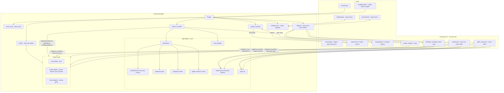
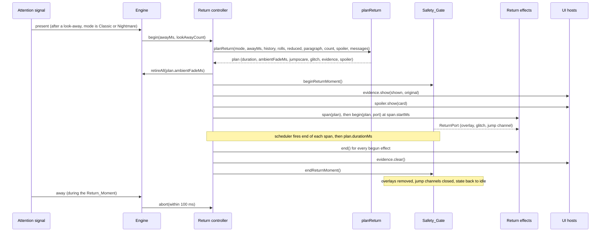
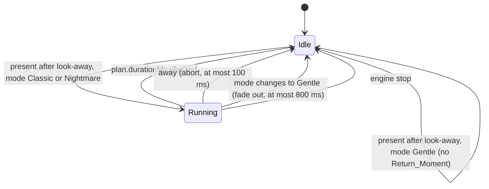

# Design Document

## Overview

Ghost-dread adds a Ghost, positioned 3D sound, a short Return_Moment (Ghost linger, Glitch, Evidence_Message, Jumpscare), a Spoiler_Threat and three Haunt_Modes on top of the haunt feature. It extends the existing code in `src/haunts/engine/` and does not replace it. The Level_Logic, the Safety_Gate, the registry, the roster and the settings store all stay. Each gets a small, generic extension.

Design decisions, with reasons:

| Decision | Reason |
| --- | --- |
| All decisions about a return (what happens, when, how long) come from one pure function, `planReturn` (Return_Planner). The engine only runs the plan. | Req 11. Every rule about jumpscare frequency, glitch length, evidence, spoiler and reduced motion becomes property-testable without a browser. |
| Haunt files get three optional exports: `role` (`lead` or `layer`), `modes`, `minLevel`. A new optional `ReturnEffect` contract (`span`, `begin`, `end`) covers effects that only run in a Return_Moment. | Footsteps, breathing, knock and the Ghost run alongside the lead haunt, so Level_Logic must not pick them. The engine reads the exports generically, so a new ghost or effect is one file in `src/haunts/` and needs no engine edit (Req 13.6 and the workspace rule "adding a haunt must not require editing the engine"). The engine is edited once, now, to read these exports. |
| Haunt modules cannot start timers (the static scan forbids `setTimeout` and `setInterval`). A port offers `audio.onTick(cb, periodMs)`, owned by the gate and cancelled when the port closes. Pulses are baked into audio buffers by pure functions. | Spatial movement needs periodic updates. Putting the timer in the gate keeps haunt files pure and lets the gate cancel everything on close. |
| A Return_Moment is a gate state. `gate.beginReturnMoment()` and `gate.endReturnMoment()` bracket it. Only then does `gate.openReturn()` hand out a `ReturnPort` (overlay over the text, Glitch, jump-sound channel). The gate also ends the state by itself after 3000 ms. | Req 5.11, 9.7 and 9.8 say the gate must reject jump sounds and cover-the-text effects outside a Return_Moment. The gate is the one place that applies safety rules, so the check lives there, with its own timer as a second guard. |
| The jump sound uses a headroom rule: its target is at most `cap − (sum of every other channel's current gain)`. | The existing cap proof assumes all rises end together after at least 300 ms. A 20 ms jump rise breaks that assumption. The headroom rule keeps the proof (see "Jump channel and the cap guarantee"). |
| The panner wrapper fixes the `PannerNode` settings (HRTF, omnidirectional cone, reference distance) and exposes only the three position parameters. | Req 1.5 holds by construction. A haunt cannot pick another panning model or raise the gain through distance settings. |
| Pulses (footstep, breath, knock, jump) are baked into buffers by pure builders with a linear attack of at least 20 ms and a peak of at most 1. The layer gain, already capped by the gate, scales them. | Req 1.9 and 5.10. A pulse cannot exceed its layer's target because it never exceeds 1 and has no gain node of its own. |
| Evidence replacement is a reversible patch (`apply` and `revert`), and the paragraph on screen is a display copy. The reader's stored text, position and progress are never written. | Req 4.4, 4.5, 4.8 and 11.10. The round trip is checked on the patch, not on a saved copy. |
| The Spoiler_Threat card is a React component beside the Reading_Column, not a haunt layer. The engine owns its 10 second timer and its dismiss path. | The card needs a focusable dismiss button, an Escape key handler and screen-reader labels. Gate layers are static markup. |
| `HauntSettings.gentle: boolean` becomes `mode: HauntMode`, with a migration from the old key. A new key `rod_haunt_mode` is written. The old key is only read. | Req 8.7 and 8.8. Existing readers who chose Gentle keep it. |
| Glitch and flicker budgets use a ledger of recent flashes in the gate, not a haunt-side count. | Req 6.4, 6.5 and 9.3. The gate sees every effect, so only the gate can keep the combined rate at or below 3 per second. |

No new dependency is added. The feature uses Vite, React, Vitest, fast-check and jsdom, which are already in `package.json`, so no new licence applies. Ghost and Jumpscare art is SVG markup written in code, with no image file.

### Research findings

Facts from the MDN pages for [PannerNode](https://developer.mozilla.org/en-US/docs/Web/API/PannerNode) and [BaseAudioContext.createPanner()](https://developer.mozilla.org/en-US/docs/Web/API/BaseAudioContext/createPanner), and from the fast-check docs through Context7. The text is a paraphrase.

- `createPanner()` takes no arguments and returns a `PannerNode`. Its `panningModel` is set with a string. The MDN example sets `panner.panningModel = "HRTF"`, so `'HRTF'` is the confirmed spelling.
- A `PannerNode` has one input and one output, and the output is always stereo. Position uses a right-handed Cartesian system through `positionX`, `positionY` and `positionZ`. These are read-only properties that hold `AudioParam` objects, so they accept `setValueAtTime` and the ramp methods.
- The MDN example gives the older fallback: when `panner.positionX` is missing, call `panner.setPosition(x, y, z)`. The same page does this for the listener (`listener.setPosition`, `listener.setOrientation`). The design uses the same feature check.
- `distanceModel` accepts `"linear"`, `"inverse"` or `"exponential"`, and the default is `"inverse"`. `refDistance`, `maxDistance`, `rolloffFactor`, `coneInnerAngle`, `coneOuterAngle` and `coneOuterGain` are plain numeric properties. The MDN example sets `coneInnerAngle = 360`, `coneOuterAngle = 0` and `coneOuterGain = 0`, which is an omnidirectional source.
- Not confirmed in the fetched pages: the default listener position and orientation, the exact attenuation formula for each distance model, and which browsers support HRTF. The design therefore sets the listener explicitly when the graph is built, and does not rely on the attenuation formula for any safety guarantee. The volume cap and the master compressor stay the guarantee.
- fast-check: `fc.assert(property, { numRuns })` runs 100 cases by default, and `seed` and `path` replay a failure. `fc.array(arb, { minLength, maxLength })` bounds array length. Other arbitraries used here (`fc.record`, `fc.constantFrom`, `fc.oneof`, `fc.integer`, `fc.string`, `fc.array`, `fc.double` with `noNaN`) are already used in this repository's tests. Options of `fc.double` beyond `noNaN` were not confirmed, so rolls in [0, 1) are built as `fc.integer({ min: 0, max: 999_999 }).map((n) => n / 1_000_000)`.

Content was rephrased for compliance with licensing restrictions.

Facts taken from the existing code, which the design must match:

- Haunt files live in `src/haunts/*.ts` and are found by one `import.meta.glob` in `engine/discover.ts`. The static scan (`src/haunts/__tests__/staticScan.unit.test.ts`) bans the identifiers `document`, `window`, `fetch`, `setTimeout`, `setInterval`, `localStorage`, `Audio(`, `.destination` and the text `animation` in haunt files, and limits their imports to `./engine/types`, `./engine/noise` and type-only `./engine/hauntAudio`. This design adds one allowed prefix, `./engine/ghost/` (pure helpers, scanned with the pure-logic rules), and renames the planned export `window` to `span` for the same reason.
- `HauntAudioContext` (in `engine/hauntAudio.ts`) has `createBuffer`, `createBufferSource`, `createBiquadFilter`, `createStereoPanner` and `input`. Wrappers are built in `gate/restrictedAudio.ts` and registered in a per-port `WeakMap`.
- `gainPlan.ts` and the "Cap guarantee" in the haunt-feature design assume that all rises in one planning pass end together at `now + planFadeIn` (300 ms, 1000 ms under reduced motion).
- `createGate(deps)` has no scheduler today. `EngineDeps` has `scheduler`, `clock`, `random` and `warn`.
- `levelLogic.evaluate` takes `gentle: boolean`. `HauntSettings` is `{ sound, gentle, noticeSeen }`. Keys are `rod_haunt_sound`, `rod_haunt_gentle`, `rod_safety_notice_seen`, `rod_volume_cap`.
- `SafetyNotice` and `HauntControl` read and write the store through `useHauntSettings()`. `NoticeBanner` shows one line of text with a Dismiss button.
- The Reading_Column is `[data-reading-column]`. `HauntStage` computes the left and right regions with `computeRegions` and owns every `@keyframes`.

## Architecture



Rules the diagram encodes:

- Nothing in `src/haunts/` imports from `src/attention/`, `src/ui/` or camera code. The engine still receives `subscribeSignal` as an argument (Req 9.15). The reader state, the paragraph display and the card reach the engine only through three small ports (`ReadingContext`, `EvidenceHost`, `SpoilerHost`) that `src/ui/` implements.
- Haunt files import only types, `noise`, and pure helpers under `./engine/ghost/`. They reach speakers and the document only through `AudioOut`, `VisualOut` and `ReturnPort`.
- `engine/ghost/` has no DOM, audio, timer, clock or random access. Time and random numbers are inputs.

### Return_Moment sequence



### Return_Moment states



A mode change to Classic or Nightmare during `Running` lets the running plan finish and applies the new mode from the next look-away (Req 3.11).

### File layout

New and changed files. Every file stays under 200 lines; the budget column is the planned size.

```
src/haunts/
  candle.ts, whispers.ts      unchanged (role lead, all modes)
  footsteps.ts                layer, Classic and Nightmare, minLevel 1            (~90)
  breathing.ts                layer, Classic and Nightmare, minLevel 1            (~80)
  knock.ts                    layer, Classic and Nightmare, minLevel 3            (~70)
  ghostFigure.ts              layer (side region) and return effect (linger)      (~120)
  glitch.ts                   return effect                                       (~70)
  jumpscare.ts                return effect, jump sound                           (~120)
  engine/
    types.ts                  + HauntMode, StartInfo, role/modes/minLevel, onTick, setLabel (~180)
    returnTypes.ts            ReturnPlan, ReturnEffect, ReturnPort, ReturnVisualOut,
                                ReadingContext, EvidenceHost, SpoilerHost            (~120)
    hauntAudio.ts             + createSpatialPanner, HauntSpatialPanner           (~75)
    levelLogic.ts             gentle:boolean -> mode:HauntMode                     (~105)
    settings.ts               mode, tip flag, migration, set() returns persisted   (~150)
    registry.ts               classifies haunts and return effects                 (~130)
    engine.ts                 wiring only                                          (~190)
    engineSelect.ts           pure: which haunts to run for a mode and level       (~60)
    engineRoster.ts           + StartInfo, retireAll(ms), retire by mode           (~190)
    returnMoment.ts           Return controller                                    (~190)
    spoilerController.ts      10 s timer, dismiss, host calls                      (~80)
    awayCounter.ts            pure look-away counter per chapter                   (~40)
    ghost/                    pure helpers, one concern per file
      mode.ts                 HauntMode, parseMode, migrateGentle                  (~50)
      ghostDistance.ts        ghostDistance(count)                                 (~25)
      ghostArt.ts             ghostMarkup(step), ghostBox(step, region)            (~140)
      spatial.ts              footstepSpec, breathingSpec, azimuthToPosition       (~90)
      pulses.ts               pulse and jump buffer builders                       (~110)
      returnPlanner.ts        planReturn                                           (~190)
      jumpscarePolicy.ts      allowed(mode, history), probability                  (~50)
      evidence.ts             tokenize, choose, apply, revert                      (~130)
      legibility.ts           legibility, blurPx                                   (~45)
      spoiler.ts              chooseSentence                                       (~60)
      sentences.ts            splitSentences, wordCount                            (~40)
      taunts.ts               nameCandidates, fillTaunt, buildTaunt                (~150)
      commonWords.ts          common-word list                                     (~60)
    gate/
      gate.ts                 + return moment, openReturn, onTick wiring           (~200, split below)
      gateReturn.ts           return-moment state and ports                        (~150)
      returnRules.ts          pure: jump attack, headroom, flicker grants, fades   (~120)
      flashLedger.ts          pure: flashes in the last second                     (~50)
      restrictedAudio.ts      + createSpatialPanner                                (~170)
      audioGraph.ts           + listener setup, jump channel flag                  (~130)
      gainPlan.ts             + jump rise rule                                     (~150)
      visualAdapter.ts        + overlay and glitch                                 (~190, split:
      returnVisual.ts         overlay and glitch DOM                               (~140)
src/ui/
  SafetyNotice.tsx            mode choice, headphones tip, save message            (~120)
  HauntControl.tsx            mode choice replaces the Gentle toggle               (~70)
  SpoilerCard.tsx / .css      card beside the column, dismiss, Escape              (~110)
  readingContext.ts           ReadingContext, EvidenceHost from reader state       (~110)
  ParagraphList.tsx           renders evidence display copy                        (~190)
  HauntStage.css              + glitch and overlay keyframes, ghost step styles
docs/BUILD_LOG.md             counterexamples
```

`engine.ts`, `gate.ts` and `visualAdapter.ts` are the files most likely to pass 200 lines; the split files above are where the new code goes, so the existing files only gain wiring lines.

### Haunt discovery and the contract

The glob stays as it is. `buildRegistry` now classifies each module:

- A module with `id`, `name`, `start`, `setLevel` and `stop` is a Haunt. Optional exports are checked when present: `role` must be `'lead'` or `'layer'`, `modes` must be a non-empty array of valid mode names, `minLevel` must be 1, 2 or 3. A bad optional export skips the file with a warning, as a missing function does today.
- A module with `id`, `name`, `span`, `begin` and `end` is a ReturnEffect. `modes` and `jumpSound` are optional and checked the same way.
- A module may be both (`ghostFigure.ts`). A module that is neither is skipped with a warning. An id is unique among files (path order, first wins), as today.

`loadHaunts(warn)` keeps its signature and returns the Haunts. A new `loadRegistry(warn)` returns `{ haunts, effects }`, and `useHauntEngine` passes `effects` to the engine. Adding a ghost, a layer or a return effect is therefore one new file. The static scan, the registry and the engine do not change. The one-time engine edit is the generic reading of `role`, `modes`, `minLevel`, `span`, `begin` and `end` described here.

## Components and Interfaces

### Haunt modes and settings (`engine/ghost/mode.ts`, `engine/settings.ts`)

```ts
export type HauntMode = 'gentle' | 'classic' | 'nightmare';
export const HAUNT_MODES: readonly HauntMode[] = ['gentle', 'classic', 'nightmare'];
export const DEFAULT_MODE: HauntMode = 'classic';

/** Pure. A valid saved mode wins; a missing one migrates from the old gentle flag; anything else is Classic. */
export function resolveMode(modeRaw: string | null, gentleRaw: string | null): HauntMode;

export interface HauntSettings {
  readonly sound: boolean;
  readonly mode: HauntMode;
  readonly noticeSeen: boolean;
  /** True once the headphones tip has been shown with a saved notice. */
  readonly headphonesTipSeen: boolean;
}
export const KEYS = {
  sound: 'rod_haunt_sound', mode: 'rod_haunt_mode', gentleLegacy: 'rod_haunt_gentle',
  noticeSeen: 'rod_safety_notice_seen', headphonesTipSeen: 'rod_headphones_tip_seen',
  volumeCap: 'rod_volume_cap',
} as const;

export interface SettingsStore {
  get(): HauntSettings;
  /** Memory first, then best-effort save. Returns false when any write failed or storage is missing. */
  set(patch: Partial<HauntSettings>): boolean;
  subscribe(cb: () => void): Unsubscribe;
}
```

`resolveMode(modeRaw, gentleRaw)`:

| `rod_haunt_mode` | `rod_haunt_gentle` | Result |
| --- | --- | --- |
| `'gentle'`, `'classic'` or `'nightmare'` | any | that mode |
| a string that is not one of the three | any | Classic (Req 8.9) |
| missing or unreadable (`null`) | `'true'` | Gentle (Req 8.7) |
| missing or unreadable | `'false'` | Classic (Req 8.8) |
| missing or unreadable | missing or garbage | Classic (Req 8.2) |

`parseSettings` calls `resolveMode`. `serializeSettings` writes `rod_haunt_mode` and no longer writes the legacy key, which is only read. Because `readKey` returns `null` for both "missing" and "storage threw", a throw on the mode key falls through to the legacy flag. That is the safer outcome for a reader who chose Gentle. `set()` keeps its memory-first rule and now reports whether every write succeeded. The old `gentle` field is removed from `HauntSettings`, so every use of it becomes a compile error and is found by the compiler.

### Level_Logic with modes (`engine/levelLogic.ts`)

`LevelInput.gentle: boolean` becomes `mode: HauntMode`. The rule is the same: when `mode === 'gentle'` the level is at most 1 and there is no companion (Req 8.12). Level_Logic still picks only among the ids it is given. The engine passes the ids of Haunts whose `role` is `'lead'` (or missing) and whose `modes` include the current mode (`engineSelect.ts`). Layers never enter Level_Logic, so the existing lead and companion rules and their properties are unchanged.

### Engine selection and roster (`engine/engineSelect.ts`, `engine/engineRoster.ts`)

```ts
/** Pure. Haunts allowed in this mode, split by role. A missing `modes` means all three. */
export function selectByMode(haunts: readonly Haunt[], mode: HauntMode): { leads: Haunt[]; layers: Haunt[] };

/** Pure. Layer ids that should run: mode allows it and level >= minLevel (default 1). Level 0 gives none. */
export function layersToRun(layers: readonly Haunt[], level: 0 | 1 | 2 | 3): string[];
```

`reconcile` adds `layersToRun(...)` to the wanted set of lead and companion. The roster changes are small:

- `start(haunt, level, info)` passes a `StartInfo` as a fourth argument: `{ mode, ghostStep, roll }`. `ghostStep` is `ghostDistance(count)` computed when the look-away began. `roll` is one `deps.random()` draw per start. Existing haunts ignore the argument.
- `retireAll(ms = FADE_MS)` takes the fade length. The Return controller passes `plan.ambientFadeMs`.
- `retireWhere(pred)` retires active entries whose haunt is no longer allowed (a mode change). The mode change to Gentle uses it with a fade of at most 800 ms (Req 8.10).
- A layer that was started is never restarted within a look-away (the roster skips ids already active), so the knock plays once per look-away (Req 1.3). Level never falls while away, so a layer with `minLevel: 3` starts once.

### Safety_Gate extensions

#### Panner wrapper (`hauntAudio.ts`, `gate/restrictedAudio.ts`)

```ts
export interface HauntSpatialPanner extends HauntNode {
  readonly positionX: HauntParam;
  readonly positionY: HauntParam;
  readonly positionZ: HauntParam;
}
// added to HauntAudioContext:
createSpatialPanner(): HauntSpatialPanner;
```

`createSpatialPanner` builds `ctx.createPanner()` and sets, before returning the wrapper: `panningModel = 'HRTF'`, `distanceModel = 'inverse'`, `refDistance = 0.5`, `rolloffFactor = 1`, `coneInnerAngle = 360`, `coneOuterAngle = 0`, `coneOuterGain = 0`. The wrapper has no setter for any of them, only the three position `HauntParam`s. It is registered in the same per-port `WeakMap` as the other wrappers, so `connect` accepts only other wrappers of the port and `ctx.input` (Req 1.6, 13.6). It adds no other path to the audio device.

Why `refDistance = 0.5`: every Spatial_Sound source stays at least 0.5 m from the listener (breathing 0.5 to 1.0 m, footsteps 1.5 m and more), so every source is at or beyond the reference distance, where an inverse-distance model does not amplify. The exact formula was not in the fetched docs, so this is a design choice that the cap does not depend on. The channel gain, the master gain and the compressor still bound the output.

If `positionX` is missing on the real node (older Safari), the wrapper builds the three params as one shim that stores the triple and calls `setPosition(x, y, z)` when a value is set. Ramps then become steps. This follows the MDN feature check. If `createPanner` itself throws, the haunt falls back to `createStereoPanner`, as `whispers.ts` already does for a missing stereo panner, and then to no panner (Req 1.15).

The listener is set once in `buildGraph`: position (0, 0, 0), forward (0, 0, −1), up (0, 1, 0), using `listener.positionX.setValueAtTime(...)` and the `forwardX` family when they exist, and `setPosition` and `setOrientation` otherwise. The default values were not confirmed in the docs, so they are set rather than assumed. With this listener, +X is to the right, −Z is straight ahead and +Z is behind.

#### Port tick (`types.ts`, `gate/gate.ts`)

```ts
// added to AudioOut:
/** Calls `cb` about every `periodMs` (at least 100) until cancelled or the port closes or fades out. Gate-owned. */
onTick(cb: () => void, periodMs: number): Unsubscribe;
```

The gate runs the tick with its injected scheduler (a self-rescheduling `setTimeout`). It cancels every tick of a port in `close()` and in `fadeOut`, and cancels all of them in `dispose()`. A throwing callback is caught and sent to `warn`. Footsteps tick every 500 ms and schedule position ramps 1500 ms ahead with `linearRampToValueAtTime`, so movement stays smooth if a background tab throttles timers to once per second. After the last tick, the final ramp ends and the source stops at the port close.

#### Return_Moment state and the ReturnPort (`gate/gateReturn.ts`)

```ts
// added to Gate:
beginReturnMoment(): void;                         // enables openReturn; starts the 3000 ms guard timer
endReturnMoment(fadeMs?: number): void;            // closes every ReturnPort, removes overlays and glitch, fadeMs <= 100 default 80
openReturn(effectId: string, opts?: { jumpSound?: boolean }): ReturnPort | null; // null when no Return_Moment is running

export interface ReturnPort {
  readonly audio: AudioOut;            // fast attack only when opened with jumpSound
  readonly visual: ReturnVisualOut;
  close(): void;
}
export type OverlayKind = 'ghost' | 'jumpscare' | 'card-hand';
export interface GlitchSpec { readonly durationMs: number; readonly flickers: number }
export interface ReturnVisualOut extends VisualOut {
  /** Full-viewport layer above the page. It may cover the Reading_Column. The gate removes it when the Return_Moment ends. */
  createOverlay(kind: OverlayKind): VisualLayer;
  /** Tear bands and colour shift over the page. Text content is never changed. Returns how many flickers the gate allowed. */
  runGlitch(spec: GlitchSpec): { grantedFlickers: number };
}
```

Behaviour:

- `openReturn` returns `null` and creates no node and no element when `beginReturnMoment` has not been called, or the guard has expired (Req 5.11, 9.7, 9.8). `ReturnVisualOut` and a jump channel exist only inside a `ReturnPort`, so a normal port cannot cover the text or play a jump sound.
- `beginReturnMoment` starts a guard timer of `RETURN_MAX_MS = 3000`. When it fires, the gate calls `endReturnMoment` itself. The Return controller normally ends the moment earlier. The guard is the second line of defence for Req 3.2 and 9.8.
- `endReturnMoment` closes every ReturnPort: overlays are removed, the glitch layer and filter are removed within 100 ms (Req 6.8), jump channels fade out within 100 ms from their current gain and then disconnect, and ticks are cancelled. It is safe to call twice. When the reader looks away again (Req 3.7), the controller calls it with `fadeMs = 80`.
- Overlays and glitch are the only ways to affect the text area. Every haunt that is not a return effect still sees only the side regions (haunt-safety: outside the return moment, effects stay around the text).

#### Return rules (`gate/returnRules.ts`, `gate/flashLedger.ts`, pure)

```ts
export const RETURN_MAX_MS = 3000;
export const JUMP_ATTACK_MIN_MS = 20;
export const JUMP_ATTACK_REDUCED_MS = 300;     // reduced motion: no startle, a normal fade-in

/** Attack of a jump channel: at least 20 ms; at least 300 ms under reduced motion. */
export function planJumpAttack(requestedMs: number | undefined, reduced: boolean): number;

/** Largest gain the jump channel may target: cap minus the other channels' current gains, never below 0. */
export function jumpHeadroom(cap: number, othersCurrent: readonly number[]): number;

/**
 * Flickers the gate allows. `continuousRate` is the sum of gutter and sweep rates now running,
 * `recent` is how many flicker flashes happened in the last 1000 ms (flashLedger).
 * Result is in [0, wanted]; 0 when reduced. Keeps the combined count in any 1000 ms window at or below 3.
 */
export function grantFlickers(wanted: number, continuousRate: number, recent: number, reduced: boolean): number;

export type FadeKind = 'ghost' | 'jumpscare' | 'glitch' | 'card' | 'evidence';
/** Fade length the gate applies. Under reduced motion: ghost >= 1000, jumpscare >= 1000, glitch >= 500, card >= 300, evidence >= 500. */
export function planOverlayFade(kind: FadeKind, requestedMs: number | undefined, reduced: boolean): number;
```

`flashLedger.ts` keeps timestamps of granted flicker flashes and answers `countInWindow(stamps, nowMs)` for the last 1000 ms. The gate adds the continuous rates already allocated by `allocateFlashRates` (`ceil(rate)` counts each continuous source as at least one flash in a window, which is conservative).

#### Jump channel and the cap guarantee

`gainPlan.ts` gets one added rule, number 5:

> 5. A channel opened with `jumpSound` is a jump channel. Its rise uses `planJumpAttack` instead of `planFadeIn`. Its target is `min(scaled target, jumpHeadroom(cap, others' current gains))`. In a pass that raises a jump channel, every other rise is held (its target for the pass is its current value) and is planned again in the first pass after the jump rise ends. Falls follow rules 3 and 4 as before. Once the jump channel has risen, it is an ordinary channel for every later pass: its target is part of the scaled sum like any other.

Why the guarantee holds. Let `now` be the pass start with `C(now) <= allowed(now)`, let `g_j` be the jump channel's new target, and let `O(t)` be the sum of the other channels' gains. In this pass no other channel rises (rule 5), so `O` is non-increasing on `[now, ∞)` and `O(t) <= O(now)`. The jump channel moves linearly from its current value to `g_j` and stays there, so its value is at most `max(current_j, g_j)`. Then `C(t) <= max(current_j, g_j) + O(now)`. If `g_j >= current_j`, `g_j <= cap_now − O(now)` gives `C(t) <= cap_now <= allowed(t)`. If the jump channel is falling, rules 3 and 4 apply and the original proof covers it. After the pass the next pass starts from `C(now') <= allowed(now')`, so the induction in the haunt-feature design continues. The 20 ms attack is therefore safe because the sum is bounded at every instant by headroom, not by the convexity argument that needs equal rise ends. ∎

Practical effect: the Return controller fades the ambient layers at the start of the Return_Moment (`ambientFadeMs`, 300 ms when a Jumpscare is planned). A False_Calm is at least 300 ms, so the ambient layers are silent before the jump channel rises and the headroom is the whole cap. If an ambient fade is still running, the jump is quieter, never louder than the cap.

### Return_Planner (`engine/ghost/returnPlanner.ts`)

```ts
export interface ReturnInput {
  readonly mode: HauntMode;
  readonly awayMs: number;                       // 0 or greater; NaN and negative become 0
  readonly history: readonly boolean[];          // jumpscare outcome of each earlier Qualifying_Return, oldest first
  readonly rolls: ReturnRolls;                   // each in [0, 1); anything else is clamped
  readonly reducedMotion: boolean;
  readonly paragraph: string;                    // the active paragraph
  readonly lookAwayCount: number;                // earlier look-aways in the chapter, before the one that just ended
  readonly spoiler: { finalChapterSentences: readonly string[]; otherChapterSentences: readonly string[] } | null;
  readonly messages: readonly string[];          // evidence pool: fixed messages plus filled taunts
}
export interface ReturnRolls {
  jump: number; calm: number; calmLen: number; jumpLen: number;
  glitchLen: number; flickers: number;
  evidence: number; evidenceMsg: number; evidenceRun: number; spoiler: number;
}
export function planReturn(input: ReturnInput): ReturnPlan;
```

Rules, in order:

1. **Gentle.** Return `EMPTY_PLAN`: `durationMs: 0` and every optional part `null` (Req 11.5). No Return_Moment starts, so the 3 s rule does not apply; `0` is inside the 0 to 3000 range of Req 11.4.
2. **Qualifying.** `qualifying = awayMs >= 10_000` (Req 5.1, 11.6).
3. **Jumpscare.** `jumpscarePolicy.allowed(mode, history)` is true when the jumpscares among the last two `history` entries number fewer than the limit: limit 1 in Classic, 2 in Nightmare. This keeps every window of three consecutive Qualifying_Returns at or below the limit, because the new outcome joins the last two. A Jumpscare is planned when `qualifying && allowed && rolls.jump < probability(mode)`. `probability` is 0.35 in Classic and 0.6 in Nightmare, so Nightmare is strictly higher (Req 5.7). At most one Jumpscare per plan by construction (Req 5.4, 11.9).
4. **False_Calm.** With a Jumpscare, `falseCalmMs` is `300 + round(calmLen * 500)` (so 300 to 800) when `rolls.calm < 0.75`, and `null` otherwise. The Jumpscare starts at `falseCalmMs ?? 0`. Its length is `700 + round(jumpLen * 500)` (700 to 1200). Under reduced motion it renders as a fade (`render: 'fade'`) of `1000 + round(jumpLen * 400)` (1000 to 1400). The ambient fade is 300 ms with a Jumpscare and 600 ms without (both at most 800 ms, Req 3.3).
5. **Glitch.** Not planned under reduced motion. Otherwise: length `300 + round(glitchLen * 500)` (300 to 800, below 1000 and at least 100), flickers `1 + floor(flickers * 3)` (1 to 3, so at most 3 in any 1000 ms window, Req 6.3). It starts at 0 when no Jumpscare is planned, and at the end of the Jumpscare (`jumpscare.startMs + jumpscare.durationMs`) when one is planned, so it never overlaps the Jumpscare or the False_Calm (Req 5.8, 6.1). If it would not end by 3000 ms it is dropped, and the plan is otherwise unchanged (Req 6.1). Under reduced motion a `fade` of 600 ms replaces it, placed at the same start (Req 3.10, 6.7, 9.10).
6. **Duration.** `durationMs = min(3000, max(2000, end of every planned part + 300))`, where the parts are the Jumpscare (or its fade), the Glitch (or fade) and the Evidence_Message. The longest case is a Jumpscare that ends at 800 + 1200 = 2000 ms (2200 ms as a reduced-motion fade) followed by a Glitch of up to 800 ms, which ends at 2800 ms or earlier. The final `min` guarantees the 3000 ms bound whatever the parts are. Because the Glitch is dropped when it would not end by 3000 ms, every kept span ends at or before `durationMs`. Evidence is shortened to fit.
7. **Evidence.** Only when `rolls.evidence < 0.6`. The planner keeps the messages whose word count is at most the paragraph's word count, then picks one with `evidenceMsg`. If none fits, no Evidence_Message (Req 4.3). The run start is `floor(evidenceRun * (n − w + 1))` for `n` paragraph words and `w` message words (Req 4.2). It starts at 300 ms, lasts `min(1500, durationMs − 300)` and ends before `durationMs` (Req 4.6).
8. **Spoiler.** Only when `awayMs > 20_000`, `spoiler !== null` and a sentence passes `chooseSentence` (Req 7.1 to 7.4, 11.12). `legibility` and `blurPx` come from `legibility.ts`. `holdMs` is `durationMs`. `stayMs` is 10_000 and applies only when the card is placed beside the column (free space of at least 160 px). The planner does not know the layout, so the Spoiler controller decides at the end of the Return_Moment (Req 7.10, 7.11, 7.18).
9. **Ghost.** `ghostStep = ghostDistance(lookAwayCount)`. The Ghost lingers for `durationMs`.

Every number the planner reads from `rolls` is clamped to [0, 1) first, and `awayMs` and `lookAwayCount` are sanitised, so any input gives a valid plan (Req 11.4). The function reads no clock, DOM, audio, camera or global random (Req 11.3), and returns the same output for the same input (Req 11.2).

With a Jumpscare, the Glitch starts after the Jumpscare ends, so the False_Calm stays calm and the two never overlap. This ordering is approved and matches Req 3.2, 5.8 and 6.1.

### Ghost_Distance and the away counter (`engine/ghost/ghostDistance.ts`, `engine/awayCounter.ts`)

```ts
export const MAX_GHOST_STEP = 4;
/** Pure. Integer step 0..4 for a count of earlier look-aways. NaN, negative and Infinity-below-zero give 0; large values give 4. */
export function ghostDistance(count: number): 0 | 1 | 2 | 3 | 4;

export interface AwayCounter { readonly chapterKey: string | null; readonly count: number }
/** Pure. Starting a look-away: returns the step to use now and the counter with this look-away added. A new chapterKey resets first. */
export function startLookAway(c: AwayCounter, chapterKey: string): { step: 0 | 1 | 2 | 3 | 4; next: AwayCounter };
/** Pure. Any chapter change, including a return to an earlier chapter: a different key gives count 0 and the new key; the same key gives `c` itself. */
export function onChapterChange(c: AwayCounter, chapterKey: string): AwayCounter;
```

The engine calls `onChapterChange` whenever `reading.chapterKey()` changes, so a return to an earlier chapter with no look-away in between also resets the count to 0 (Req 2.4). It also calls `startLookAway(counter, reading.chapterKey())` when a look-away starts, which resets on a different key before the step is taken.

### Ghost art (`engine/ghost/ghostArt.ts`)

```ts
export interface GhostArt { readonly markup: string; readonly heightUnits: number; readonly detailCount: number }
export function ghostArt(step: 0 | 1 | 2 | 3 | 4): GhostArt;
/** Pure. Rendered size inside a side region; never wider or taller than the region, keeps aspect ratio. Null when the region is under 48 px wide. */
export function ghostBox(step: number, region: { width: number; height: number }): { width: number; height: number } | null;
```

`ghostArt` returns SVG markup for a silhouette with two faint eyes. Heights are increasing in `step` (for example 120, 150, 185, 225, 270 viewBox units), and `detailCount` (hem folds, hands, a second shadow layer) strictly increases, so each step differs (Req 2.6). The eyes use `var(--text)` at a constant `fill-opacity` with no animate element and no `animation` (Req 2.8). All colours come from the theme custom properties. The markup has no `<image>`, no `href` and no `url(http` (Req 2.7). The jumpscare close-up uses `ghostArt(4)` scaled up in an overlay, with extra darkness from `var(--shadow)` and no full-screen red.

The Ghost drawn while the reader is away is a layer in a side region, so every pixel is outside the column by construction (Req 2.2). `ghostBox` keeps the drawing inside the region. If the region is narrower than 48 px (small screens, as in the haunt-feature "known limitation"), no Ghost is drawn and the sound carries the haunt.

Screen-reader label (Req 2.12): `VisualLayer` gains `setLabel(text: string)`. The visual adapter sets `role="img"` and `aria-label` on that layer's element. Today `HauntStage` sets `aria-hidden="true"` on its root, and a descendant cannot undo an `aria-hidden` ancestor. The root therefore loses the attribute, the glow elements keep theirs, and the adapter sets `aria-hidden="true"` on every layer it creates unless `setLabel` was called. `ghostFigure.ts` calls `setLabel('A ghost stands nearby')`. Layers have `pointer-events: none` and no `tabindex`, so keyboard focus never moves.

### Spatial sound (`engine/ghost/spatial.ts`, `engine/ghost/pulses.ts`, `footsteps.ts`, `breathing.ts`, `knock.ts`)

```ts
export interface FootstepSpec { readonly distanceM: number; readonly degPerSec: number; readonly stepsPerSec: number; readonly gain: number }
export function footstepSpec(level: HauntLevel): FootstepSpec;
/** Level 1: 6 m, 20 deg/s. Level 2: 4 m, 45 deg/s. Level 3: 2.5 m, 80 deg/s. Distance never rises; turn rate strictly rises. */

export interface BreathingSpec { readonly azimuthDeg: number; readonly distanceM: number }
/** Side from the start roll. |azimuth| in [60, 120], sign by side, distance in [0.5, 1.0]. Same input, same output. */
export function breathingSpec(side: 'left' | 'right', roll: number): BreathingSpec;

/** Listener at the origin facing -Z, +X to the right. Distance is preserved; azimuth 0 is straight ahead. */
export function azimuthToPosition(azimuthDeg: number, distanceM: number): { x: number; y: 0; z: number };

export interface PulseSpec { readonly kind: 'footstep' | 'breath' | 'knock' | 'jump'; readonly pulsesPerLoop: number; readonly attackMs: number; readonly peak: number }
/** Pure. Mono samples in [-peak, peak]; every pulse rises linearly over attackMs (at least 20) from 0. Seeded, no Math.random. */
export function buildPulseTrain(sampleRate: number, seconds: number, spec: PulseSpec): Float32Array;
```

- **footsteps.ts** (layer): on `whenReady`, builds a looped buffer of footstep pulses, a filter, a spatial panner and a source whose `playbackRate` follows `stepsPerSec`. A tick every 500 ms adds `positionX` and `positionZ` ramps 1500 ms ahead along the circle at `degPerSec`. The start azimuth comes from `info.roll`. `setLevel` re-reads `footstepSpec` and re-sets the distance and rate. Gain per level is a requested value the gate scales.
- **breathing.ts** (layer): alternates the side each look-away (module state set in `start`, like `whispers.ts`), builds a slow breath pulse train with a bandpass filter, and sets a fixed position from `breathingSpec`. It never moves, so the side is kept for the whole look-away (Req 1.2).
- **knock.ts** (layer, `minLevel: 3`): in `start`, on `whenReady`, schedules one knock buffer at `ctx.currentTime + 0.35` so the layer's 300 ms fade-in has finished and the knock still starts within 500 ms (Req 1.3). The knock fires once per `start`, and the roster never restarts an active layer.
- All three declare `modes: ['classic', 'nightmare']`, so Gentle plays none (Req 1.14). With sound off or audio locked, `whenReady` never fires and nothing plays, while the Ghost figure still shows (Req 1.11, 1.15). On `present`, the engine retires them with the normal 600 to 800 ms fade-out, which the gate bounds at 800 ms (Req 1.12). A fade-out starts from the current gain, because every ramp is re-issued from the adapter's schedule (Req 1.16). `stop()` disconnects every tracked node and stops the source, as `whispers.ts` does (Req 1.13). No audio file is loaded: every buffer comes from `buildPulseTrain` (Req 1.4, 1.10).

### Return effects

`ghostFigure.ts` (layer and return effect): as a layer it draws `ghostArt(info.ghostStep)` in a side region through `createLayer`, with `setOpacity(1, ...)` and the fade-in floors from the gate (Req 2.9: at least 1000 ms and no movement under reduced motion). As a return effect it draws the same art in an overlay of kind `'ghost'` so it may cover the column, holds it for `plan.ghostLingerMs`, then fades it out; `end()` removes the overlay. With a Spoiler_Threat it also draws an overlay of kind `'card-hand'` beside the card position.

`glitch.ts` (return effect): `span(plan)` returns the plan's glitch (or fade) span. `begin` calls `port.visual.runGlitch({ durationMs, flickers })` and uses `grantedFlickers` as given. With reduced motion it calls an overlay of kind `'glitch'` once with a single opacity fade. `end` removes what it made.

`jumpscare.ts` (return effect, `jumpSound: true`): `span(plan)` gives the Jumpscare span. `begin` creates a `'jumpscare'` overlay with the close-up, builds the jump buffer with `buildPulseTrain` (`kind: 'jump'`, attack at least 20 ms), plays it once and calls `port.audio.setGain(...)`. With sound off or audio locked it shows the close-up without sound (Req 5.14). `end` stops and disconnects every node and closes the channel (Req 5.13).

Both obey the gate's fade floors, so under reduced motion the close-up becomes a fade of at least 1000 ms without movement or flicker (Req 5.12).

### Return controller (`engine/returnMoment.ts`)

```ts
export interface ReturnDeps {
  gate: Gate; effects: readonly ReturnEffect[];
  reading: ReadingContext; evidence: EvidenceHost; spoiler: SpoilerController;
  scheduler: EngineDeps['scheduler']; random(): number; warn(msg: string): void;
}
export interface ReturnController {
  /**
   * Plans and runs one Return_Moment. Returns the plan, or null (and does nothing, not even `retireAmbient`)
   * when the mode is Gentle or one is already running. `retireAmbient(ms)` is called once, before the gate
   * state begins, and must retire the running haunts with that fade.
   */
  begin(
    args: { mode: HauntMode; awayMs: number; lookAwayCount: number; reducedMotion: boolean },
    retireAmbient: (fadeMs: number) => void,
  ): ReturnPlan | null;
  /** Ends the running Return_Moment: effects end, evidence is restored, gate state ends. */
  abort(reason: 'away' | 'gentle' | 'stop'): void;
  running(): boolean;
  /** Outcomes of earlier Qualifying_Returns, oldest first, kept to the last two. */
  history(): readonly boolean[];
}
```

`begin` order matters: (1) read the reading context and build the evidence pool and spoiler input, (2) `planReturn`, (3) record the outcome in the history when the return qualified, (4) `retireAmbient(plan.ambientFadeMs)`, (5) `gate.beginReturnMoment()`, (6) show evidence and the spoiler card, (7) for each effect whose `modes` allow the mode, read `span(plan)` and schedule `begin` at `startMs` and `end` at `endMs` (clamped to `durationMs`), (8) schedule the end of the whole moment at `durationMs`. Step 4 comes before step 5 on purpose: `gate.fadeOutAll` marks every open port as faded, so a ReturnPort opened first would be silenced and hidden with the rest. Each call into an effect is wrapped, as the roster does: a throw is sent to `warn`, that effect is closed, and the others continue. `openReturn` returning `null` skips the effect without a message.

When the Return_Moment ends by time, the evidence is restored, effects end, `gate.endReturnMoment()` runs and the spoiler controller starts its 10 s timer (the card stays, without the Ghost). `abort('away')` runs in one synchronous call, so it ends inside the 100 ms limit (Req 3.7): effects end, evidence restores, `gate.endReturnMoment(80)` closes the ports, and a card that is still being held by the Ghost is hidden. A card that already outlived its Return_Moment is left to its own timer, and a later Return_Moment that plans a Spoiler_Threat replaces it. `abort('gentle')` ends the moment with an 800 ms fade through `gate.endReturnMoment(...)` and hides any card (Req 8.10). A mode change to Classic or Nightmare does nothing here (Req 3.11).

The history stays in the controller, not in the planner, so the planner is pure. Only the last two outcomes are needed by the policy.

### Evidence (`engine/ghost/evidence.ts`)

```ts
/** Splits text into alternating parts: even index = word (may be '' at the ends), odd index = whitespace gap. */
export function tokenize(text: string): string[];
export function wordCount(text: string): number;

export interface EvidencePatch {
  readonly start: number;                   // index of the first replaced word, among words
  readonly original: readonly string[];     // the words that were replaced
  readonly replacement: readonly string[];  // the message words, same length
}
/** Pure. Null when the paragraph has fewer words than the message. */
export function makePatch(text: string, message: string, runRoll: number): EvidencePatch | null;
export function applyPatch(text: string, patch: EvidencePatch): string;
/** Needs only the shown text and the patch, not the original text. */
export function revertPatch(shown: string, patch: EvidencePatch): string;
```

A word is a maximal run of non-whitespace characters, as in Req 4.1. `applyPatch` replaces the words `start..start+n-1` one for one with the message words and leaves every gap and every other word as it was (Req 4.4). `revertPatch` writes `patch.original` back into the same positions, so `revertPatch(applyPatch(t, p), p) === t` for every valid patch, which is the round trip of Req 11.10. Words replaced one for one means a run's internal gaps survive.

The display side is `EvidenceHost`:

```ts
export interface EvidenceHost {
  /** Show `shown` to sighted readers; screen readers keep `original`. Display only. */
  show(shown: string, original: string): void;
  clear(): void;
}
```

`ParagraphList` renders the active paragraph as `<span aria-hidden="true">{shown}</span>` plus a visually hidden span with `original` while a patch shows, and as the plain text otherwise. It sets no colour, so the computed `color` and its contrast are unchanged (Req 4.9). It writes nothing to the reader state, the stored book or the saved progress (Req 4.8). A fade, not a movement, shows and removes it under reduced motion (Req 4.10).

### Legibility and spoiler (`engine/ghost/legibility.ts`, `spoiler.ts`, `sentences.ts`, `SpoilerCard.tsx`)

```ts
export const BREACH_MS = 20_000;
export const REVEAL_MS = 60_000;
export const MAX_CLASSIC_LEGIBILITY = 0.69;
export const MAX_BLUR_PX = 14;

/** Pure. t = clamp((awayMs - BREACH_MS) / (REVEAL_MS - BREACH_MS), 0, 1). Classic: 0.69 * t. Nightmare: t. Gentle: 0. */
export function legibility(mode: HauntMode, awayMs: number): number;
/** Pure. MAX_BLUR_PX * (1 - legibility), so a lower legibility never gives a smaller blur. */
export function blurPx(legibility: number): number;

/** Pure. Sentences of 5 to 25 words found in the final chapter and in no other chapter; one is picked with `roll`. */
export function chooseSentence(final: readonly string[], others: readonly string[], roll: number): string | null;
export function splitSentences(text: string): string[];
```

With these formulas Classic never reaches 0.7 (maximum 0.69), and Nightmare reaches exactly 1 at `awayMs >= 60_000` and stays below 1 before it (Req 7.6, 7.7, 11.14). Legibility is a non-decreasing function of `awayMs` in each mode (Req 7.5, 11.13). `blurPx(0) = 14` is larger than `blurPx(0.69) ≈ 4.3` (Req 7.8). Whether a 4.3 px blur hides the text enough at the card's font size is a visual judgement. It is covered in the manual checks, and `MAX_BLUR_PX` is the one constant to adjust.

The `SpoilerController` is a small engine part:

```ts
export type CardPlacement =
  | { kind: 'beside'; rect: Rect }      // free space >= 160 px: beside the column, never over it
  | { kind: 'overlay' };                // free space < 160 px: only during the Return_Moment, may cover the text

/** Pure. Picks the right side first, then the left. 'beside' only when a free side region is at least 160 px wide and the rect does not overlap the column. */
export function placeCard(viewport: Rect, column: Rect): CardPlacement;

/** Pure timeline. Hidden time in ms from the start of the Return_Moment, or null while not yet hidden. */
export function cardHiddenAt(args: {
  placement: CardPlacement; returnMs: number; dismissAtMs: number | null;
}): number;   // overlay: min(returnMs, dismiss). beside: min(returnMs + 10_000, dismiss). Dismiss before the start counts as none.

export interface SpoilerHost {
  show(card: { sentence: string; legibility: number; blurPx: number; holding: boolean; placement: CardPlacement }): void;
  setHolding(holding: boolean): void;   // false when the Return_Moment ends (the Ghost leaves)
  hide(): void;
}
export interface SpoilerController {
  show(card: SpoilerPlan): void;        // computes placement from the current viewport and column, shows the card
  returnEnded(): void;                  // beside: holding false, start the 10 s timer. overlay: hide now
  dismiss(): void;                      // button or Escape, in both placements and at any time while shown: hide within 300 ms, cancel the timer
  hide(): void;
}
```

`SpoilerCard.tsx` renders from `placement`. With `beside` it sits in the side region from `computeRegions` (right side first, then left), never overlapping the column box. With `overlay` (free space under 160 px) it is drawn in the Return_Moment overlay layer, may cover the text, and is removed when the Return_Moment ends (Req 7.18). The Return_Moment guard already limits it to 3000 ms. While `legibility < 1` it renders the sentence in a span with `aria-hidden="true"` and `user-select: none`, and exposes `role="img"` with `aria-label="A ghost holds a blurred sentence"` (Req 7.9). It has a text-labelled "Dismiss" button with the existing focus ring, reachable by Tab, activated by Enter or Space (native button), and a `keydown` listener for Escape that is attached only while the card shows (Req 7.12, 7.13), in both placements and also while the Ghost holds the card. It never takes focus. Under reduced motion it fades for 300 ms with no movement; the normal fade is 150 ms. The 300 ms fade equals the 300 ms removal limit of Req 7.12, so the removal call is made at the start of the fade and the unmount happens at its end.

When the region beside the column is under 160 px wide (viewports below about 760 px), the card uses the `overlay` placement: it shows only during the Return_Moment, may cover the text then, and is hidden when the Return_Moment ends or on dismiss, whichever is first (Req 7.18). The 3000 ms Return_Moment bound and the Escape and button dismissal apply in both placements. Reading position, saved progress and pace data are never read or written by the card, the controller or the planner (Req 7.16). The Final_Chapter text is read from `ReadingContext` on the device only, and nothing here makes a network request (Req 7.14).

### Taunt_Builder (`engine/ghost/taunts.ts`, `commonWords.ts`)

```ts
export const FIXED_MESSAGES: readonly string[];        // "I was here", ... original, each at most 6 words
export const TAUNT_TEMPLATES: readonly string[];       // original, with {name}; each at most 7 words counting {name} as one
export const NAME_FREE_TEMPLATES: readonly string[];   // original, no slot, each at most 8 words
export const COMMON_WORDS: ReadonlySet<string>;        // lower case: pronouns, titles, days, months, "I", "God", ...

/** Capitalised words in text.slice(0, readingPosition), at most 10, by descending count, ties by first appearance. */
export function nameCandidates(text: string, readingPosition: number): string[];
export function fillTaunt(template: string, name: string): string;     // every {name} replaced; braces in `name` removed
export function discardBadCached(cached: readonly string[]): string[]; // drops entries with { or } or more than 8 words

export interface TauntInput {
  text: string; readingPosition: number;
  cached?: readonly string[];
  rolls: { template: number; name: number };
}
export interface Taunt { text: string; kind: 'cached' | 'named' | 'name-free' }
export function buildTaunt(input: TauntInput): Taunt;
/** Pure. Fixed messages plus the taunts the builder can produce; used as the evidence pool. */
export function evidencePool(input: TauntInput): readonly string[];
```

`nameCandidates` works only on the text before `readingPosition` (Req 12.2). A word qualifies when it starts with an upper-case letter and appears at least once away from a sentence start: the previous word does not end in `.`, `!` or `?` (with optional closing quote or bracket) and there is no blank line before it (Req 12.3). Words in `COMMON_WORDS`, compared in lower case, are dropped (Req 12.4). The count that orders the list is every capitalised occurrence of a qualifying word. Ties keep first appearance. The list is cut at 10 (Req 12.1).

`buildTaunt`: cached taunts left after `discardBadCached` are used in place of the templates (Req 12.9, 12.10). With none left, or none given, a named template is used when there is a candidate, and a name-free template when there is not (Req 12.6, 12.11, 12.15). `fillTaunt` removes `{` and `}` from the name before substitution, so no brace can reach the result even from an odd name (Req 12.5, 12.14). Template length limits give at most 8 words for a one- or two-word name (Req 12.7). The module imports nothing that can reach the network (Req 12.12). The builder runs when a return begins, over text the reader has already read, and the result is memoised by reading position so a very large book is scanned once per paragraph.

### Settings UI

`SafetyNotice` changes (Req 8.3, 10.1 to 10.8):

- Text names dimming light, ghosts, glitching of the page, and quiet or sudden sound. It does not say "shadow". It says the reader can turn sound off or choose Gentle.
- A `<fieldset>` with a `<legend>` and three radio inputs: Gentle, Classic, Nightmare. Classic is preselected. Each has a description of at most 120 characters:
  - Gentle: "The candle dims and a faint whisper. No ghost, no glitch, no sudden sound." (75 characters)
  - Classic: "A ghost stands closer each time you look away. A glitch and a rare scare when you return." (90 characters)
  - Nightmare: "More scares, and a long absence can reveal a line from the end of the book." (77 characters)
- The headphones recommendation shows only when `headphonesTipSeen` is false, inside the same dialog (Req 10.2, 10.3). A test checks every description length.
- "Begin reading" calls `update({ noticeSeen: true, mode, headphonesTipSeen: true })`. The notice closes whether or not the save worked. When `set` returns `false`, `HauntLayer` shows a `NoticeBanner` that says the choice will not be remembered on this device (Req 10.5, 10.6). The reader stays on the page.
- Radios and the button are native, reachable by Tab, with the existing `useFocusTrap` and focus ring. The Camera_Consent_Dialog stays held back by `visibleDialogs` (Req 10.8).

`HauntControl` replaces the Gentle toggle with the same three-way choice (a `<fieldset>` named "Haunt mode" with three radios), keeping the sound toggle. It works with the keyboard alone, exposes the current choice to screen readers through the radio state, and applies within 200 ms because the store notifies synchronously and the engine reacts in `onSettings` (Req 8.4, 8.5, 8.11).

### Engine changes (`engine/engine.ts`)

`EngineDeps` gains:

```ts
reading: ReadingContext;        // chapterKey(), activeParagraph(), spoilerSource(), readSoFar()
evidence: EvidenceHost;
spoiler: SpoilerHost;
reducedMotion(): boolean;       // current preference, from the same adapter the gate uses
```

Changes:

- `gentle: boolean` becomes `mode: HauntMode`. A change of mode calls `recompute`, then `roster.retireWhere` with the 800 ms fade when the new mode no longer allows a running haunt, and `returnController.abort('gentle')` when the new mode is Gentle and a Return_Moment runs (Req 8.10).
- When `reading.chapterKey()` changes, the engine calls `onChapterChange(counter, key)`, so a return to an earlier chapter resets the count too. On `away`, the engine calls `startLookAway(counter, reading.chapterKey())` to get the `ghostStep`, and passes `StartInfo` to every start.
- `recompute(fadeMs = FADE_MS)` passes the fade to `roster.retireAll(fadeMs)` when the level is 0.
- On `present` after a look-away, it computes `awayMs = signal.timestamp − awayStart`. If `mode !== 'gentle'` and the engine is armed, it calls `returnController.begin(args, (ms) => recompute(ms))`, so level 0 and the ambient fade happen inside `begin` at step 4. If `begin` returns `null` (Gentle, not armed, or one already running) the engine calls `recompute()` itself, which is the existing 600 ms fade (Req 3.9).
- On `away` while a Return_Moment runs, it calls `returnController.abort('away')` before handling the new look-away (Req 3.7).
- `stop()` also aborts the Return_Moment and the spoiler controller.

## Data Models

```ts
// engine/returnTypes.ts
export interface ReturnPlan {
  readonly durationMs: number;                 // 0 (Gentle) or 1..3000
  readonly qualifying: boolean;                // awayMs >= 10_000 in Classic or Nightmare
  readonly ambientFadeMs: number;              // at most 800
  readonly ghostStep: 0 | 1 | 2 | 3 | 4;
  readonly ghostLingerMs: number;              // <= durationMs
  readonly falseCalmMs: number | null;         // null or 300..800
  readonly jumpscare: { startMs: number; durationMs: number; render: 'full' | 'fade' } | null;
  readonly glitch: { startMs: number; durationMs: number; flickers: number } | null;   // durationMs in [100, 1000), flickers 1..3
  readonly fade: { startMs: number; durationMs: number } | null;                       // reduced-motion replacement, >= 500
  readonly evidence: { message: string; patch: EvidencePatch; startMs: number; durationMs: number } | null; // durationMs <= 1500
  readonly spoiler: { sentence: string; legibility: number; blurPx: number; holdMs: number; stayMs: number } | null;
}

export interface ReturnEffect {
  readonly id: string;
  readonly name: string;
  readonly modes?: readonly HauntMode[];
  readonly jumpSound?: boolean;
  /** Pure. When this effect runs inside the Return_Moment, or null when the plan gives it nothing to do. */
  span(plan: ReturnPlan): { startMs: number; endMs: number } | null;
  begin(plan: ReturnPlan, port: ReturnPort): void;
  end(): void;
}

export interface ReadingContext {
  /** Changes when the reader moves to another chapter. */
  chapterKey(): string;
  activeParagraph(): string | null;
  /** Null when the book has no chapter structure, has one chapter, or the reader is in the final chapter. */
  spoilerSource(): { finalChapterSentences: readonly string[]; otherChapterSentences: readonly string[] } | null;
  /** Text before and including the active paragraph, and the offset where it ends. */
  readSoFar(): { text: string; position: number };
}

// engine/types.ts
export interface StartInfo { readonly mode: HauntMode; readonly ghostStep: 0 | 1 | 2 | 3 | 4; readonly roll: number }
export interface Haunt {
  readonly id: string; readonly name: string;
  start(level: HauntLevel, audio: AudioOut, visual: VisualOut, info?: StartInfo): void;
  setLevel(level: HauntLevel): void;
  stop(): void;
  readonly role?: 'lead' | 'layer';          // default 'lead'
  readonly modes?: readonly HauntMode[];     // default all three
  readonly minLevel?: HauntLevel;            // layers only, default 1
}
```

Storage keys (all `'true'` or `'false'` except the mode):

| Key | Values | Default | Notes |
| --- | --- | --- | --- |
| `rod_haunt_mode` | `'gentle'`, `'classic'`, `'nightmare'` | `'classic'` | new |
| `rod_haunt_gentle` | `'true'`, `'false'` | none | read only, for migration |
| `rod_haunt_sound` | `'true'`, `'false'` | `'true'` | unchanged |
| `rod_safety_notice_seen` | `'true'`, `'false'` | `'false'` | unchanged |
| `rod_headphones_tip_seen` | `'true'`, `'false'` | `'false'` | new |
| `rod_volume_cap` | decimal text | 0.4 | unchanged, read by the gate only |

Constants: `BREACH_MS 20000`, `REVEAL_MS 60000`, `QUALIFYING_MS 10000`, `RETURN_MAX_MS 3000`, `JUMP_ATTACK_MIN_MS 20`, `MAX_GHOST_STEP 4`, spoiler card display time after the Return_Moment `10000`, evidence maximum `1500`.

### Amendments to the haunt-feature spec (Req 13)

These edits are made to `.kiro/specs/haunt-feature/` in the task list, not in this document. The design lists them so the two specs stop contradicting each other.

| Req | Target in haunt-feature | Change |
| --- | --- | --- |
| 13.1 | requirements 2.2, design "Signal to haunt sequence" | Ambient effects finish fading within 800 ms of `present`. The Ghost may stay up to 3000 ms (the Return_Moment). |
| 13.2 | haunt list in requirements and design, "File layout", `shadow.ts` task, steering 3.5 note | The Ghost replaces the shadow haunt. No `shadow.ts` is built. |
| 13.3 | requirements 6.11, 6.12, 16.4, design "Colour rule" test | During the Return_Moment (at most 3000 ms) return effects, including the Evidence_Message, may cover or change the column. Within 100 ms after it ends the column is identical to its state before. The colour-rule test runs outside the Return_Moment. |
| 13.4 | requirements 7.1 to 7.4, 9.3, 9.5, `HauntSettings`, `levelLogic` | `Gentle_Mode` means the Gentle value of a three-valued Haunt_Mode with Classic as default. Gentle limits haunts to level 1 with no Ghost, glitch or jumpscare. |
| 13.5 | requirements 8.2, `SafetyNotice` text | The notice describes ghosts and glitching, with no moving shadow. |
| 13.6, 13.7 | `restrictedAudio.ts`, Cap guarantee | One new panner wrapper; it gets the cap, fade-in and attack limits like every other sound (this design, "Panner wrapper" and "Jump channel and the cap guarantee"). |

## Correctness Properties

*A property is a characteristic or behavior that should hold true across all valid executions of a system-essentially, a formal statement about what the system should do. Properties serve as the bridge between human-readable specifications and machine-verifiable correctness guarantees.*

### Property 1: Haunt mode resolution and settings round trip

*For any* stored `rod_haunt_mode` value (missing, one of the three names, or any other string) and any stored `rod_haunt_gentle` value (missing, `'true'`, `'false'`, or any other string), `resolveMode` returns one of the three modes: the saved mode when it is valid, Classic when it is any other string, Gentle when the mode is missing and the legacy flag is `'true'`, and Classic otherwise. *For any* `HauntSettings`, parsing the output of `serializeSettings` returns an equal value.

**Validates: Requirements 8.2, 8.7, 8.8, 8.9, 10.5**

### Property 2: Level_Logic with modes

*For any* Level_Logic input with `mode` Gentle, the level is at most 1 and there is no companion. *For any* input with `mode` Classic or Nightmare, the output equals the output the previous Level_Logic gave for the same input with `gentle` false.

**Validates: Requirements 8.12**

### Property 3: Ghost_Distance is bounded and non-decreasing

*For any* count (including negative numbers, `NaN`, fractions and values above 4), `ghostDistance` returns an integer from 0 to 4. *For any* two counts `a <= b`, `ghostDistance(a) <= ghostDistance(b)`. *For any* non-negative integer count, the result is `min(count, 4)`.

**Validates: Requirements 2.5, 11.15**

### Property 4: Look-away counter follows the chapter

*For any* sequence of look-away starts and chapter changes, the step returned at each look-away start equals the number of earlier look-aways since the last chapter change, capped at 4, and the first look-away after a chapter change returns step 0.

**Validates: Requirements 2.3, 2.4**

### Property 5: Ghost art grows with the step and stays safe and inside its region

*For any* steps `s < t` in 0 to 4, `heightUnits(s) < heightUnits(t)` and `detailCount(s) < detailCount(t)`. *For any* step and region, `ghostBox` is no wider and no taller than the region and is `null` for a region under 48 px wide. *For any* step, the markup has no `<image>`, no `href`, no `http`, no animate or `set` element and no text `animation`, every colour is a `var(--...)` reference, and the eye opacity is the same at every step.

**Validates: Requirements 2.2, 2.6, 2.7, 2.8, 5.9**

### Property 6: Footstep and breathing specs

*For any* levels `l < m`, the footstep distance at `m` is at most the distance at `l`, and the turn rate at `m` is strictly greater than at `l`. *For any* side and roll, the breathing azimuth magnitude is from 60 to 120 degrees, its sign matches the side, its distance is from 0.5 to 1.0 m, and the same input gives the same output. *For any* azimuth and distance, `azimuthToPosition` returns a point at that distance from the origin.

**Validates: Requirements 1.1, 1.2**

### Property 7: Pulses have a slow enough attack and never exceed 1

*For any* sample rate from 8000 to 96000, duration, pulse kind and pulse count, every sample of `buildPulseTrain` is finite and has magnitude at most the spec's `peak` (which is at most 1), and every pulse rises from 0 to its peak over at least 20 ms with no sample change larger than `peak / (0.020 * sampleRate)` per sample during the rise.

**Validates: Requirements 1.9, 5.10**

### Property 8: Return plan bounds and determinism

*For any* planner input with `mode` Classic or Nightmare, `0 < durationMs <= 3000`, `ambientFadeMs` is from 50 to 800, every span ends at or before `durationMs`, `falseCalmMs` is `null` or from 300 to 800, a plan with a Jumpscare has `falseCalmMs ?? 0` plus the Jumpscare length at most `durationMs`, a Glitch has a length from 100 to below 1000 ms with 1 to 3 flickers, starts at 0 when there is no Jumpscare and at or after the Jumpscare's end when there is one, and ends at or before `durationMs` (it is absent when it would not fit), and an Evidence_Message lasts at most 1500 ms. *For any* input, calling `planReturn` twice gives deeply equal results and does not change the input.

**Validates: Requirements 3.2, 3.3, 4.6, 5.8, 6.1, 6.2, 6.3, 11.2, 11.4, 11.9, 11.16**

### Property 9: Gentle plans are empty

*For any* planner input with `mode` Gentle, the plan has `durationMs` 0 and no Jumpscare, Glitch, fade, Evidence_Message or Spoiler_Threat.

**Validates: Requirements 4.12, 5.2, 6.10, 7.15, 11.5**

### Property 10: Reduced motion plans have no Glitch and no close-up

*For any* planner input with `reducedMotion` true and `mode` Classic or Nightmare, the plan has no Glitch, has a `fade` of at least 500 ms, and any Jumpscare has `render: 'fade'` with a length of at least 1000 ms.

**Validates: Requirements 3.10, 5.12, 6.7, 9.10, 11.16**

### Property 11: A Jumpscare needs a Qualifying_Return

*For any* planner input with `awayMs` below 10000, the plan has no Jumpscare, and `qualifying` is false.

**Validates: Requirements 5.1, 11.6**

### Property 12: Jumpscare frequency over any three Qualifying_Returns

*For any* sequence of Qualifying_Returns (each with its own `awayMs` of at least 10000 and its own rolls) planned in order, with each outcome fed back into the next input's `history`, any three consecutive outcomes in Classic contain at most 1 Jumpscare, and in Nightmare at most 2. Every plan holds at most one Jumpscare.

**Validates: Requirements 5.4, 5.5, 5.6, 11.7, 11.8, 11.9**

### Property 13: Nightmare is more likely to scare than Classic

*For any* rolls, with an empty history and a Qualifying_Return, if the Classic plan has a Jumpscare then the Nightmare plan has one. A roll between 0.35 and 0.6 gives a Jumpscare in Nightmare only.

**Validates: Requirements 5.7**

### Property 14: Evidence patch round trip and preservation

*For any* text and any patch that `makePatch` returns for it, `revertPatch(applyPatch(text, patch), patch)` equals `text`. The shown text has the same whitespace gaps as the original in the same order, every word outside the run is unchanged, and the run holds the message words in order.

**Validates: Requirements 4.4, 4.5, 11.10**

### Property 15: Evidence choice is valid

*For any* paragraph, message pool and rolls, if the plan has an Evidence_Message then the message is in the pool, its word count is at most the paragraph's word count, the run lies inside the paragraph's words, and the run length equals the message word count. If no message in the pool fits, the plan has none.

**Validates: Requirements 4.1, 4.2, 4.3, 12.8**

### Property 16: Legibility is bounded and non-decreasing, and Classic never reveals

*For any* mode and any `awayMs`, legibility is from 0 to 1. *For any* `a <= b`, legibility at `a` is at most legibility at `b`. In Classic it is below 0.7 for every `awayMs`. In Nightmare it is exactly 1 when `awayMs >= 60000` and below 1 when `awayMs < 60000`.

**Validates: Requirements 7.5, 7.6, 7.7, 11.13, 11.14**

### Property 17: Blur never shrinks as legibility drops

*For any* legibilities `l1 <= l2` in [0, 1], `blurPx(l1) >= blurPx(l2)`, and `blurPx(0) > blurPx(0.69)`.

**Validates: Requirements 7.8**

### Property 18: Spoiler sentence comes from the final chapter only

*For any* final-chapter sentences, other-chapter sentences, away time and rolls, a planned Spoiler_Threat sentence is in the final-chapter list, is not in the other-chapter list, and has 5 to 25 words. The plan has a Spoiler_Threat only when the mode is not Gentle, `awayMs > 20000`, the spoiler source is not `null` and an eligible sentence exists. When it has none, the plan is still valid under Property 8.

**Validates: Requirements 7.1, 7.2, 7.3, 7.4, 11.11, 11.12**

### Property 19: Name candidates are filtered and ordered

*For any* generated text with planted names and common words, `nameCandidates` returns at most 10 distinct words, none of which is in the common-word list (compared without case), none of which appears only at the start of a sentence, ordered by descending occurrence count with ties in order of first appearance.

**Validates: Requirements 12.1, 12.3, 12.4**

### Property 20: Name candidates come only from text before the position

*For any* text and reading position, every candidate appears in `text.slice(0, position)`, and replacing everything from `position` on with any other text leaves the result unchanged.

**Validates: Requirements 12.2, 12.13**

### Property 21: Taunts are well formed

*For any* template and any name string (including braces), `fillTaunt` returns text with no `{` and no `}`. *For any* built-in template and any name of one or two words, the filled taunt has at most 8 words. *For any* cached list, `discardBadCached` keeps exactly the entries with no brace and at most 8 words, in order. *For any* text, position, cached list and rolls, `buildTaunt` returns text with no brace; when the discarded cached list is non-empty the result is one of its entries; when it is empty the result comes from the templates; and when the text has no candidate the result is a name-free template.

**Validates: Requirements 12.5, 12.6, 12.7, 12.9, 12.10, 12.11, 12.14, 12.15**

### Property 22: The registry accepts the extended contract and still rejects bad files

*For any* record of modules, `buildRegistry` classifies a module with the Haunt exports as a Haunt, a module with `span`, `begin` and `end` as a ReturnEffect, and a module with both as both. It skips a module with an invalid `role`, an empty or invalid `modes`, or an invalid `minLevel`, and a module with a duplicate id, with the first path in code-unit order winning. Adding a valid module to the record adds exactly that module to the result and changes nothing else.

**Validates: Requirements 1.14**

### Property 23: Combined gain stays at or below the cap with spatial layers and a jump channel

*For any* script of port opens (normal, spatial-panner chains and jump channels), gain requests, cap changes, sound toggles, reduced-motion toggles, return-moment begin and end, and time steps, run against the real gate with the fake AudioContext: the combined gain at every sampled instant is at most the highest cap in force in the previous 50 ms; every rise on a non-jump channel lasts at least 300 ms (at least 1000 ms under reduced motion); every rise on a jump channel lasts at least 20 ms (at least 300 ms under reduced motion); a jump channel's target never exceeds the cap minus the other channels' current gains; every channel reaches 0 within 800 ms of a fade-out; and a fade-out never starts with an upward step.

**Validates: Requirements 1.7, 1.8, 1.12, 1.16, 5.10, 9.4, 9.5, 9.6, 9.7, 13.7**

### Property 24: Return-only features exist only inside a Return_Moment

*For any* script of `beginReturnMoment`, `endReturnMoment`, `openReturn`, scheduler time steps and `dispose`, `openReturn` returns `null` and creates no audio node and no element whenever no Return_Moment is running, including after the 3000 ms guard fires. After `endReturnMoment`, no ReturnPort, overlay, glitch element or jump channel node remains connected.

**Validates: Requirements 5.11, 6.9, 9.7, 9.8**

### Property 25: Flicker grants keep the flash rate at or below 3 per second

*For any* wanted count, continuous flash rate (from 0 to 3), recent flicker count and reduced-motion flag, `grantFlickers` returns an integer from 0 to `wanted`, returns 0 under reduced motion, and when it grants at least one flicker, `ceil(continuousRate) + recent + granted <= 3`.

**Validates: Requirements 6.4, 6.5, 9.3**

### Property 26: Fade floors under reduced motion

*For any* fade kind and requested length (including `undefined`, negative and non-finite values) and `reduced` true, `planOverlayFade` returns at least 1000 for `ghost` and `jumpscare`, at least 500 for `glitch` and `evidence`, and at least 300 for `card`, and is finite. With `reduced` false it never returns less than the request or a negative value.

**Validates: Requirements 2.9, 3.10, 5.12, 7.17, 9.10**

### Property 27: Spoiler card timeline and placement

*For any* Return_Moment length, dismiss time (or none) and viewport and column rectangles, the card is shown from the start of the Return_Moment. With `beside` placement it is hidden at the earliest of the dismissal and 10000 ms after the Return_Moment ends. With `overlay` placement it is hidden at the earliest of the dismissal and the end of the Return_Moment. It is never shown after that, and a dismissal at any time while shown (including during the Return_Moment) hides it. For any viewport and column, `placeCard` returns `beside` with a rectangle that has no overlap with the column rectangle exactly when a free side region is at least 160 px wide, and returns `overlay` otherwise.

**Validates: Requirements 7.1, 7.11, 7.12, 7.18**

### Property 28: The engine runs ghosts and returns inside their rules

*For any* script of attention signals, clock steps, timer firings, mode changes, chapter changes, reduced-motion toggles and arming, run against the real engine with fake lead haunts, fake layers (some with `minLevel` 3 and some limited to Classic and Nightmare), fake return effects, a fake gate and a fake scheduler:

- While not armed, nothing runs and no Return_Moment begins.
- Layers run only while the signal is `away`, only in modes they allow, only at or above their `minLevel`, and a layer with `minLevel` 3 is started at most once per look-away.
- Return effects begin only inside a Return_Moment that began at a `present` that followed an `away`, in Classic or Nightmare, at the same clock time as that `present`.
- A Return_Moment begins at most once per `present`, and every effect `begin` has exactly one `end`, no later than 3000 ms after the Return_Moment began.
- 3000 ms after a Return_Moment began, no effect runs, the evidence host is cleared and the gate is out of its return state.
- A new `away` during a Return_Moment ends it in the same synchronous call.
- In Gentle, no layer that excludes Gentle runs, no Return_Moment begins, and 800 ms after a switch to Gentle nothing excluded by Gentle still runs.
- A mode change to Classic or Nightmare during a Return_Moment does not end it early.
- The ghost step passed to a start equals the number of earlier look-aways in the current chapter, capped at 4.
- After `engine.stop()` nothing runs, no timer is pending and the subscriptions are removed.

**Validates: Requirements 1.3, 1.14, 2.4, 2.13, 3.1, 3.5, 3.6, 3.7, 3.9, 3.11, 4.7, 5.3, 8.10, 9.8, 9.9, 9.13**

## Error Handling

| Situation | Handling |
| --- | --- |
| A layer or return effect throws in `start`, `setLevel`, `stop`, `span`, `begin` or `end` | Same as haunts today: caught, sent to `warn`, that haunt or effect is closed, the engine continues. A throwing `span` skips that effect for this plan. |
| `openReturn` returns `null` (no Return_Moment, guard expired, or the gate is disposed) | The Return controller skips the effect without a message. |
| `createPanner` throws or is missing | The haunt falls back to `createStereoPanner`, then to no panner. The sound plays unpositioned or not at all. No message. |
| `positionX` is missing on the real panner (older Safari) | The wrapper uses `setPosition`. Ramps become steps. |
| `AudioContext` cannot be created, is blocked or sound is off | No Spatial_Sound and no Jump_Sound. Ghost, Glitch, Jumpscare close-up and the card still show (Req 1.11, 1.15, 5.14). |
| The scheduler fires late (background tab) | The gate guard and the controller end the Return_Moment on their own timers; a late timer delays the end but the `present` or `away` signal always ends it first. The footstep tick schedules 1500 ms ahead so audio movement continues. |
| The gate guard expires before the controller ends the moment | The gate ends its return state and closes every ReturnPort. The controller's later `end()` calls find closed ports and do nothing. |
| `planReturn` receives odd input (`NaN`, negative, out-of-range rolls, empty strings) | Sanitised: `awayMs` and `lookAwayCount` are clamped to 0 or more, rolls are clamped to [0, 1). The result is still a valid plan (Property 8). |
| The paragraph has no words, or no message fits | No Evidence_Message. The rest of the plan is unchanged. |
| `spoilerSource()` is `null`, or no sentence of 5 to 25 words is unique to the final chapter | No Spoiler_Threat. The rest of the plan is unchanged. |
| The region beside the column is under 160 px wide | The card uses the `overlay` placement: shown only during the Return_Moment, hidden when it ends. Under 48 px, no Ghost figure. Sound and the rest of the Return_Moment continue. |
| Mode storage is unreadable or holds an unknown value | Classic, with no message (Req 8.9). The reading view stays usable. |
| Saving the mode and the notice flag fails | `set` returns `false`. The session continues with the chosen mode. `HauntLayer` shows a `NoticeBanner` saying the choice will not be remembered (Req 10.6). |
| `reading.readSoFar()` is large | `nameCandidates` is memoised by reading position. If it throws, the evidence pool is the fixed messages only. |
| The reader changes mode to Gentle mid-return | `abort('gentle')`: effects end, evidence restores, the gate ends its return state with an 800 ms fade, and the card is hidden. |
| `start` is given no `StartInfo` (an older caller or a test) | Haunts use mode Classic, step 0 and roll 0. The argument is optional. |

Errors are never shown to the reader during reading. The only reader-visible additions are the Safety_Notice mode choice, the Haunt_Control choice, the card, and the save-failure line.

## Testing Strategy

Property-based testing applies to this feature. The Return_Planner, Ghost_Distance, evidence patch, legibility, spoiler choice, Taunt_Builder, spatial specs, pulse builders, settings resolution and the gate rules are pure functions with large input spaces and universal invariants. It does not apply to how the Ghost looks, CSS keyframes, the sound of a footstep or the layout of the card. Those use example tests, a markup and CSS text scan, and a manual pass.

Libraries: Vitest with jsdom and fast-check 4, all already installed. No new dependency. `fc.assert(property, { numRuns })` defaults to 100 runs per the fast-check docs, and every property test here sets `numRuns` to at least 100 explicitly (500 for Properties 12, 23 and 28, which are scripts).

Conventions:

- Each property is one fast-check test, tagged `// Feature: ghost-dread, Property N: <title>`.
- Pure-logic tests live in `src/haunts/engine/ghost/__tests__/` named `<area>.gdNN.prop.test.ts`. Gate and engine tests live in `src/haunts/engine/__tests__/` with the same suffix. The `gd` prefix keeps them apart from the existing `pNN` files.
- Generators live in `ghost/__tests__/arbitraries.ts` and reuse `rollsArb` and the fakes from `engine/__tests__`. They include: unit fractions `fc.integer({ min: 0, max: 999_999 }).map((n) => n / 1_000_000)` (not `fc.double`, whose options were only partly confirmed); `ReturnRolls`; `ReturnInput` for each mode, including `awayMs` of 0, 9999, 10000, 20000, 20001, 59999, 60000 and very large values; paragraphs of 0 to 40 words with irregular whitespace; message pools including messages longer than the paragraph; chapter sentence lists with short, long and duplicated sentences; text built from planted names, sentence starts, common words in odd case and blank lines; and script steps for the engine and gate.
- No test mocks the function under test. Fakes stand in only for the clock, the scheduler, the `AudioContext`, storage and the stage hosts, as in the existing haunt tests. A failing test is reported, never weakened to pass.
- After each task the run is reported as the testing rules require: which properties were added, how many cases ran, and any counterexample. Counterexamples go in `docs/BUILD_LOG.md`.

Coverage notes. Criteria that test the same function were merged: the planner bounds (3.2, 3.3, 4.6, 5.8, 6.2, 6.3, 11.4, 11.9) form one property, the four jumpscare-frequency criteria (5.5, 5.6, 11.7, 11.8) form one, and the many gate criteria on gain, fade-in, jump attack and cap (1.7, 1.8, 1.12, 1.16, 5.10, 9.4 to 9.7, 13.7) form one script property over the real gate. Engine behaviour criteria (1.3, 1.14, 2.13, 3.1, 3.5 to 3.7, 3.9, 3.11, 4.7, 5.3, 8.10, 9.8, 9.9, 9.13) form one script property over the real engine. Criteria that only check a component's look, wording, focus or ARIA state (1.5, 1.6, 2.1, 2.10 to 2.12, 3.4, 3.8, 4.8 to 4.11, 5.4, 5.13, 5.14, 6.8, 6.11, 7.9, 7.10, 7.12, 7.13, 7.16, 8.3 to 8.6, 8.11, 9.11, 10.1 to 10.4, 10.6, 10.7, 13.6) are example tests, and criteria about files, the network and the camera (1.4, 1.10, 6.6, 7.14, 9.1, 9.2, 9.12, 9.14, 9.15, 11.1, 11.3, 12.12, 13.1 to 13.5) are static scans, spy tests or document review. See the Testing Strategy.

Unit and example tests:

- **Haunt contract and ghosts (Req 1.5, 1.6, 1.11, 1.13, 1.15, 2.1, 2.10 to 2.12, 5.13, 5.14):** each new haunt file satisfies the `Haunt` or `ReturnEffect` type and, with a recorder, creates and then disconnects the same number of nodes and removes every layer on `stop` or `end`. A fake `AudioContext` records `createPanner`, and every panner has `panningModel` `'HRTF'`. The panner wrapper has no setter for it. Walking own and inherited properties of the wrapper finds no `destination` and no `context`, and `connect` to a foreign object throws. With a throwing `createPanner` or `createAudioContext`, no error escapes and the Ghost layer is still created. In Gentle no element is added. `knock.ts` starts one source at an offset under 0.5 s from `whenReady`.
- **Gate (Req 3.4, 5.4, 6.8, 6.11):** overlays and the glitch layer exist inside a Return_Moment and are gone within 100 ms of `endReturnMoment`; text content before and during a Glitch is identical; the 3000 ms guard ends the state with a fake scheduler.
- **Settings and notice (Req 8.3 to 8.6, 10.1 to 10.7):** the notice lists three modes with Classic preselected, every description is at most 120 characters, the text names dimming light, ghosts, glitching and quiet or sudden sound, and does not contain "shadow". The headphones tip shows with `headphonesTipSeen` false and not with true. Dismiss saves mode, `noticeSeen` and the tip flag; with a throwing `setItem`, the session continues and the banner shows. Everything works with the keyboard alone and shows a focus ring. `HauntControl` shows the current mode to screen readers and applies a change at once; the engine test checks the reaction on the same clock tick.
- **Evidence and card (Req 4.8 to 4.11, 7.9, 7.10, 7.12, 7.13, 7.16):** the paragraph shows `aria-hidden` shown text and a visually hidden original; computed `color` is unchanged; reader state spies are never called. The card has a labelled Dismiss button, a visible focus ring, works with Enter, Space and Escape, hides the sentence from the accessibility tree and from selection while `legibility < 1`, and has `role="img"` with the label. Under reduced motion it fades for 300 ms.
- **Static scan (Req 1.4, 1.10, 9.1, 9.2, 9.15, 11.3, 12.12):** the existing scan is extended. `ALLOWED_HAUNT_IMPORTS` gains the prefix `./engine/ghost/`. Every file in `engine/ghost/` is scanned with the pure-logic rules (no `document`, `window`, `Date`, `performance`, `setTimeout`, `Math.random`) and with a rule for `fetch` and `XMLHttpRequest`. No haunt file exports a name that the scan forbids (this is why `window` became `span`). `.destination` still appears only in `audioAdapter.ts` and `audioGraph.ts`. No media extension appears under `src/haunts`. The scan self-checks gain a sample with `ghost/` imports.
- **CSS and colours (Req 6.6, 9.12):** `HauntStage.css` is checked as text. Glitch and overlay colours use `var(--...)` or `color-mix` over theme variables. No saturated red literal is present. Reduced-motion rules set `animation: none` for glitch and tear.
- **Network (Req 7.14, 12.12, 9.14):** the spy test runs a full session with a Return_Moment, a Spoiler_Threat and taunts, and asserts `fetch`, `XMLHttpRequest` and `navigator.sendBeacon` are never called, and `localStorage.setItem` is called only with the documented keys.
- **Reduced motion over real effects (workspace rule: no flashing effect under reduced motion):** each real return effect runs on a jsdom stage with reduced motion on, and the test asserts that none of the classes `is-guttering`, `is-sweeping` or `is-glitching` is ever added and that `grantedFlickers` is 0.
- **Haunt-feature tests to update:** `levelLogic.p01` to `p08` and `engine.p20` use `gentle`; they move to `mode` with the same assertions plus Property 2. `settings.p16` moves to Property 1. `registry.p17` gains the new exports. `colorRule` runs the new layers outside a Return_Moment. The existing engine fakes gain `reading`, `evidence` and `spoiler`.
- **Manual checks:** listen to footsteps, breathing, knock and the jump sound with the cap at its default and at 1, with headphones and speakers, check the spoiler blur strength: at the card's font size, with Classic legibility just under 0.7 (the maximum, 0.69, which gives about 4.3 px), confirm the sentence cannot be read, and tune `MAX_BLUR_PX` if it can; also check it in the overlay placement on a narrow viewport, watch a Glitch and a Jumpscare with and without reduced motion, check that no effect covers the text outside the Return_Moment, and make a keyboard-only pass through notice, reading, a return and the card.

Open points for the reader of this design:

1. Under reduced motion a Jumpscare is still planned and counted in the frequency history, rendered as a fade of at least 1000 ms with a normal 300 ms sound fade-in. Req 3.10 says "no Jumpscare close-up" and Req 5.12 says the close-up becomes a fade, and this reading satisfies both.
2. Req 7.12 (removal within 300 ms) and Req 7.17 (fade of at least 300 ms under reduced motion) meet exactly at 300 ms.
3. Req 10.3 needs a stored flag to tell a later session from a first one, because the notice is only shown while `noticeSeen` is false. The design adds `rod_headphones_tip_seen`.
