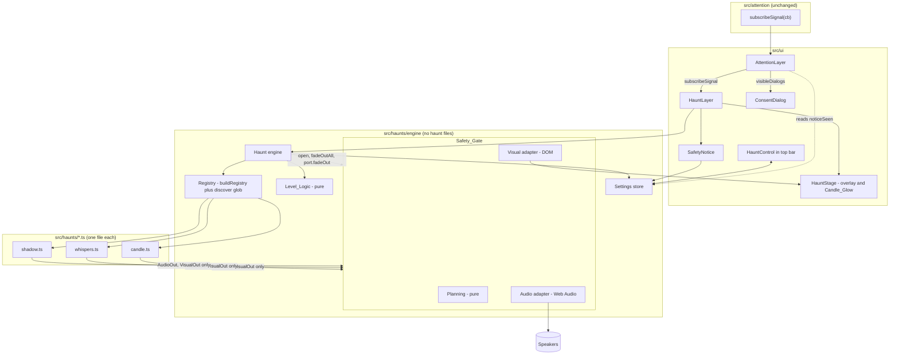
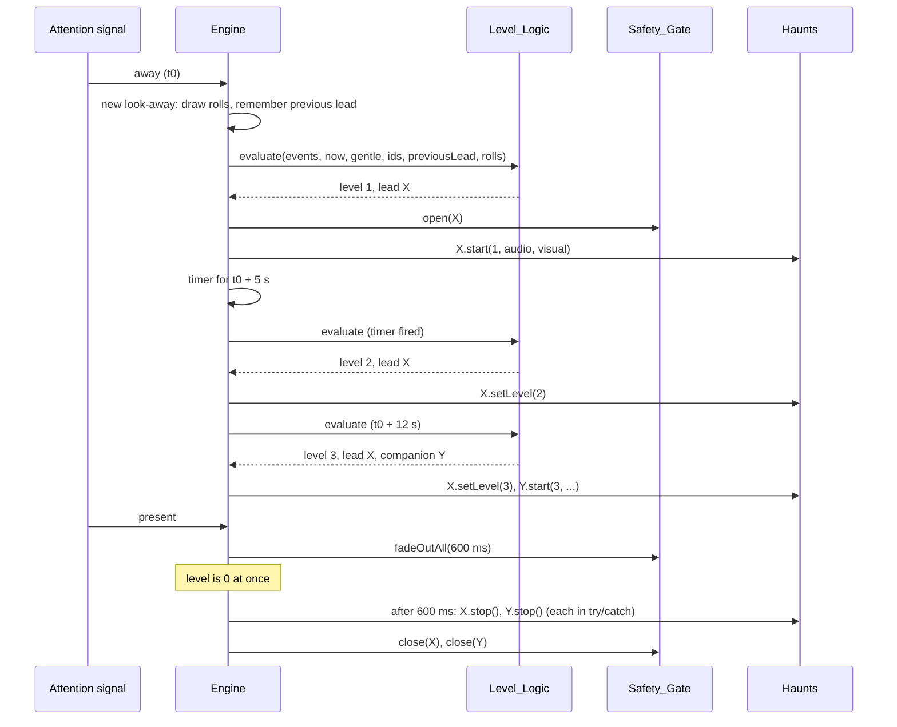
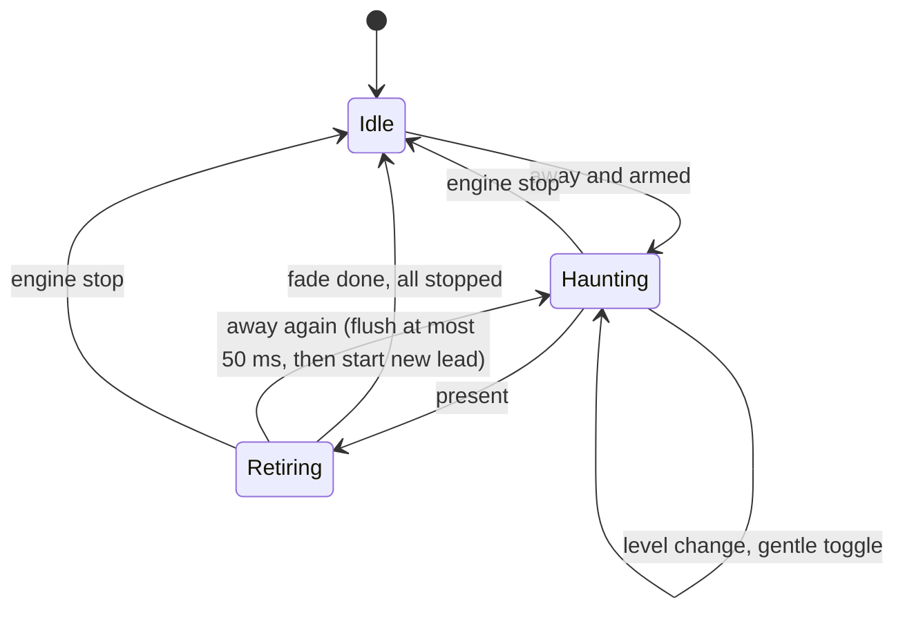

# Design Document

## Overview

The haunt feature turns the attention signal (`present` or `away`) into escalating, layered haunts. A pure function, the Level_Logic, decides the Haunt_Level (0 to 3), the Lead_Haunt and the Companion_Haunt. An engine runs the haunts the Level_Logic names. A single Safety_Gate sits between every haunt and the outside world (speakers and document) and enforces volume, fade, flash and reduced-motion rules on the combined output of all running haunts.

Design decisions, with reasons:

| Decision | Reason |
| --- | --- |
| Engine, Level_Logic, Safety_Gate, registry and shared types live in `src/haunts/engine/`. Only haunt files live directly in `src/haunts/`. | The glob `src/haunts/*.ts` is one level deep, so it never matches `engine/`. Adding a haunt is one file (Req 5.2). |
| Haunts are discovered with an eager `import.meta.glob`, then validated at run time. | Eager keeps all haunts available synchronously when the reader looks away. Run-time validation covers files that pass the glob but do not satisfy the contract (Req 4.7). |
| The Safety_Gate is pure planning functions plus thin Web Audio and DOM adapters. | The rules (gain scaling, flash budget, fade durations, cap parsing) become property-testable without a browser. |
| Haunts see only `AudioOut` and `VisualOut`. Time-varying visuals use gate primitives (`setOpacity`, `setSweep`, `setFlashRate`, `glow.setGutter`), never haunt-written CSS animation. | The gate can count and limit every flash and movement. All `@keyframes` live in one stylesheet owned by the stage. |
| Level_Logic takes its random choices as inputs (`rolls`). | The function stays pure and deterministic (Req 10.2), while the engine supplies one random draw per look-away. |
| One shared settings store (sound, gentle, notice seen) read by the engine, the top-bar control and the dialog hold-back. | One source of truth. No prop drilling through `AttentionLayer` or `ReaderView`. |
| Consent hold-back is a pure predicate `visibleDialogs(noticeSeen, choice)` used by `AttentionLayer`. | Two complementary conditions can never be true together, and the attention module is untouched (Req 8.12). |

No new dependency is proposed. The feature uses Vite, React, Vitest, fast-check and jsdom, which are already in `package.json`. No new licence applies.

### Research findings

Findings that shaped the design, from the Vite documentation ([Features: Glob Import](https://vite.dev/guide/features.html), and the Vite v8.3.5 docs via Context7). The text below is a paraphrase.

- `import.meta.glob` accepts an array of patterns. A pattern that starts with `!` excludes matches, for example `['./dir/*.js', '!**/bar.js']`.
- `{ eager: true }` turns the dynamic imports into static imports, so the result is a plain map of path to module namespace. Without it the map holds lazy `() => import()` functions.
- Patterns are treated like import specifiers. They must be relative (`./`, `../`), absolute from the project root (`/`), or an alias. All arguments must be literals; variables and expressions do not work.
- Matching is done by tinyglobby, and `*` does not cross directory separators, so `../*.ts` called from `src/haunts/engine/` matches files directly in `src/haunts/` and nothing in `engine/` or `__tests__/`.
- Glob import is a Vite-only feature. Vitest runs through Vite, so the same call works in tests.
- Browser autoplay policy keeps an `AudioContext` suspended until a user gesture ([MDN: Autoplay guide](https://developer.mozilla.org/en-US/docs/Web/Media/Guides/Autoplay)). The Audio_Unlock listener therefore creates and resumes the context inside the first gesture.
- WCAG 2.3.1 sets the general flash threshold at three flashes in any one second ([W3C: Three Flashes or Below Threshold](https://www.w3.org/WAI/WCAG22/Understanding/three-flashes-or-below-threshold.html)). This is the source of the 3 per second limit in the haunt-safety steering file.

Content was rephrased for compliance with licensing restrictions.

Facts taken from the existing code, which the design must match:

- `useAttention()` exposes `subscribeSignal(cb)` (`src/ui/useAttention.ts`). It is a stable module-level function, and it delivers the current signal once on subscribe (`src/attention/signalBus.ts`). `AttentionSignal` is `{ value: 'present' | 'away'; timestamp: number }`, and timestamps use `performance.timeOrigin + performance.now()`. The engine clock must use the same time base.
- `AttentionLayer` makes the only `useAttention()` call, renders `HauntLayer` (the removed temporary label's place), and renders `ConsentDialog` only when `visibleDialogs(...).consent` is true, so the consent dialog waits until the safety notice has been seen. `ReaderView` passes the camera indicator into the top bar through a render prop.
- Storage keys use the `rod_` prefix with string values (`rod_pace_guide` is `'true'` or `'false'`). Storage reads and writes are wrapped in try/catch and are best-effort.
- The reading column is `.paragraph-list` (`max-width: 65ch`, centred). `src/ui/theme.css` defines the colour variables.
- Test files sit in `__tests__/` next to the code, named `*.unit.test.ts` and `*.pNN.prop.test.ts`.

## Architecture



Rules the diagram encodes:

- Nothing in `src/haunts/` imports from `src/attention/`, `src/ui/` or camera code. The engine receives `subscribeSignal` as a constructor argument (Req 11.1, 11.2).
- Haunt files import only types and the noise helper from `./engine/`. They reach speakers and the document only through `AudioOut` and `VisualOut` (Req 4.4). The `HauntAudioContext` from `whenReady` is restricted by construction: no `destination`, no raw context, connections only to the port input.
- `src/haunts/engine/` has no React. React lives in `src/ui/`.

### Signal to haunt sequence



### Engine states



"Armed" means the Safety_Notice has been dismissed. While not armed, the engine drops signal events and stays Idle (Req 8.4). When it becomes armed and the latest known signal is `away`, the engine records a synthetic `away` event stamped with the current time, so escalation starts at level 1 and does not jump straight to level 3.

### File layout

```
src/haunts/
  candle.ts              haunt: exports id, name, start, setLevel, stop
  whispers.ts            haunt (increment 2)
  shadow.ts              haunt (increment 2)
  __tests__/             haunt tests (the glob does not match subfolders)
  engine/
    types.ts             Haunt, HauntLevel, AudioOut, VisualOut, Gate, ports
    hauntAudio.ts        HauntAudioContext and wrapper node types (types only)
    levelLogic.ts        evaluate, nextChangeDelay (pure)
    registry.ts          buildRegistry (pure)
    discover.ts          the one import.meta.glob call
    engine.ts            createHauntEngine (orchestration, ports injected)
    settings.ts          parseSettings, serializeSettings, createSettingsStore
    dialogOrder.ts       visibleDialogs (pure)
    regions.ts           computeRegions (pure)
    noise.ts             createNoiseBuffer helper for haunts
    gate/
      plan.ts            parseVolumeCap, scaleGains, allocateFlashRates, planFadeIn, planFadeOut (pure)
      gate.ts            createGate: ties plan to the adapters
      audioAdapter.ts    AudioContext, per-haunt channel gain, master limiter, unlock
      audioGraph.ts      node graph and gain ramps (with audioAdapter.ts, the only `.destination` use)
      restrictedAudio.ts wrapper nodes: the restricted context haunts receive
      visualAdapter.ts   writes into the stage host elements
      reducedMotion.ts   matchMedia adapter
    index.ts             public surface for src/ui
    __tests__/
src/ui/
  HauntLayer.tsx / .css  hook up engine, stage, notice (replaces TempAttentionLabel)
  HauntStage.tsx / .css  overlay, side regions, Candle_Glow, all @keyframes
  SafetyNotice.tsx / .css
  HauntControl.tsx / .css
  useHauntSettings.ts    useSyncExternalStore over the settings store
```

No file exceeds 200 lines. `gate.ts` and `engine.ts` are the largest and are split further (for example `engineTimer.ts`) if they approach the limit.

### Haunt discovery

`src/haunts/engine/discover.ts` is the only file that calls `import.meta.glob`:

```ts
const modules = import.meta.glob(['../*.ts', '!../*.test.ts', '!../*.d.ts'], { eager: true });
export const discovered: Record<string, unknown> = modules;
```

- Patterns are literals and relative to `discover.ts`, as the Vite docs require. `../*.ts` is `src/haunts/*.ts` (Req 5.1).
- `eager: true` gives the module namespaces directly. The cost is that a haunt module that throws while loading breaks app start, so haunt modules must have no import-time side effects (state is created in `start`). This is a rule for haunt authors and is covered by the static test.
- Test files are excluded by location (`__tests__/`) and by the negative patterns. Shared helpers live in `engine/`, so they never match. A stray helper file placed directly in `src/haunts/` is excluded by contract validation with a warning (Req 5.3, 4.7).
- `buildRegistry` sorts the keys with a plain code-unit string comparison before validating. "Path order" in Req 4.8 means this order. The result does not depend on the order Vite returns the keys.

## Components and Interfaces

### Haunt contract and gate outputs (`engine/types.ts`)

```ts
export type HauntLevel = 1 | 2 | 3;
export type Unsubscribe = () => void;

/** The shape of a haunt module's named exports. */
export interface Haunt {
  readonly id: string;
  readonly name: string;
  start(level: HauntLevel, audio: AudioOut, visual: VisualOut): void;
  setLevel(level: HauntLevel): void;
  stop(): void;
}

export interface AudioOut {
  /**
   * Calls `cb` once, as soon as sound is possible (after Audio_Unlock), or at
   * once if it already is. `ctx` is a restricted context: it makes sources,
   * filters and panners, and connects them only to each other and to
   * `ctx.input` (this haunt's channel gain). It has no `destination` and no
   * raw AudioContext. Returns a cancel function.
   */
  whenReady(cb: (ctx: HauntAudioContext) => void): Unsubscribe;
  /** Requested absolute gain, 0 to 1. The gate clamps, scales and ramps it. */
  setGain(requested: number): void;
}

/** In engine/hauntAudio.ts (types only), re-exported from engine/types.ts. */
export interface HauntParam {
  setValueAtTime(value: number, time: number): void;
  linearRampToValueAtTime(value: number, time: number): void;
  cancelScheduledValues(time: number): void;
}
export interface HauntSink { readonly isHauntSink: true }            // another haunt node, or ctx.input
export interface HauntNode extends HauntSink {
  connect<T extends HauntSink>(target: T): T;                        // throws for any foreign target
  disconnect(): void;
}
export interface HauntBufferSource extends HauntNode {
  buffer: AudioBuffer | null; loop: boolean; readonly playbackRate: HauntParam;
  onended: (() => void) | null; start(when?: number): void; stop(when?: number): void;
}
export interface HauntFilter extends HauntNode {
  type: BiquadFilterType;
  readonly frequency: HauntParam; readonly Q: HauntParam; readonly gain: HauntParam; readonly detune: HauntParam;
}
export interface HauntPanner extends HauntNode { readonly pan: HauntParam }
export interface HauntAudioContext {
  readonly input: HauntSink;
  readonly sampleRate: number;
  readonly currentTime: number;
  /** Shaped like `createBuffer`, so `createNoiseBuffer(ctx, seconds)` in noise.ts works. */
  createBuffer(numberOfChannels: number, length: number, sampleRate: number): AudioBuffer;
  createBufferSource(): HauntBufferSource;
  createBiquadFilter(): HauntFilter;
  createStereoPanner(): HauntPanner;
}

export interface GlowControl {
  /** 0 = calm glow, 1 = darkest allowed. Fade is raised to the plan minimum. */
  setDim(amount: number, fadeMs?: number): void;
  /** Dips of the glow. `depth` 0 to 1, `dipsPerSec` is limited by the flash budget. */
  setGutter(depth: number, dipsPerSec: number): void;
}

export interface VisualLayer {
  /** Static SVG or CSS content from a string constant. Parsed by the gate. */
  setMarkup(svg: string): void;
  setOpacity(opacity: number, fadeMs?: number): void;
  /** Slow movement across the layer, one crossing per `periodMs`; null stops it. */
  setSweep(periodMs: number | null): void;
  remove(): void;
}

export interface VisualOut {
  readonly glow: GlowControl;
  /** A layer in the left or right region beside the Reading_Column. */
  createLayer(side: 'left' | 'right'): VisualLayer;
}
```

A haunt file looks like this (candle shown in outline):

```ts
import type { AudioOut, HauntLevel, VisualOut } from './engine/types';

export const id = 'candle';
export const name = 'The candle gutters';

const DIM: Record<HauntLevel, number> = { 1: 0.25, 2: 0.5, 3: 0.7 };
const GUTTER: Record<HauntLevel, { depth: number; rate: number }> = {
  1: { depth: 0, rate: 0 }, 2: { depth: 0.15, rate: 0.2 }, 3: { depth: 0.3, rate: 0.5 },
};

let visual: VisualOut | null = null;
export function start(level: HauntLevel, _audio: AudioOut, v: VisualOut): void { visual = v; apply(level); }
export function setLevel(level: HauntLevel): void { apply(level); }
export function stop(): void { visual?.glow.setDim(0); visual?.glow.setGutter(0, 0); visual = null; }
function apply(level: HauntLevel): void { /* glow.setDim(DIM[level]); glow.setGutter(...) */ }
```

The numbers are starting values to tune by eye; tests check order (level 1 < 2 < 3), not the exact values. The whispers haunt starts with gains 0.04, 0.10 and 0.18, and the shadow haunt uses sweep periods of 14 s, 10 s and 6 s. A haunt module keeps its state at module level. The engine never starts a running haunt twice, so one instance per module is enough.

### Level_Logic (`engine/levelLogic.ts`)

```ts
export interface LevelInput {
  /** Delivery order. The latest run of `away` events at the end gives the away start. */
  readonly events: readonly AttentionSignalLike[];
  readonly now: number;
  readonly gentle: boolean;
  readonly hauntIds: readonly string[];
  /** Lead of the previous look-away, or null. */
  readonly previousLeadId: string | null;
  /** Fixed for one look-away. Each is in [0, 1). */
  readonly rolls: { readonly lead: number; readonly companion: number };
}
export interface AttentionSignalLike { readonly value: 'present' | 'away'; readonly timestamp: number }

export interface LevelOutput {
  readonly level: 0 | 1 | 2 | 3;
  readonly leadId: string | null;
  readonly companionId: string | null;
}

export const THRESHOLDS_MS = { level2: 5000, level3: 12000 } as const;

export function evaluate(input: LevelInput): LevelOutput;
/** Ms until the level next changes, or null if it cannot change by time alone. */
export function nextChangeDelay(input: LevelInput): number | null;
```

Rules of `evaluate`:

1. No events, or the last event is `present`: `{ level: 0, leadId: null, companionId: null }`.
2. Otherwise `start` is the timestamp of the first event in the trailing run of `away` events. `elapsed = max(0, now - start)`. `level` is 1 below 5000 ms, 2 from 5000 ms, 3 from 12000 ms.
3. With no haunt ids, the level is 0 and both ids are null (Req 3.7).
4. `leadId`: the candidates are `hauntIds` without `previousLeadId`. If that leaves none (one haunt), or `previousLeadId` is null or absent from the list, the candidates are all `hauntIds`. The lead is `candidates[floor(rolls.lead * candidates.length)]`. The index is clamped to the last element, so a roll outside `[0, 1)` cannot index out of range.
5. `companionId`: only when `level === 3` and there are at least two ids. Candidates are `hauntIds` without `leadId`, and the companion is `candidates[floor(rolls.companion * length)]`. Otherwise null.
6. Gentle: `level = min(level, 1)` and `companionId = null`.

Because rolls and `previousLeadId` are fixed for a look-away, the lead is a function of the events only. It does not change with `now` or `gentle`, which gives Req 3.4 and Req 7.3 for free.

`nextChangeDelay` returns `5000 - elapsed` or `12000 - elapsed` for the next threshold, and null when the level is 0, 3, gentle, or the haunt list is empty.

### Registry (`engine/registry.ts`)

```ts
export interface RegistryResult {
  readonly haunts: readonly Haunt[];
  readonly warnings: readonly string[];
}
/** Pure. `modules` maps file path to module namespace (unknown shape). */
export function buildRegistry(modules: Readonly<Record<string, unknown>>): RegistryResult;
export function loadHaunts(warn?: (msg: string) => void): readonly Haunt[]; // buildRegistry(discovered) + warn
```

`buildRegistry` visits paths in sorted order. A module is valid when `id` is a non-empty string, `name` is a string, and `start`, `setLevel` and `stop` are functions. An invalid module is skipped, with a warning naming the path. A module whose `id` is already taken is skipped, with a warning naming both paths. The result holds plain objects copied from the namespace, so later changes to a module cannot alter the registry.

### Safety_Gate

Pure planning in `gate/plan.ts`:

```ts
export const DEFAULT_VOLUME_CAP = 0.4;
export const MIN_FADE_IN_MS = 300;
export const MIN_FADE_IN_REDUCED_MS = 1000;
export const MAX_FADE_OUT_MS = 800;
export const MAX_FLASHES_PER_SEC = 3;

/** Number in [0, 1] from storage text; otherwise 0.4. */
export function parseVolumeCap(raw: unknown): number;
/** Clamp each request to [0, cap] (non-finite becomes 0). If the sum exceeds cap, scale all by cap / sum. */
export function scaleGains(requests: readonly GainRequest[], cap: number): readonly GainRequest[];
/** Each rate clamped to [0, 3]. Reduced motion gives 0. If the sum exceeds 3, scale all by 3 / sum. */
export function allocateFlashRates(requests: readonly RateRequest[], reduced: boolean): readonly RateRequest[];
export function planFadeIn(requestedMs: number | undefined, reduced: boolean): number;  // >= 300, or >= 1000 when reduced
export function planFadeOut(requestedMs: number | undefined): number;                   // in [50, 800], same in every mode
/** Gains actually requested of the gate: zero when sound is off or audio is locked. */
export function effectiveRequests(requests: readonly GainRequest[], soundOn: boolean, unlocked: boolean): readonly GainRequest[];
/** Sweep period to flash-equivalent rate: 1000 / periodMs, with periodMs floored at 2000. */
export function sweepRate(periodMs: number): number;

export interface GainRequest { readonly key: string; readonly gain: number }
export interface RateRequest { readonly key: string; readonly rate: number }
```

Design notes:

- Gains add, so the plan treats the sum of channel gains as the worst-case combined level. A DynamicsCompressor on the master bus is a second line of defence for filter resonance peaks. It is not what the guarantee relies on.
- A flash is one dip and recovery of brightness or opacity. A sweep crossing counts as one flash-equivalent, so the budget covers moving shadows as well as glow gutters. The minimum sweep period of 2 s caps one sweep at 0.5 per second.
- Fades that fall (gain or opacity going down, cap lowered, sound switched off) use `planFadeOut`. Fades that rise use `planFadeIn`. Lowering the cap or switching sound off uses a fixed short ramp (cap: 50 ms, sound off: 150 ms), which is inside the 100 ms and 300 ms limits of Req 6.13 and 9.2.

Adapters:

```ts
export interface Gate {
  open(hauntId: string): GatePort;
  /** Fade every open port to zero. Returns the planned duration, at most 800 ms. */
  fadeOutAll(requestedMs: number): number;
  setSoundEnabled(on: boolean): void;
  setReducedMotion(on: boolean): void;
  /** Re-read the Volume_Cap from storage. Also called on the `storage` event. */
  refreshVolumeCap(): void;
  /** Create and resume the AudioContext. Called by the first-gesture listener. */
  unlockAudio(): void;
  dispose(): void;
}
export interface GatePort {
  readonly audio: AudioOut;
  readonly visual: VisualOut;
  /**
   * Fades only this port's audio and visuals to 0 over `planFadeOut(ms)` (at most 800 ms in
   * every mode, reduced motion included), then ignores further audio and visual requests.
   * Does not release the port; `close()` still does. `fadeOutAll` runs the same per-port path.
   */
  fadeOut(ms: number): void;
  /** Gate-side cleanup: removes layers, disconnects the channel. Safe to call twice. */
  close(): void;
}
export function createGate(deps: GateDeps): Gate;
```

`GateDeps` holds the host elements, a storage reader, a `createAudioContext` factory, a scheduler and a `matchMedia` adapter, so tests inject fakes. The gate recomputes the whole plan (scaled gains, flash allocation, glow dim as the maximum over ports) whenever any request, the cap, the sound setting, the unlock state or reduced motion changes.

Audio adapter: each port gets a `GainNode` (`input`) feeding a master `GainNode`, then a `DynamicsCompressorNode`, then `destination`. Gains change with `linearRampToValueAtTime` from the current value. Only `audioAdapter.ts` and `audioGraph.ts` touch `ctx.destination`. The Audio_Unlock listener (`pointerdown` and `keydown` on `window`, once, capture) creates the context if needed and calls `resume()`, then notifies waiting `whenReady` callbacks with the port's restricted context.

Restricted audio context (`gate/restrictedAudio.ts`): a haunt never receives the real `AudioContext`, `destination` or a real `AudioNode`. A real node has a `.context` property that leads back to both, so the restriction is structural and not only a type. `createRestrictedContext(ctx, channelGain)` returns wrapper objects that keep the real node in a closure and expose only the parameters in `HauntParam` and the properties listed above. A wrapper's `connect(target)` looks the target up in a per-port `WeakMap` and throws `TypeError` unless it is another wrapper of the same port or `ctx.input`. `ctx.input` has no `connect`, so a chain can only end at the channel gain. There is no `createGain`, `createMediaStreamDestination`, `createMediaElementSource` or `audioWorklet`. `onended` is called without the event, because `event.target` would be the real node. Every path to the speakers therefore passes through the channel gain (the Volume_Cap scaling), the master gain and the compressor, so no haunt can bypass the cap (haunt-safety: the cap is enforced in one place). The static scan (task 5.4) stays as a second guard on haunt source files.

Visual adapter: it writes only inside the stage host (see below). Glow dim and gutter set CSS custom properties and classes on the stage root (`--glow-dim`, `--glow-fade`, `--gutter-depth`, `--gutter-period`, `is-guttering`). A layer is a `div` appended to a side region. Opacity sets `opacity` and `transition-duration`. A sweep sets `--sweep-period` and the class `is-sweeping`. Under reduced motion the adapter never adds `is-sweeping` or `is-guttering` and holds the sweep layer in place at a fade (Req 15.6). The adapter does not use the Web Animations API, which jsdom lacks, so the DOM tests run in the normal test environment.

### Engine (`engine/engine.ts`)

```ts
export interface EngineDeps {
  subscribeSignal(cb: (s: AttentionSignalLike) => void): Unsubscribe;
  haunts: readonly Haunt[];
  gate: Gate;
  settings: SettingsStore;
  /** Same time base as signal timestamps. */
  clock: { now(): number };
  scheduler: { setTimeout(fn: () => void, ms: number): unknown; clearTimeout(id: unknown): void };
  random(): number;
  warn(msg: string): void;
}
export interface EngineState {
  readonly level: 0 | 1 | 2 | 3;
  readonly leadId: string | null;
  readonly companionId: string | null;
  readonly running: readonly string[];
}
export interface HauntEngine {
  start(): void;   // subscribe; level 0
  stop(): void;    // unsubscribe, stop everything, dispose timers
  getState(): EngineState;
}
export function createHauntEngine(deps: EngineDeps): HauntEngine;
```

Behaviour:

- `start` subscribes through `subscribeSignal` and also subscribes to the settings store for `gentle`, `sound` and `noticeSeen`. The first value delivered on subscribe is handled like any other event (Req 11.4).
- The engine keeps the events since the last `present`. A consecutive duplicate value is ignored. When a look-away begins it draws `rolls` once with `random()` and freezes `previousLeadId` as the lead of the previous look-away.
- `recompute()` calls `evaluate` with `clock.now()`, then `reconcile`:
  - `level 0`: if anything runs, call `gate.fadeOutAll(600)`, then after 600 ms call `stop()` on each running haunt in its own try/catch, then `port.close()` for each. A thrown error is passed to `warn`. The level is 0 from the moment of the call (Req 2.1 to 2.4).
  - `level > 0`: start the lead if not running (`gate.open(id)`, `haunt.start(level, port.audio, port.visual)`), call `setLevel(level)` on running haunts when the level changed, and start the companion when `companionId` is set. When the companion is no longer wanted (gentle turned on), call `port.fadeOut(600)` on the companion's port only (the lead keeps running), then stop the companion and `port.close()` it after at most 600 ms (Req 7.2).
  - Every `start`, `setLevel` and `stop` call is wrapped in try/catch. A failing haunt is stopped and reported through `warn`. It does not stop the engine.
  - A timer is set for `nextChangeDelay`. On firing, the engine calls `recompute()` with the clock time, so a timer delayed by a background tab only delays the change. The engine also recomputes when the settings store changes.
- If a look-away starts while haunts are still retiring, the engine flushes them first (ramp of at most 50 ms, then `stop()`), so a haunt chosen again has no module-level state left over. This case is rare: it needs present then away within 600 ms.
- `armed` is `settings.noticeSeen`. While not armed, signal events are only remembered, never acted on. On arming see the state diagram note above.
- `stop()` clears timers, unsubscribes from the signal and the settings store, and stops and closes every port, whatever state the engine is in (Req 11.3, 16.2).

### Settings (`engine/settings.ts`)

```ts
export interface HauntSettings { readonly sound: boolean; readonly gentle: boolean; readonly noticeSeen: boolean }
export const DEFAULT_SETTINGS: HauntSettings = { sound: true, gentle: false, noticeSeen: false };
export const KEYS = {
  sound: 'rod_haunt_sound', gentle: 'rod_haunt_gentle',
  noticeSeen: 'rod_safety_notice_seen', volumeCap: 'rod_volume_cap',
} as const;

/** Pure. `read(key)` returns a string or null. Anything unreadable gives the default. */
export function parseSettings(read: (key: string) => string | null): HauntSettings;
export function serializeSettings(s: HauntSettings): Record<string, string>; // 'true' | 'false'

export interface SettingsStore {
  get(): HauntSettings;
  set(patch: Partial<HauntSettings>): void;   // saves, best-effort, then notifies
  subscribe(cb: () => void): Unsubscribe;
}
export function createSettingsStore(storage: Pick<Storage, 'getItem' | 'setItem'> | null): SettingsStore;
```

The store follows the existing storage convention: reads and writes in try/catch, no error shown. If writing fails the value still holds in memory for the session. `get()` returns the same object until a value changes, so `useSyncExternalStore` works as it does in `useAttention`. There is no function in this spec that writes `rod_volume_cap`; only the gate reads it (Req 6.16).

### Dialog order (`engine/dialogOrder.ts`)

```ts
export function visibleDialogs(noticeSeen: boolean, cameraChoice: 'unanswered' | 'camera' | 'no-camera' | string):
  { notice: boolean; consent: boolean };
// notice = !noticeSeen;  consent = noticeSeen && cameraChoice === 'unanswered'
```

`AttentionLayer` changes in two lines: it renders `ConsentDialog` only when `visibleDialogs(...).consent` is true, and it renders `<HauntLayer subscribeSignal={subscribeSignal} />` in place of `<TempAttentionLabel />`. `HauntLayer` renders `SafetyNotice` when `visibleDialogs(...).notice` is true. The attention controller, its status and its camera code are not touched. The controller may still ask for camera consent in its status while the notice shows; the dialog is simply not rendered until the notice is dismissed.

### Stage regions (`engine/regions.ts`)

```ts
export interface Rect { readonly left: number; readonly right: number; readonly top: number; readonly bottom: number }
export interface Regions { readonly left: Rect; readonly right: Rect }
/** Pure. Left region: x from 0 to column.left. Right region: x from column.right to viewportWidth. Widths never below 0. */
export function computeRegions(viewportWidth: number, viewportHeight: number, column: Rect): Regions;
```

### UI components

| Component | Responsibility |
| --- | --- |
| `HauntLayer` | Builds the engine and gate once per mounted reading view (`useEffect` with cleanup), passes `subscribeSignal`, renders `HauntStage` and, when needed, `SafetyNotice`. No logic beyond wiring. |
| `HauntStage` | Fixed, full-viewport overlay (`pointer-events: none`, `aria-hidden`, z-index below the top bar). Holds the Candle_Glow and the two side regions. Measures the column (`[data-reading-column]`, set on `.paragraph-list`) with `ResizeObserver` and the window `resize` event, and sets the region sizes from `computeRegions`. Exposes the host elements to `HauntLayer` through a ref callback. Owns every `@keyframes` rule. |
| `SafetyNotice` | Modal dialog (`role="dialog"`, `aria-modal`, `useFocusTrap`), one button "Begin reading". Text: haunts include dimming light and moving shadow, haunts include quiet sound, sound can be turned off or Gentle mode used. Writes `noticeSeen` to the settings store on dismiss. |
| `HauntControl` | Two buttons in the top bar with `aria-pressed`: "Haunt sound: on/off" and "Gentle mode: on/off". Reads and writes the settings store through `useHauntSettings`. Uses the existing `reader__button` styling and focus ring. |

Placement: `ReaderView` adds `<HauntControl />` next to the Pace Guide button, and `ParagraphList` gains the attribute `data-reading-column` on `.paragraph-list`. Nothing else in `ReaderView` or the reading flow changes.

The Candle_Glow CSS in `HauntStage.css` uses `color-mix(in srgb, var(--accent) 20%, transparent)`, so no colour is hard-coded and `theme.css` needs one new line at most (`--glow`, same expression). Its drift animation changes opacity between 0.97 and 1 over a 16 s cycle (3 percent, one cycle per 16 s, inside Req 12.3). `@media (prefers-reduced-motion: reduce)` sets `animation: none` on the glow, and the gate also refuses to add motion classes when reduced motion is on. The shadow and vignette layers use `var(--shadow)`. Everything that darkens never lightens the area behind the reading text, and all effects sit in the side regions.

Known limitation: on screens narrow enough that the column fills the width (about 360 px), the side regions have almost no width, so visual haunts are thin there. The sound still carries the haunt. This follows from "never over the active paragraph" (Req 6.11) and is accepted. A later change could add top and bottom bands.

## Data Models

```ts
// Level_Logic
type Level = 0 | 1 | 2 | 3;
interface LevelInput { events; now; gentle; hauntIds; previousLeadId; rolls }   // see above
interface LevelOutput { level: Level; leadId: string | null; companionId: string | null }

// Engine, per look-away (internal)
interface LookAway { startedAt: number; rolls: { lead: number; companion: number }; previousLeadId: string | null }
interface Running { haunt: Haunt; port: GatePort; level: HauntLevel }

// Settings in localStorage (strings)
// rod_haunt_sound        'true' | 'false'     default 'true'
// rod_haunt_gentle       'true' | 'false'     default 'false'
// rod_safety_notice_seen 'true' | 'false'     default 'false'
// rod_volume_cap         decimal text in [0,1], default 0.4 when missing, unreadable or out of range

// Gate requests (internal)
interface ChannelRequests { gain: number; layers: Map<VisualLayer, { opacity: number; sweepMs: number | null }>; gutter: { depth: number; rate: number } }
```

Storage holds only these four values. No video, no camera data, nothing is sent over the network (Req 16.6, 16.7).

## Correctness Properties

*A property is a characteristic or behavior that should hold true across all valid executions of a system-essentially, a formal statement about what the system should do. Properties serve as the bridge between human-readable specifications and machine-verifiable correctness guarantees.*

Reflection on the prework: the escalation threshold, never-falls and lead-stability criteria all follow from one model-based comparison plus one monotonicity property, so they are kept as two properties. Fade-in and fade-out checks are separate because they have different bounds. The "combined gain" check appears twice on purpose: once on the pure plan (Property 12) and once on the real adapter and real haunts through a fake audio context (Property 14), because the second one catches wiring mistakes the first cannot. Criteria that are configuration, wording or visual feel (6.1, 6.16, 11.5, 12.x amplitudes) are covered by example and static tests in the Testing Strategy.

### Property 1: Level is bounded and gentle mode caps it

*For any* event history, time, haunt list and rolls, `evaluate` returns a level from 0 to 3. *For any* such input with `gentle` on, the level is at most 1 and `companionId` is null.

**Validates: Requirements 1.4, 7.1, 7.4, 10.4, 10.5**

### Property 2: Escalation follows the thresholds

*For any* history whose trailing run of `away` events starts at time `s`, any `now`, and any non-empty haunt list with gentle off, the level is 1 when `now - s < 5000`, 2 when `5000 <= now - s < 12000`, and 3 when `now - s >= 12000`. A negative elapsed time gives level 1.

**Validates: Requirements 1.1, 1.2, 1.3, 2.5**

### Property 3: Present means level 0

*For any* history whose last event is `present` (or that is empty), and any other input, the output is level 0 with no lead and no companion. Extending such a history with further `present` events never raises the level.

**Validates: Requirements 1.5, 2.1, 10.6, 10.7**

### Property 4: Level never falls while away, and the lead stays the same

*For any* history that ends in `away`, any `gentle` value, and any `t1 <= t2`, `evaluate` at `t2` returns a level at least as high as at `t1`, and the same `leadId`. Changing only `gentle` does not change `leadId`, and with gentle off the level equals the threshold level for the elapsed time.

**Validates: Requirements 1.6, 3.4, 7.3, 10.11**

### Property 5: Consecutive look-aways use different leads

*For any* list of two or more distinct haunt ids and any sequence of look-aways with arbitrary rolls, folding `evaluate` over the sequence (feeding each lead in as the next `previousLeadId`) never gives the same `leadId` twice in a row. *For any* list with exactly one id, the lead is that id and the companion is null. *For any* empty list the level is 0.

**Validates: Requirements 3.1, 3.2, 3.3, 3.7, 10.8, 10.10**

### Property 6: Companion rules

*For any* input where `companionId` is not null, the level is 3, the haunt list has at least two ids, `companionId` differs from `leadId`, and both ids are in the list. *For any* input with level below 3, `companionId` is null.

**Validates: Requirements 3.5, 3.6, 10.9**

### Property 7: Level_Logic is deterministic and does not mutate its input

*For any* input, calling `evaluate` twice on structurally equal copies returns equal outputs, and the input is unchanged after the call.

**Validates: Requirements 10.1, 10.2**

### Property 8: nextChangeDelay lands on the next level change

*For any* input where `nextChangeDelay` returns a delay `d`, `evaluate` at `now + d` returns a higher level than at `now`, and at `now + d - 1` the same level as at `now`. It returns null exactly when the level is 0 or 3, gentle is on, or the haunt list is empty.

**Validates: Requirements 1.2, 1.3, 11.5**

### Property 9: Combined gain never exceeds the Volume_Cap

*For any* list of gain requests (including negative, NaN and infinite values) and any cap in [0, 1], the scaled gains are each in [0, cap], their sum is at most `cap` (within 1e-9), a request list whose clamped sum exceeds the cap is scaled so the sum equals the cap (within 1e-9), the ratio between any two non-zero gains is preserved, and no gain is raised.

*Precision note:* ratio preservation holds for gains at or above 1e-200. Below that, subnormal doubles lose precision when scaled, which does not affect audible gains (0 to 1). The cap and sum guarantees still hold for all values.

**Validates: Requirements 6.2, 6.6, 6.17**

### Property 10: Sound is silent when off or locked

*For any* gain requests, with the sound setting off or Audio_Unlock not yet done, every effective gain is 0.

**Validates: Requirements 8.5, 8.7, 9.2**

### Property 11: Fade durations respect their bounds

*For any* requested duration (including undefined, negative, NaN and infinite), `planFadeIn` returns at least 300 ms, and at least 1000 ms when reduced motion is on. `planFadeOut` returns at most 800 ms in both modes.

**Validates: Requirements 2.2, 6.3, 6.4, 6.8, 6.9, 7.2, 13.5, 13.6, 14.9, 15.6**

### Property 12: Combined flash rate is at most 3 per second, and zero under reduced motion

*For any* list of rate requests (including sweep rates derived from any period) the allocated rates are each at least 0, their sum is at most 3 (within 1e-9), requests that already fit are unchanged, and with reduced motion on every allocated rate is 0.

**Validates: Requirements 6.5, 6.7, 6.10, 6.17**

### Property 13: Volume_Cap parsing falls back to 0.4

*For any* string, null, undefined or non-string value, `parseVolumeCap` returns a number in [0, 1]. *For any* number `n` in [0, 1], parsing its decimal text returns `n`. *For any* input that is missing, empty, not a finite number, or outside 0 to 1, the result is 0.4.

**Validates: Requirements 6.14, 6.15**

### Property 14: Real adapter and real haunts stay under the cap

*For any* ordered pair of distinct real haunts (lead, companion), any level for each, any cap in [0, 1], and any interleaving of `setGain`, `setLevel`, cap changes and sound toggles, recorded against a fake `AudioContext`, the sum of the target values of all channel gains never exceeds the cap (within 1e-9), every upward ramp lasts at least 300 ms, and after a cap change the new cap is applied within 100 ms of the change.

**Validates: Requirements 4.3, 6.2, 6.3, 6.4, 6.13, 14.5**

### Property 15: Reduced motion emits no flashing from any haunt

*For any* real haunt, level, and sequence of level changes with reduced motion on, the visual adapter adds no `is-sweeping` or `is-guttering` class, every recorded fade-in lasts at least 1000 ms, and the combined flash-equivalent rate is 0. With reduced motion off, the combined rate is at most 3.

**Validates: Requirements 6.8, 6.10, 13.5, 15.6, 15.4**

### Property 16: Settings round trip and safe defaults

*For any* `HauntSettings` value, `parseSettings` over `serializeSettings` of it returns an equal value. *For any* map of arbitrary string or null storage values, `parseSettings` returns booleans for all three fields, and a missing or unreadable value gives the default (sound on, gentle off, notice not seen).

**Validates: Requirements 9.4, 9.5, 9.6**

### Property 17: Registry excludes invalid and duplicate files, and the first path wins

*For any* record of module objects, where each is valid, missing a contract field, has a field of the wrong type, or reuses an id, `buildRegistry` returns only valid haunts with unique ids. Each excluded file has a warning that names it, and a duplicate warning names both paths. When two files share an id, the one that sorts first by path is kept, whatever the insertion order of the record.

**Validates: Requirements 4.2, 4.7, 4.8, 5.2, 5.3**

### Property 18: Effects stay outside the Reading_Column

*For any* viewport size and any column rectangle inside it, the left and right regions have non-negative width, lie inside the viewport, and neither intersects the column rectangle.

Overlap means a positive-area intersection; an empty (zero-width or zero-height) region cannot hold an effect and does not count as overlapping the column.

**Validates: Requirements 6.11, 12.2, 15.2**

### Property 19: The Safety_Notice and the Camera_Consent_Dialog are never visible together

*For any* combination of `noticeSeen` and camera choice, `visibleDialogs` never returns `notice` and `consent` both true. The notice is visible exactly when it has not been seen. The consent dialog is visible exactly when the notice has been seen and the choice is `unanswered`.

**Validates: Requirements 8.9, 8.10, 8.11**

### Property 20: Engine keeps haunts within its rules for any script

*For any* script of signal events, clock advances, timer firings, gentle toggles, sound toggles and arming, run against the real engine with fake haunts, a fake gate, a fake clock and a fake scheduler: the level is always in [0, 3]; the level does not rise while the signal is `present`; the running set is always within the lead and companion of the current look-away and has at most one haunt when gentle is on (after the transition window of 800 ms); while not armed the level is 0 and nothing runs; the lead does not change within a look-away; and 800 ms after any `present` nothing runs. Every `start` is matched by exactly one `stop`, including when some `stop` calls throw, and after `engine.stop()` nothing runs, no timer is pending and the signal subscription is removed.

**Validates: Requirements 1.5, 1.7, 2.2, 2.3, 2.4, 3.4, 7.2, 8.4, 11.3, 16.2**

## Error Handling

| Situation | Handling |
| --- | --- |
| A haunt's `start`, `setLevel` or `stop` throws | The engine catches it, calls `warn`, stops and closes that haunt's port, and continues with the others. The level logic is unaffected (Req 2.4). |
| Haunt file does not satisfy the contract, or duplicate `id` | Excluded by `buildRegistry`, with a console warning naming the file or both files (Req 4.7, 4.8). |
| No valid haunt | `evaluate` returns level 0; the engine does nothing; the reading view works as before (Req 3.7, 5.4). |
| Haunt module throws while loading | With an eager glob this fails app start. Mitigated by the rule and the static test that haunt modules have no import-time side effects. |
| `localStorage` unavailable or throws | Settings and cap use defaults (sound on, gentle off, notice not seen, cap 0.4). Writes are best-effort and the value stays in memory for the session. |
| Stored volume cap missing, unreadable or outside 0 to 1 | 0.4 (Req 6.15). |
| `AudioContext` cannot be created or is blocked | The audio adapter reports "not ready"; `whenReady` callbacks never fire; haunts show their visuals only (Req 8.7). No message to the reader. |
| Audio_Unlock has not happened | No context exists; `whenReady` waits. |
| `matchMedia` unavailable | Treated as reduced motion off. CSS `prefers-reduced-motion` rules still apply. |
| `ResizeObserver` or column element missing | `HauntStage` uses a centred 65ch estimate for the column. |
| Timer delayed by a hidden tab | The engine recomputes from the clock when it fires, so levels are correct on return. A `present` signal always resets to 0. |
| Haunt requests more gain, flash rate or fade shorter than allowed | The gate reduces or lengthens the request without an error (Req 6.17). |
| New look-away starts while haunts are still retiring | Engine flushes them (ramp at most 50 ms) before starting the new lead. |
| Notice dismissed while the signal is `away` | The engine records a synthetic `away` stamped now, so escalation starts at level 1. |

Errors are never shown to the reader. The only reader-visible text added is the Safety_Notice and the Haunt_Control labels.

## Testing Strategy

Property-based testing applies here: Level_Logic, registry, settings, region and gate planning functions are pure, have large input spaces and have universal invariants. It does not apply to CSS look, `@keyframes` or the feel of a haunt; those use example tests and a manual pass.

Libraries: Vitest with jsdom (already configured) and fast-check 4 (already installed). No new dependency.

Conventions:

- Each property is one fast-check test with at least 100 runs (`numRuns: 100` or more).
- Each carries the tag comment `// Feature: haunt-feature, Property N: <title>` and lives in `src/haunts/engine/__tests__/` as `<area>.pNN.prop.test.ts`, matching the existing `*.pNN.prop.test.ts` names.
- Generators sit in `__tests__/arbitraries.ts`: event histories (sorted timestamps, duplicates allowed), haunt id lists (0 to 5 ids, distinct), rolls in [0, 1), cap values including bad strings, rect and viewport pairs, module records (valid, wrong types, duplicate ids, helper-like objects).
- After each task the run is reported as the testing steering requires: properties added, cases run, counterexamples. Counterexamples go in `docs/BUILD_LOG.md`.

Fakes (in `__tests__/fakes.ts`): fake clock and scheduler; fake haunts that record calls and can throw; fake gate; fake `AudioContext` that records node creation, `connect` and `disconnect`, and every `AudioParam` automation call; fake storage. Real haunts run only against the real gate with the fake `AudioContext` and a jsdom stage host.

Unit and example tests:

- **Haunt contract (Req 4.1, 4.5, 4.6, 13 to 15):** each real haunt is checked with a type assertion (`const h: Haunt = candle`) and at run time. A recorder counts what each haunt asks for at levels 1, 2 and 3. For each haunt, every "stronger means larger" observable is non-decreasing from level to level and at least one strictly rises (dim, gain, opacity, size, and sweep frequency). After `stop()`, nodes created equals nodes disconnected and layers created equals layers removed. The haunt never calls `setLevel` side effects that stop it.
- **Static source scan (Req 4.4, 6.1, 6.18, 6.19, 10.3, 11.2):** the files `src/haunts/*.ts` do not contain `document`, `window`, `AudioContext(`, `.destination`, `fetch`, `Audio(`, `speechSynthesis`, `SpeechSynthesis`, `@keyframes`, `animation`, `setInterval`, `setTimeout`, `localStorage`, or an import from outside `./engine/types` and `./engine/noise`. `levelLogic.ts` and `plan.ts` do not mention `document`, `window`, `Date`, `performance`, `setTimeout` or `Math.random`. `src/haunts/` has no import from `src/attention`, `src/ui` or camera or video code. `.destination` appears only in `audioAdapter.ts` and `audioGraph.ts`. The scan is the second guard: the restricted audio context already gives haunts no way to reach `destination` (`engine/__tests__/restrictedAudio.unit.test.ts`). No `.mp3`, `.wav`, `.ogg` or `.m4a` string appears under `src/haunts/`.
- **Discovery smoke test (Req 5.1, 5.3):** the keys of `discovered` are exactly the haunt files present, and contain no test file and nothing under `engine/`. A synthetic extra valid module passed to `buildRegistry` appears in the result without any engine change (Req 5.2).
- **Colour rule (Req 6.12, 12.5):** a jsdom fixture renders `HauntStage` beside a column element whose `color` and `background-color` come from inline styles. For each real haunt at each level, with the real gate, the test records `getComputedStyle` of the column and of a text element before and after, and installs a `MutationObserver` on `document.documentElement`. It asserts that the computed colours are unchanged and that every mutation target lies inside the stage overlay root. This is the DOM-level check of the rule that haunt visuals write only to the overlay outside the column. The static scan above is its second half.
- **Restricted audio context:** with only the context from `whenReady`, a caller finds no `destination`, raw context or `.context` on the context or any wrapper (own and inherited properties walked); `connect` to anything but a same-port wrapper or `ctx.input` throws; after source, filter, panner, `ctx.input`, the fake graph shows exactly one path to `destination`, through the channel gain, master gain and compressor.
- **Gate adapters:** cap change applied within 100 ms; sound toggle off ramps to zero within 300 ms; gain ramps start from the current value; rising ramps last at least 300 ms; no sound before unlock, and the first `pointerdown` or `keydown` unlocks (Req 8.5 to 8.7).
- **Engine:** a first signal delivered at subscribe time is treated as an event (Req 11.4); away, 5 s, 12 s gives start, `setLevel(2)`, companion start; present stops everything within 800 ms; gentle on at level 3 lowers the lead and stops the companion within 800 ms; gentle off restores the level from elapsed time with the same lead (Req 7.2, 7.3); present then away restarts timing and picks a new lead (Req 2.5); arming while away starts at level 1.
- **Components (React Testing Library):** `SafetyNotice` is shown on the first session, dismisses with the keyboard, and is not shown again; `ConsentDialog` is not in the document while the notice shows and appears after dismissal when the choice is unanswered, and with a saved notice only under the attention-signal conditions (Req 8.1 to 8.11); `HauntControl` has labels, `aria-pressed`, keyboard operation and a focus ring, and saves and restores values; the reading view has no `temp-attention-label`; reading with Enter and Space still works while a haunt runs (Req 16.5); the stage contains the Candle_Glow while the view is open and removes it on close (Req 12.1, 12.6); `HauntStage.css` is checked as text for the 3 percent amplitude, the 16 s cycle and `animation: none` under `prefers-reduced-motion` (Req 12.3, 12.4).
- **Network and storage (Req 16.6, 16.7):** a spy test runs a session and asserts `fetch`, `XMLHttpRequest` and `navigator.sendBeacon` are never called, and `localStorage.setItem` is called only with the four documented keys.
- **Manual checks:** listen to each haunt at each level with the cap at its default and at 1, check the haunts are quiet and never abrupt, check the visual feel and flash rate by eye with and without reduced motion, and run a keyboard-only pass through notice, consent, reading and the top bar.

The existing `TempAttentionLabel.unit.test.tsx`, `TempAttentionLabel.tsx` and `TempAttentionLabel.css` are deleted when the wiring lands (Req 16.3), and `AttentionLayer`'s test cases that rely on the label are updated to use `HauntLayer`.

### Incremental delivery order

The feature is built so that one haunt works end to end before the others exist.

1. **Pure core first.** `types.ts`, `levelLogic.ts`, `plan.ts`, `settings.ts`, `registry.ts`, `regions.ts`, `dialogOrder.ts`, with Properties 1 to 13 and 16 to 19.
2. **Engine plus one haunt plus wiring, end to end.** `engine.ts`, the gate adapters, `discover.ts`, `candle.ts`, `HauntStage` with the Candle_Glow, `HauntLayer`, `SafetyNotice`, `HauntControl`, the `AttentionLayer` hold-back, the `data-reading-column` attribute, and removal of `TempAttentionLabel` and its test. With only one haunt, the lead is always the candle (Req 3.2) and no companion appears. Property 20, the colour-rule test and the integration tests run here. Checkpoint: look away in the browser and watch the glow dim, gutter and recover.
3. **Whispers.** `whispers.ts` as a single file. Adding it must need no edit in `engine/`; this is the check on Req 5.2. Properties 14 and 15 then run over two haunts, so the companion and no-repeat rules are used for the first time.
4. **Shadow.** `shadow.ts` as a single file, with the same checks. Properties 14 and 15 run over every ordered pair.
5. **Final pass.** Static scan, network spy, manual listening and keyboard checks, and the `docs/BUILD_LOG.md` entry.
