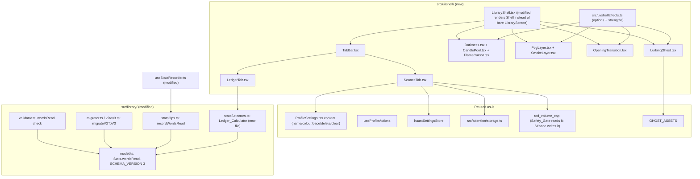

# Design Document

## Overview

Haunted-shell replaces the gear-icon settings dialog and the plain library header with a three-tab Shell (Library, The Ledger, The Séance) that sits in near-darkness lit by a pointer-following candle. It adds one field to the Data_Model (`wordsRead`) so the Ledger can show a reader's measured pace, and it reuses almost everything else: the existing `ProfileSettings` logic, the haunt settings store, the camera-choice storage, `rod_volume_cap`, and the bundled ghost images.

The work splits cleanly into two risk tiers:

- **Numeric/data logic** (Ledger_Calculator, the `wordsRead` migration): wrong output here is silently wrong forever, because it feeds decisions ("read a bit longer") and because migration bugs can corrupt or lose a reader's saved history. This gets property-based tests.
- **Visual/interaction logic** (Tab_Bar, Candle_Pool, Fog_Layer, Cover_Effect, Opening_Transition, Lurking_Ghost): these are DOM/CSS/animation concerns. A bug here is visible immediately and costs nothing to fix; property tests would mostly assert "a number is a number" about timing constants. Per the workspace testing rule, this is handled with a few example tests and, for the parts the requirements explicitly forbid testing (12.6), no tests at all.

A later browser check asked for a darker room and new default looks: a flame cursor instead of the round candle pool, rising smoke instead of faint fog, a burn-away of the chosen cover on open, and a bigger lurking ghost with a `?demo=1` switch. All visual choices move into one options file, `src/ui/shellEffects.ts`, so each new look can be switched back to the earlier one ('pool', 'fog', 'fade') by changing one value. See "Visual revision" below. This revision is implemented as task 11, which runs before tasks 5 to 7.

A final revision (Requirements 19 to 22, tasks 13 to 17) widens the Shell tabs to a desktop width, rebuilds the Ledger as a card dashboard over the same calculations, caps the away seconds recorded per look-away at 120 s, and replaces the drawn ghost in the reading haunts with the bundled images (also shrinking the lurking ghost to about 22 vh). See "Layout, dashboard, away cap and one ghost" below. Conflicts found while writing it are listed in that section.

Given the two-day budget, the shell's visual layer is designed as thin, independent CSS/React pieces layered over the existing `LibraryScreen`/`ProfileSettings` content, not as a rewrite of library-v2.

## Architecture



### Why a new `src/ui/shell/` folder

`LibraryScreen.tsx` is already near the 200-line component limit once the Darkness/Candle/Fog/Ghost layers and the Tab_Bar are added. Rather than growing it, the Shell introduces a thin wrapper (`ShellFrame.tsx`) that owns the darkroom chrome and tab state, and renders the *existing* `LibraryScreen` unchanged inside the Library_Tab. `ProfileSettings`' internal JSX is reused by lifting it: the Séance tab imports the same subcomponents (`ClearDataConfirm`, `Avatar`, `COLOUR_NAMES`) and the same `useProfileActions`/`useClearData` hooks that `ProfileSettings.tsx` already uses, so no settings logic is duplicated. The existing `ProfileSettings.tsx` dialog and its gear-icon trigger in `LibraryScreen.tsx` are deleted (Requirement 2.1).

### Data flow for Words_Read

`useStatsRecorder.ts` already computes nothing about word count; it forwards a `StatEvent` to `recordEvent` (`statsOps.ts`) for both the book's Stats and the day's Stats. The one call site that fires on `Paragraph_Recorded` (the `paragraphs` event) is extended to also carry a word count, computed by the existing `countWords` (`src/reader/paceCalc.ts`) from the paragraph text already in scope in `ReaderView`/`useReader`. No paragraph text is added to the `StatEvent` type — only the number — preserving Requirement 11.5 and the product rule that book text never enters the Data_Model.

## Components and Interfaces

### 1. Tab_Bar (`src/ui/shell/TabBar.tsx`, `ShellFrame.tsx`)

```ts
export type ShellTabName = 'library' | 'ledger' | 'seance';
export const SHELL_TAB_NAMES: readonly ShellTabName[] = ['library', 'ledger', 'seance'];
const TAB_STORAGE_KEY = 'rod_shell_tab'; // mirrors rod_attention_choice-style guarded read/write

export interface TabBarProps {
  active: ShellTabName;
  onChange: (tab: ShellTabName) => void;
}
```

`TabBar` is a plain ARIA tabs widget (roles `tablist`/`tab`/`tabpanel`, roving `tabindex`, Left/Right/Home/End) with no haunt-specific logic — a UI-wiring component, tested with example tests per Requirement 12.3. `ShellFrame` owns the `ShellTabName` state, reads/writes `rod_shell_tab` through a guarded `try { localStorage... } catch` pair exactly like `src/attention/storage.ts`'s `loadChoice`/`saveChoice`, and falls back silently to `'library'` on any failure (Requirement 1.10, 1.11). `ShellFrame` renders the Darkness/Candle/Fog layers and the active tab's panel; it hides itself entirely (no Tab_Bar, no Darkness, no Fog) while `bookId` is set in `LibraryShell`, satisfying Requirement 1.13 and 10.1.

### 2. Séance tab (`src/ui/shell/SeanceTab.tsx`)

Composed from existing pieces, not reimplemented:

- Name, candle colour, pace guide, delete profile, clear data: renders the same JSX fragments as today's `ProfileSettings.tsx` (name input, `CANDLE_COLOURS` radio group with `Avatar`/`COLOUR_NAMES`, pace-guide checkbox, `ClearDataConfirm`), wired to the same `useProfileActions(lib.updateModel)` and `lib.clearAllData`. `ProfileSettings.tsx` stops being a modal dialog — its content moves into `SeanceTab`, and the file is deleted; `useFocusTrap` is dropped since the Séance is a tab panel, not a dialog (a confirmation sub-view inside the tab still needs the existing focus-to-first-control-on-open and Escape-to-cancel behaviour, which is kept as-is, per Requirement 2.18).
- Haunt_Mode: a 3-option radio group bound to `useHauntSettings()` from `src/ui/useHauntSettings.ts`, calling `update({ mode })`. No new store.
- Camera choice: two radio-style buttons reading `loadChoice()`/writing `saveChoice()` from `src/attention/storage.ts`. `SeanceTab` imports only `CameraChoice`, `loadChoice`, `saveChoice` — no camera, detector, or video module (Requirement 2.22).
- Volume_Cap: a `<input type="range" step="5">` 0-100, converted to 0-1 on write. This is the **one new piece of storage-writing code** in the Shell:

```ts
// src/ui/shell/volumeCap.ts — new, pure except for the two guarded storage calls
import { DEFAULT_VOLUME_CAP } from '../../haunts/engine/gate/plan'; // reuse the 0.4 default + parse rule
export const VOLUME_CAP_KEY = 'rod_volume_cap';
export function loadVolumeCapPercent(read: (k: string) => string | null = safeGet): number {
  const n = parseVolumeCap(read(VOLUME_CAP_KEY)); // reuse engine's own parser, not a second one
  return Math.round(n * 100);
}
export function saveVolumeCapPercent(percent: number, write: (k: string, v: string) => void = safeSet): boolean { ... }
```

  `parseVolumeCap` and `DEFAULT_VOLUME_CAP` are imported from `src/haunts/engine/gate/plan.ts` (already exported) so the Séance's "missing/unreadable → 40%" fallback (Requirement 2.11) is guaranteed to agree with what the Safety_Gate itself falls back to — one parser, two call sites, no drift. `SeanceTab` only ever reads and writes the string; it performs no volume scaling itself (Requirement 2.12), and no file under `src/haunts/engine/` is touched (Requirement 2.19).
- "Clear my data": after `lib.clearAllData()` resolves true, `SeanceTab`'s caller (`ShellFrame`) also removes `rod_daily_goal`, `rod_shell_tab`, and `rod_volume_cap` via the same guarded-write helper (Requirement 2.14). `useClearData` itself is not touched — it owns only the Data_Store-backed keys — so this clean-up lives in the Shell, next to the other Shell-local storage keys.

### 3. Ledger tab (`src/ui/shell/LedgerTab.tsx` + `src/library/ledgerCalculator.ts`)

`ledgerCalculator.ts` is the pure, DOM-free module (Requirement 8.17) that `LedgerTab.tsx` calls into. It takes the already-loaded `DataModel` and a `today: string` (never reads the clock itself, Requirement 8.16):

```ts
// src/library/ledgerCalculator.ts
import { overallStats, ZERO_STATS } from './statsOps';
import { statsForDate, statsForLastDays, type DayStats } from './statsSelectors';
import type { DataModel, Stats } from './model';

export type MoonPhase = 'new' | 'crescent' | 'half' | 'gibbous' | 'full';
export const PACE_THRESHOLD_SECONDS = 120;
export const DEFAULT_DAILY_GOAL_MINUTES = 15;
export const MIN_DAILY_GOAL_MINUTES = 1;
export const MAX_DAILY_GOAL_MINUTES = 240;

function safeAmount(n: unknown): number {
  return typeof n === 'number' && Number.isFinite(n) && n >= 0 ? n : 0; // 8.18
}

/** Undefined when active+away seconds sum to 0 (8.3). */
export function focusScore(activeSeconds: number, awaySeconds: number): number | undefined {
  const a = safeAmount(activeSeconds), w = safeAmount(awaySeconds);
  const sum = a + w;
  if (sum === 0) return undefined;
  return Math.round((a / sum) * 100);
}

/** Sums seconds across the given days first, then divides (8.4) — not an average of daily scores. */
export function sevenDayFocusScore(days: readonly DayStats[]): number | undefined {
  const a = days.reduce((t, d) => t + safeAmount(d.stats.activeReadingSeconds), 0);
  const w = days.reduce((t, d) => t + safeAmount(d.stats.awaySeconds), 0);
  return focusScore(a, w);
}

export function moonPhase(activeSeconds: number, dailyGoalMinutes: number): MoonPhase {
  const a = safeAmount(activeSeconds);
  const goalSeconds = Math.max(1, dailyGoalMinutes) * 60;
  if (a <= 0) return 'new';
  const pct = (a / goalSeconds) * 100;
  if (pct < 50) return 'crescent';
  if (pct < 75) return 'half';
  if (pct < 100) return 'gibbous';
  return 'full';
}

/** 0-100, rounded and capped (8.9). */
export function goalProgress(todayActiveSeconds: number, dailyGoalMinutes: number): number {
  const pct = (safeAmount(todayActiveSeconds) / (Math.max(1, dailyGoalMinutes) * 60)) * 100;
  return Math.min(100, Math.max(0, Math.round(pct)));
}

export interface PaceInput { wordsRead: number; activeReadingSeconds: number }

/** undefined when there are no Pace_Days, below threshold, or rounds to 0 (8.13). */
export function measuredPace(days: readonly PaceInput[]): number | undefined {
  const paceDays = days.filter((d) => safeAmount(d.wordsRead) > 0);
  const activeSum = paceDays.reduce((t, d) => t + safeAmount(d.activeReadingSeconds), 0);
  if (activeSum < PACE_THRESHOLD_SECONDS) return undefined;
  const wordsSum = paceDays.reduce((t, d) => t + safeAmount(d.wordsRead), 0);
  const wpm = Math.round(wordsSum / (activeSum / 60));
  return wpm >= 1 ? wpm : undefined;
}

export function clampDailyGoalMinutes(n: number): number {
  if (!Number.isFinite(n)) return DEFAULT_DAILY_GOAL_MINUTES;
  return Math.min(MAX_DAILY_GOAL_MINUTES, Math.max(MIN_DAILY_GOAL_MINUTES, Math.round(n)));
}
```

Books finished/in-progress (8.14) and paragraphs/chapters read (8.15) are computed directly in `LedgerTab.tsx` (or a tiny `bookCounts()` helper) from `model.shelves`/`model.books` and the existing `overallStats(model)` — thin wrappers, covered by example tests, not duplicated as a "property" per the prework above.

`LedgerTab.tsx` itself (rendering Candle_Gauge, Tally_Marks, Moon_Phase strip, the Daily_Goal field, the pace sentence) is UI wiring over these pure functions — example-tested per Requirement 12.4, not property-tested.

### 4. Words_Read in the data model

`model.ts`:

```ts
export const SCHEMA_VERSION = 3 as const;
export interface Stats {
  paragraphsRead: number;
  chaptersFinished: number;
  activeReadingSeconds: number;
  lookAwayCount: number;
  sessionCount: number;
  awaySeconds: number;
  wordsRead: number; // new
}
export const STATS_FIELDS = [
  'paragraphsRead', 'chaptersFinished', 'activeReadingSeconds',
  'lookAwayCount', 'sessionCount', 'awaySeconds', 'wordsRead',
] as const;
```

`statsOps.ts`: `ZERO_STATS` gains `wordsRead: 0` (Requirement 11.12); a new pure op:

```ts
export function recordWordsRead(stats: Stats, words: number): Stats {
  return isAmount(words) ? { ...stats, wordsRead: stats.wordsRead + words } : stats;
}
export type StatEvent =
  | { kind: 'paragraphs'; count: number; words: number } // words added, count unchanged in shape
  | ... // unchanged variants
```

`applyEvent`'s `'paragraphs'` branch calls both `recordParagraphsRead` and `recordWordsRead` so one `StatEvent` updates both fields atomically (Requirement 11.2's "in the same change").

`useStatsRecorder.ts`'s paragraph-open effect changes from `record(inputRef.current, { kind: 'paragraphs', count: 1 })` to `record(inputRef.current, { kind: 'paragraphs', count: 1, words: countWords(paragraphText) })`, where `paragraphText` is threaded through `StatsInput` (today it already knows `chapterIndex`/`paragraphIndex`; `ReaderView.tsx` already has the active paragraph's text via `r.paragraphs[r.paragraphIndex]`, so one more field is added to the `StatsInput` object built in `ReaderView.tsx`). No other file needs to import `countWords` for this purpose; `recordWordsRead`/`StatEvent` never see paragraph text, only the number (Requirement 11.5).

**Migration** (`migrator.ts`, new `migrateV2ToV3.ts` in the same folder, or an added function in `migrator.ts` — reusing the existing `migrateWithReport`/`migrate` naming):

```ts
// src/library/schemaV3.ts (new, small, pure)
export function addWordsRead(stats: Stats | (Omit<Stats, 'wordsRead'> & { wordsRead?: number })): Stats {
  return { ...stats, wordsRead: typeof stats.wordsRead === 'number' ? stats.wordsRead : 0 };
}
/** v2 -> v3: every per-book and per-day Stats gets wordsRead (default 0); everything else untouched. */
export function migrateV2ToV3(model: DataModel /* v2 or v3 shape at the type level widened to unknown fields */): DataModel {
  if (model.schemaVersion >= 3) return model; // idempotent (11.7)
  return {
    ...model,
    schemaVersion: 3,
    stats: mapValues(model.stats, addWordsRead),
    daily: mapValues(model.daily, addWordsRead),
  };
}
```

`localStore.ts`'s `load()` gains one step: after `validate(data)` normally runs against `SCHEMA_VERSION` (now 3), a Data_Model read with `schemaVersion === 2` is passed through `migrateV2ToV3` *before* `validate()`, so the Validator only ever sees Schema_Version 3 shapes (Requirement 11.10). `hasNewerVersion` already guards anything above `SCHEMA_VERSION`, so schema 4+ keeps today's behaviour unchanged (11.13). The legacy v1 path (`migrateWithReport` in `migrator.ts`) is updated so the one `Stats` record it constructs includes `wordsRead: 0` directly (Requirement 11.8) — no separate migration step needed since that code builds a fresh Stats object either way.

`validator.ts`: `STATS_FIELDS` already drives the generic per-field "non-negative whole number" check in `checkDaily`/`checkStats`; adding `'wordsRead'` to `STATS_FIELDS` and to `Stats` is sufficient — no new validation code, only the new field name flowing through existing loops (Requirement 11.9).

## Visual revision (Requirements 13 to 18)

### 5. Effect options (`src/ui/shellEffects.ts`)

One file holds every visual choice. Effect components import from it and nothing else holds these values.

```ts
export type CursorLight = 'flame' | 'pool';
export type Ambient = 'smoke' | 'fog';
export type BookOpen = 'burn' | 'fade';

export interface EffectStrengths {
  imageBrightness: number;      // 0.40 (allowed 0.35-0.45)
  imageSaturation: number;      // 0.40
  backgroundBrightness: number; // 0.40
  vignette: number;             // 0.6 edge darkness
  lightRadiusPx: number;        // 280 (pool) and the cap for the flame glow
  flameGlowRadiusPx: number;    // 220
  flameGlowMaxAlpha: number;    // 0.16, measured below
  flameFlickerMaxHz: number;    // 2.5, under the 3 per second limit
  smokeMaxAlpha: number;        // 0.10, measured below
  smokeRiseSeconds: number;     // 20, at least 15
  burnMs: number;               // 1200
  burnMaxSparks: number;        // 12
  ghostHeightVh: number;        // 22, allowed 20-24 (was 32; Requirement 18.1, 22.9)
  ghostVisibleFraction: number; // 0.6, at most 0.7
  peekDelaySeconds: readonly [number, number];     // [45, 90]
  demoFirstPeekDelaySeconds: number;               // 3, first Peek after page load in Demo_Mode
  demoPeekDelaySeconds: readonly [number, number]; // [4, 6], later Peeks in Demo_Mode
}

export interface ShellEffects {
  cursorLight: CursorLight; ambient: Ambient; bookOpen: BookOpen; strengths: EffectStrengths;
}

export const DEFAULT_EFFECTS: ShellEffects = {
  cursorLight: 'flame', ambient: 'smoke', bookOpen: 'burn', strengths: { /* values above */ } as EffectStrengths,
};
export const shellEffects: ShellEffects = DEFAULT_EFFECTS; // the one place to edit

/** Pure. Unlisted option names resolve to the default for that option (13.7). */
export function resolveEffects(raw: Partial<Record<'cursorLight' | 'ambient' | 'bookOpen', unknown>>): ShellEffects;
```

Each effect component takes an optional `effects: ShellEffects` prop that defaults to `shellEffects`, so tests can pass 'pool', 'fog' or 'fade' without editing the file. `ShellFrame` picks `CandlePool` or `FlameCursor`, `FogLayer` or `SmokeLayer`, and `OpeningTransition` picks the burn or the plain fade, from these options. The Candle_Pool, Fog_Layer and plain fade stay exactly as built in tasks 3.1 and 3.3.

### 6. Darkness, Vignette and lit covers (Requirement 14)

`Darkness.tsx` stays a fixed layer behind all content, and gains the Vignette (a radial gradient from clear in the centre to dark at the edges) and a background brightness set from `backgroundBrightness`. The covers are dimmed by a new `LitCover` wrapper used by Cover_Card:

- Base image: CSS `filter: brightness(imageBrightness) saturate(imageSaturation)`.
- Lit image: the same image again on top, full colour, with a `mask-image` radial gradient centred on the Light_Anchor translated into the card's own coordinates. Only the covers inside the viewport are updated, once per animation frame, so cost stays small.
- Title and author text are siblings of the image layers and are never filtered, so text colour and opacity do not change. Text contrast is checked against the darker background, which can only raise it.

The reading page does not mount any of this.

### 7. Flame cursor (Requirement 15)

`FlameCursor.tsx` draws a small canvas (about 40 by 56 px, no dependency) at the Light_Anchor: layered teardrop gradients from reddish-orange to pale amber. `pointer-events: none`, and the system pointer is left visible. The Flame_Glow is a CSS radial gradient (red-amber, `flameGlowRadiusPx`, centre alpha at most `flameGlowMaxAlpha`) on the same layer as the Candle_Pool today, and the same mask feeds the lit covers.

- Flicker: the flame shape wobbles with a smoothed noise value. Glow brightness follows a value that is resampled at most `flameFlickerMaxHz` times per second and eased between samples, so brightness changes stay under 3 per second.
- Keyboard focus: the glow moves to the focused element's centre and the flame is not drawn there. Touch: flame and glow go to the touch point until the next pointer, touch or focus event.
- Reduced motion: still flame, steady glow at a fixed alpha, no animation loop.
- 'pool': `CandlePool` is used unchanged.

### 8. Smoke layer (Requirement 16)

`SmokeLayer.tsx` draws a small number of soft wisps (canvas or CSS gradients, no dependency) that drift upward from the bottom, each taking `smokeRiseSeconds` or longer, fading in and out along the path. It sits behind content with `pointer-events: none`, no focus, at peak alpha `smokeMaxAlpha`. It pauses on `visibilitychange` hidden. Under reduced motion it renders one still haze gradient. `FogLayer` is unchanged and used when `ambient` is 'fog'.

### 9. Burn on open (Requirement 17)

`BurnOverlay.tsx` is rendered by `OpeningTransition` before the existing sequence when `bookOpen` is 'burn' and reduced motion is off.

- The clicked cover's rectangle and image are passed in from the click. The overlay draws that image on a canvas at the same rectangle, and hides the real card for the duration.
- Burn effect: a low-resolution value-noise grid generated in code (no dependency) is scaled up. Each frame has a threshold that rises from 0 to 1 over `burnMs`, starting at the card edges (noise plus distance from the edge). Pixels below the threshold are erased. Pixels within a thin band above it are painted as a glowing orange ember rim. At most `burnMaxSparks` small sparks rise from the rim.
- Brightness: the rim has a steady glow that ramps up and down once, so there is no flicker above 3 per second, and everything is local to the cover, with no full-screen red.
- Timing: the book text starts loading at the click, in parallel. When the burn ends (`burnMs`, about 1200 ms), the existing gutter, dim and fade-up plays unchanged. The total limit is about 1200 + 1500 = 2700 ms when the book is ready by the end of the dim. If the book is still loading, the screen holds dark under the existing rule, so the extra wait is the load time only.
- Skip: a key press, click or touch calls the same `end()` the existing transition uses, which ends the burn and the whole transition. Reduced motion skips the burn and plays the single fade of at most 300 ms. 'fade' skips the burn. A failed open or a draw error also skips it.
- The overlay uses `pointer-events: none` and listens on `window`, as the existing transition does, so input reaches the page beneath.

### 10. Lurking ghost size and demo switch (Requirement 18)

Pure helpers in a new `src/ui/shell/ghostPlacement.ts`, so they can be example-tested:

```ts
/** True when the query string contains demo=1. */
export function isDemoMode(search: string): boolean;
/** Peek delay in ms, given rand in [0,1). Normal: 45-90 s for every Peek. Demo: exactly 3 s when
 *  isFirst is true (first Peek after page load), otherwise 4-6 s. */
export function nextPeekDelayMs(rand: number, demo: boolean, isFirst: boolean, fx?: ShellEffects): number;
/** Ghost box for an edge slot: height ghostHeightVh of the viewport, width from the image aspect ratio,
 *  pushed past the edge so that ghostVisibleFraction of it is inside the viewport. */
export function slotRect(edge: Edge, offset: number, viewport: Size, aspect: number, fx?: ShellEffects): Rect;
/** Part of the ghost inside the viewport; the part behind the edge is ignored (18.3, 7.5). */
export function visiblePart(rect: Rect, viewport: Size): Rect;
/** First slot whose visiblePart overlaps no Control rect, or undefined (the Peek is then skipped). */
export function pickSlot(controls: readonly Rect[], viewport: Size, aspect: number, rand: number, fx?: ShellEffects): Rect | undefined;
```

`LurkingGhost` reads `window.location.search` once on mount for `isDemoMode`, and uses `nextPeekDelayMs` for every delay, passing `isFirst` true only for the first Peek after the page loads (so a return to the Library tab later uses the 4 to 6 second range). Demo mode changes nothing else: Gentle, reduced motion, other tabs, hidden document, no-free-slot skip and the pointer vanish all behave as before. Nothing is stored. A bigger ghost still never covers a Control because only the inside-viewport part is tested against each Control's bounding box, several slots per edge are tried, and the Peek is skipped when none is free. In a narrow viewport a 22 vh ghost may find no free slot, and then the skip rule applies.

## Layout, dashboard, away cap and one ghost (Requirements 19 to 22)

### 11. Shell width (Requirement 19)

Today `LedgerTab.css` and `SeanceTab.css` cap their content at `max-width: 40rem`, while `LibraryScreen.css` already uses `75rem` and `TabBar.css` is full width. That mismatch is the narrow column seen on a desktop. The fix is one shared rule in `ShellFrame.css`, with the width and the padding named once:

```css
.shell-frame { --shell-max-width: 75rem; --shell-pad: clamp(1rem, 4vw, 2.5rem); }
.shell-frame__inner { box-sizing: border-box; width: 100%; max-width: var(--shell-max-width); margin-inline: auto; padding-inline: var(--shell-pad); }
```

`TabBar` and each tab panel content wrap in `shell-frame__inner` (or use the same two custom properties). `.ledger` and `.settings` drop their own `max-width` and horizontal padding. `LibraryScreen.css` keeps its `75rem` but reads `--shell-max-width`, so there is one source. The Séance grid is one column below 1024 px and two columns from 1024 px (`grid-template-columns: repeat(2, minmax(0, 1fr))`), with Profile and Haunt mode in the first column and Camera, Volume and the data buttons in the second (DOM order unchanged, so keyboard order is unchanged). `overflow-wrap: anywhere` stays on the panels. The reading page does not use `ShellFrame` and is untouched.

Verification is by hand at 1440, 1024, 768, 390 and 360 px (no horizontal scroll, no overlap). No test is written for it, because it is layout only (Requirement 12.16).

### 12. Ledger dashboard (Requirement 20)

The data flow in `LedgerTab.tsx` does not change: the same `statsForDate`, `statsForLastDays`, `overallStats`, `bookCounts`, `focusScore`, `sevenDayFocusScore`, `measuredPace`, `moonPhase`, `goalProgress`. Only the rendering is regrouped into `Dashboard_Card` sections, each a `<section aria-labelledby>` with an `h3`, so the existing role and text queries keep working. The existing `ledger-section` class becomes the card class (`ledger-card`).

```
LedgerTab (grid)
  Row 1 (3 cards)   FocusCard | PaceCard | GoalCard
  Row 2             LookAwayCard   (7 columns)
  Row 3             MoonCard       (30 moons, one row, two on phones)
  Row 4             ReadingCard    (4 Stat_Tiles)
  Foot note         FOCUS_STATEMENT
```

Grid: `.ledger__top { display: grid; grid-template-columns: repeat(3, minmax(0, 1fr)); gap: 1.5rem }` at 1024 px and up, two columns from 640 px, one below. Cards: `background: var(--surface); border-radius: 0.5rem; padding: 1.25rem;`. Headings keep Cormorant Garamond. Numbers use `font-variant-numeric: tabular-nums` in the system UI font.

| File | Role | Change |
|---|---|---|
| `LedgerTab.tsx` | Composes the cards, keeps the empty state and skeleton | Regroup only; under 200 lines |
| `CandleGauge.tsx` | Gauge | Larger size prop (about 96 px tall) |
| `PaceSection.tsx` | Pace card | Big figure, `PaceBar`, typical-speeds text, Source note, fallback text |
| `PaceBar.tsx` (new) | Horizontal bar | 0 to 400 wpm scale, markers 238 and 260, reader marker; `role="img"` with a text alternative |
| `GoalSection.tsx` | Daily goal card | Field kept; progress bar replaced by `ProgressRing` |
| `ProgressRing.tsx` (new) | Ring | SVG circle; wrapper keeps `role="progressbar"`, `aria-valuemin/max/now/valuetext` and the "N of M minutes" text |
| `TallyMarks.tsx` | Look-aways card | 7 columns (`grid-template-columns: repeat(7, 1fr)`), weekday label under each, marks above, count as text, today highlighted with a border and the word "Today" for assistive technology |
| `MoonStrip.tsx` | Moon card | Grid with `repeat(30, 1fr)` (one row) from 1024 px and `repeat(15, 1fr)` (two rows) below that; today marked with a ring and a text label; legend of the five phases |
| `StatTiles.tsx` (new) | Reading card | `dl` of four tiles; four columns, two by two below 640 px |
| `LedgerTab.css` | Styling | Cards, grids, tokens only; no hard-coded colours |

Pace_Bar position: `left = clamp(pace, 0, 400) / 400 * 100%`, markers at `238 / 400` and `260 / 400`. The two markers are close (5.5 percent of the width apart), so their labels sit one above and one below the bar. The look-aways card uses the same last 7 days as before.

Contrast: new combinations are text on `--surface` cards over `--darkness`/`--bg` (already measured, so no new ratio), `--accent` ring and bar fills on `--surface` (non-text, 3:1 needed), the ring track in `--text-dim` on `--surface` (3:1 for non-text), and the today highlight border in `--accent`. The text labels on them use `--text` and `--text-dim`, whose ratios against `--surface` are 12.86 and 5.49. Task 14 measures every new pair with the shared contrast module, adds them to `themeContrast.unit.test.ts`, and records the numbers in `docs/BUILD_LOG.md`.

Reduced motion: nothing in the dashboard animates, so no override is needed beyond keeping it that way.

### 13. Away cap (Requirement 21)

Where away seconds are recorded: `useStatsRecorder.ts` feeds `changeTimer`/`tickTimer` (`src/library/statsTimer.ts`), which return whole `away` seconds that `recordStep` sends to `statsOps` as `{ kind: 'away', seconds }`. The cap belongs in the pure timer because it is the only place that knows when one look-away starts and ends. `statsOps`, the Data_Model and the Schema_Version do not change.

```ts
export const AWAY_CAP_SECONDS = 120;

export interface TimerState {
  readonly value: TimerValue | null;
  readonly at: number;
  readonly rest: number;
  /** Whole away seconds already recorded for the current look-away (0 to 120). */
  readonly awayCredited: number;
}
export const IDLE_TIMER: TimerState = { value: null, at: 0, rest: 0, awayCredited: 0 };
```

- `tickTimer` while `away`: `seconds = floor(total / 1000)` as now, then `credit = min(seconds, AWAY_CAP_SECONDS - awayCredited)`, `away = credit`, `awayCredited += credit`. The remainder in `rest` is kept as now, so time is not lost or double counted below the cap; once the cap is reached, further seconds are consumed and not recorded.
- `changeTimer` to `away` from any other value resets `awayCredited` to 0 (a new look-away). `away` to `away` keeps it. `away` to `present` or `null` resets it to 0.
- `useStatsRecorder.ts` needs no change: it already spreads the timer state returned by each step. The 5-second flush, signal changes and close all go through the same two functions, so the cap holds however the time is split.
- `lookAway` is still 1 on each present to away change, so a Break_Period still counts as one look-away.

Property 9 (below) tests this directly on `statsTimer.ts`. Break prompts: the app has no break prompt or break state in code yet (a search for break state found none), so there is nothing to wire; library-v2 criteria 13 and 14 (no away seconds during a reader-started break) stay as the rule for when a break feature is built. The cap is consistent with haunt-safety: it can only record less away time, never more, and leaving the screen for a break is never counted as a breach.

Saved data: values already saved are untouched (no migration, no change to `schemaV3.ts`). The Ledger_Calculator is unchanged. Old long absences stay in old days; only new time is capped.

### 14. One ghost (Requirement 22)

What draws a ghost today:

| Where | What | Change |
|---|---|---|
| `src/haunts/ghostFigure.ts` | `ghostArt(step).markup` into a layer and into the return overlay | Image_Layer with `ghost-standing.png` |
| `src/haunts/jumpscare.ts` | `ghostArt(4).markup` into a jumpscare overlay | Image_Layer with `ghost-face.png` (Nightmare) or `ghost-standing.png` (Classic) |
| `src/haunts/engine/ghost/ghostArt.ts` | Sheet-and-hood SVG, `ghostBox` fitting | Drawing code removed; `ghostBox` fitting kept and reused for the image |
| `src/ui/shell/LurkingGhost.tsx` | Already the PNGs via `assetUrl` | Smaller only (`ghostHeightVh` 32 to 22) |
| `whispers.ts` | Text markup, not a ghost | Unchanged |

Files checked: `public/ghosts/ghost-standing.png` and `ghost-face.png` exist (1376 by 768, RGBA with a transparent background, listed in the README as the project's own work). `GHOST_ASSETS` lists exactly these two names and `assetUrl('ghost', name)` returns `/ghosts/<name>`, a same-origin URL beginning with `/ghosts/`, as ghost-dread Requirement 14 asks. Visible parts (alpha bounding boxes): `ghost-standing.png` 667 by 649 px (starting at 359, 64), `ghost-face.png` 1269 by 768 px (starting at 66, 0). The Image_Layer fits the visible part, not the whole file, so the empty margins do not shrink the ghost.

Image_Layer in the gate. The gate parses SVG markup through `parseSvgMarkup`, which allows only an allowlist of SVG elements and rejects external references, so an `<image>` cannot be passed as markup. Rather than loosen that sanitiser, add to `VisualLayer`:

```ts
/** Shows one bundled Ghost_Image. The gate resolves the URL; haunts pass only an allowlisted name. */
setImage(name: GhostAssetName, fit: ImageFit): void;
interface ImageFit { visible: { x: number; y: number; w: number; h: number }; /* alpha bbox in image px */ }
```

The gate builds an `` (or an SVG `<image>`) whose `src` comes only from `assetUrl('ghost', name)`; a name that is not in `GHOST_ASSETS` makes no request. The `` uses `alt=""` with the label set on the layer container as today, `decoding="async"`, no `crossorigin` and no query. The same layer already owns opacity fades, reduced-motion minimums, region confinement, and the flash budget, so every haunt-safety limit stays in one place (Requirement 22.6). Scale and position come from a pure function in a new `src/haunts/engine/ghost/imageFit.ts`:

```ts
/** Rendered size of the visible part inside a region; aspect kept; never larger than the region;
 *  strictly larger for a higher step (while the region allows). null when the region is under 48 px wide. */
export function imageBox(step: number, visible: {w: number; h: number}, region: {width: number; height: number}): {width: number; height: number} | null;
```

It reuses the sanitising and the `MIN_GHOST_BOX_WIDTH` rule of `ghostBox`. The height fractions per step grow like `GHOST_HEIGHT_UNITS`, so the Ghost_Distance still reads as nearer. Unsafe sizes count as 0, as in `ghostBox`.

Load failure: the `` `error` event removes the picture and the layer stays empty. There is no cartoon fallback (Requirement 22.4); the sound haunts and the candle dim still carry the haunt.

Jumpscare: the close-up uses the Image_Layer in the existing overlay with the existing rush timing, fast attack and reduced-motion fade (1000 ms or more, no scale change) from `returnRules.ts`; nothing about those limits changes. The Red_Coverage of `ghost-face.png`, whose eyes are saturated red (see the image), is measured once (task 16) at the largest rendered scale: the red-eye pixels divided by the viewport area must be at most 15 percent, which the eyes, a small part of the picture, should meet by a wide margin; the number is recorded in `docs/BUILD_LOG.md`. If it ever failed, the Nightmare close-up would use `ghost-standing.png` at a smaller scale.

Removing the drawn ghost: `ghostArt()`, its detail drawings and their unit/property tests are removed because the code they test is gone; this is deletion with the code, not weakening a test. The `ghostBox` region-fitting logic and its tests stay. Haunts that import `ghostArt` are updated. `staticScan.unit.test.ts` (checks haunt files for banned patterns) stays and must keep passing.

Superseded ghost-dread text (the spec files are not edited): Requirement 9 criterion 1 ("original silhouette ... using SVG or canvas"), criterion 7 ("SHALL load no image file"), Requirement 11 criterion 9 ("close-up drawn in code") and the Ghost glossary entry. Requirement 15 of ghost-dread already describes images and is the closer match; this spec uses only its Image_Layer, scale-by-step, Reduced_Motion and Red_Coverage parts. The Smoke_Entrance and Rim_Glow of ghost-dread Requirement 15 criteria 12 to 18 are not part of this change.

Lurking ghost size: `ghostHeightVh` goes from 32 to 22 in `src/ui/shellEffects.ts`. `slotRect` already derives the height from this value, and a smaller ghost makes a free slot easier to find. The existing `ghostPlacement` example tests that mention a height are updated to the new value in the same task.

### Conflicts found and resolved

| Conflict | Resolution |
|---|---|
| Req "out of scope: haunt engine, Safety_Gate" vs the ghost image change | Requirement 22 is the one allowed change: it adds an Image_Layer to the gate and changes what two haunts draw; no limit changes |
| Req 10.1 "reading page unchanged" vs reading haunts drawing a different ghost | 10.1 now names the ghost image of Requirement 22 as the only change |
| ghost-dread "no image file / SVG or canvas" vs the bundled images (and vs ghost-dread Requirement 15) | Requirement 22 supersedes it for the figure and the close-up; ghost-dread files untouched |
| ghost-dread 15.19 "fall back to the SVG Ghost" vs "one ghost everywhere" | No picture on load failure (22.4) |
| library-v2 "away seconds are all whole seconds away" vs the cap | Requirement 21 supersedes it for newly recorded time only |
| library-v2 criteria 13 and 14 (break) vs the cap | Both stay; the cap only records less |
| Req 9 criteria 3, 14, 22 (list, progress bar) vs the dashboard | Requirement 20 applies where they describe the same layout (9.23) |
| "Mon to Sun" labels vs "last 7 days" | The columns are the same last 7 days, oldest first, each labelled with its own weekday, today last and highlighted; a fixed Monday-to-Sunday week would change the data window, so it is not used |
| Req 12.6 "no tests for pure visuals" vs example tests for D | The haunts using images is behaviour, not look, so tested (12.15) |
| Req 12.1/12.2 allowed property tests only for the Ledger and migration vs the away cap | Requirement 12.13 allows the one extra property test |
| Req 18.1 height 30 to 35 percent | Changed to 20 to 24 percent |
| Existing design snippets for `ghostHeightVh` (32) | Updated to 22 |

## Data Models

```ts
// Delta from library-v2's model.ts
export const SCHEMA_VERSION = 3 as const; // was 2

export interface Stats {
  paragraphsRead: number;
  chaptersFinished: number;
  activeReadingSeconds: number;
  lookAwayCount: number;
  sessionCount: number;
  awaySeconds: number;
  wordsRead: number; // new, non-negative whole number
}
```

New Shell-local localStorage keys (none inside the Data_Model/Data_Store; all read/written the way `rod_attention_choice` already is — guarded `try/catch`, never thrown):

| Key | Shape | Owner | Default when missing/invalid |
|---|---|---|---|
| `rod_shell_tab` | `'library' \| 'ledger' \| 'seance'` | `ShellFrame.tsx` | `'library'` |
| `rod_daily_goal` | integer string, 1-240 | `LedgerTab.tsx` | `15` |
| `rod_volume_cap` | decimal string, 0-1 | `SeanceTab.tsx` writes; `Safety_Gate` (existing) reads | `0.4` (existing `DEFAULT_VOLUME_CAP`) |

`rod_haunt_mode` and `rod_attention_choice` are read and written only through the existing `hauntSettingsStore`/`src/attention/storage.ts` — the Shell never writes them through a second path.

## Correctness Properties

*A property is a characteristic or behavior that should hold true across all valid executions of a system — essentially, a formal statement about what the system should do. Properties serve as the bridge between human-readable specifications and machine-verifiable correctness guarantees.*

These properties cover the two areas assessed as high-risk pure logic: the Ledger_Calculator (Requirement 8) and the Words_Read migration (Requirement 11). Tab navigation, settings wiring, candlelight, fog, cover tilt, the opening transition and the lurking ghost are DOM/animation/UI-interaction concerns and are intentionally excluded from property-based testing (see Testing Strategy).

### Property 1: Focus_Score is bounded, and undefined exactly when there is no data

For all non-negative whole numbers `active` and `away`, `focusScore(active, away)` is `undefined` if and only if `active + away === 0`; otherwise it is an integer in `[0, 100]`.

**Validates: Requirements 8.2, 8.3**

### Property 2: Seven-day Focus_Score uses summed seconds, not an average of daily scores

For any list of 7 `DayStats`, `sevenDayFocusScore(days)` equals `focusScore(sum of each day's activeReadingSeconds, sum of each day's awaySeconds)`, and differs in general from the arithmetic mean of each day's individual `focusScore` (demonstrated by at least one generated case where a day with `0` total seconds is mixed with days that have data, where the mean would be undefined/skewed but the sum-based score is defined).

**Validates: Requirements 8.4**

### Property 3: Moon_Phase is always exactly one of five phases and never regresses as reading time rises

For all non-negative `activeSeconds` and all `dailyGoalMinutes` in `[1, 240]`, `moonPhase(activeSeconds, dailyGoalMinutes)` returns one of `'new' | 'crescent' | 'half' | 'gibbous' | 'full'`; and for any two non-negative values `s1 <= s2` with the same `dailyGoalMinutes`, the phase index of `moonPhase(s1, goal)` is less than or equal to the phase index of `moonPhase(s2, goal)` (where the phase order is new < crescent < half < gibbous < full).

**Validates: Requirements 8.6, 8.7**

### Property 4: Goal_Progress is bounded

For all non-negative `activeSeconds` and all `dailyGoalMinutes` in `[1, 240]`, `goalProgress(activeSeconds, dailyGoalMinutes)` is an integer in `[0, 100]`.

**Validates: Requirements 8.9**

### Property 5: Measured_Pace is derived only from Pace_Days, is a positive whole number or absent, and is unaffected by zero-Words_Read days

For any list of per-day pace inputs (non-negative whole `wordsRead` and `activeReadingSeconds`), `measuredPace(days)` is either `undefined` or a whole number `>= 1`; it is `undefined` whenever the summed `activeReadingSeconds` of the days with `wordsRead > 0` is below `PACE_THRESHOLD_SECONDS`; and appending any number of additional days with `wordsRead === 0` (and any `activeReadingSeconds`) to the list never changes the result.

**Validates: Requirements 8.10, 8.11, 8.13**

### Property 6: Recording a paragraph adds exactly its word count to Words_Read and one to paragraphs read

For any paragraph text (including empty/whitespace-only text) and any starting `Stats`, applying the `{ kind: 'paragraphs', count: 1, words: countWords(text) }` event through `applyEvent`/`recordEvent` increases `wordsRead` by exactly `countWords(text)` and `paragraphsRead` by exactly `1`, for both the affected book's `stats` entry and the affected day's `daily` entry, and leaves every other `Stats` field unchanged.

**Validates: Requirements 11.2, 11.3, 11.4**

### Property 7: Migrating a Schema_Version 2 Data_Model produces a Schema_Version 3 Data_Model with Words_Read defaulted to 0 and nothing else changed

For any valid Schema_Version 2 `DataModel`, `migrateV2ToV3(model)` returns a model with `schemaVersion === 3`, where every per-book and per-day `Stats` record equals its Schema_Version 2 counterpart with `wordsRead: 0` added, and every other field (`profile`, `shelves`, `books`, `positions`) is deeply equal to the input's corresponding field.

**Validates: Requirements 11.6**

### Property 8: Migration is idempotent, and an existing Words_Read value is preserved

For any valid Schema_Version 3 `DataModel` (including one where some `Stats` records already carry a nonzero `wordsRead`), `migrateV2ToV3(model)` returns a value deeply equal to its input.

**Validates: Requirements 11.7**

### Property 9: Away seconds recorded per look-away never exceed 120

For any list of tick durations (in ms, including zero and very long ones) and any splitting of one away period into `tickTimer` calls and `changeTimer` calls that keep the value `away`, the sum of `away` seconds returned for that look-away equals `min(floor(total elapsed ms / 1000), 120)` (a look-away of 120 s or less is recorded exactly, a longer one records exactly 120), and never exceeds 120. A new present then away change starts a new look-away with its own cap, and `lookAway` is reported once per such change.

**Validates: Requirements 21.1, 21.2, 21.3, 21.4, 21.5**

## Error Handling

- **Shell-local storage keys** (`rod_shell_tab`, `rod_daily_goal`, `rod_volume_cap`): every read and write is wrapped in its own `try/catch`, mirroring `src/attention/storage.ts`. A read failure or an invalid stored value falls back to the stated default without an error message (Requirements 1.10, 1.11, 2.11, 9.15); a write failure for the Daily_Goal keeps the new value for the session and shows a short, non-alarming message (Requirement 9.16); a write failure for the Tab or the Volume_Cap is silent, consistent with how `saveChoice` already treats camera-choice write failures.
- **Profile saves** (name, candle colour, pace guide): unchanged — `useProfileActions`/`useLibrary`'s existing debounced saver and `MSG.profileSaveFailed` / `role="alert"` message continue to apply verbatim inside the Séance tab (Requirement 2.15).
- **Clear my data**: unchanged `useClearData` contract (all-or-nothing, returns `boolean`); the Shell's own key cleanup (`rod_shell_tab`, `rod_daily_goal`, `rod_volume_cap`) runs only after `useClearData` resolves `true`, so a failed Data_Store clear never leaves the Shell's own keys wiped while book data remains (Requirement 2.14).
- **Migration failure**: `migrateV2ToV3` is a total function over any object shaped like a Schema_Version 2 `DataModel` and cannot throw; if the *input itself* is not validly shaped (e.g. corrupted JSON), that is caught upstream by the existing `localStore.ts` load path exactly as today (`invalid` / `migration_failed` `FailureKind`s), before migration is attempted. No new failure mode is introduced beyond what `localStore.ts` already reports.
- **Validator**: extending `STATS_FIELDS` with `'wordsRead'` means a Schema_Version 3 model missing or misshaping `wordsRead` on any `Stats` record is rejected with a problem string naming that record and field, via the existing generic loop — no new error-handling code path.
- **Burn and effect options**: a draw error in the Burn skips it and plays the existing sequence (Requirement 17.10). A draw error in the Flame_Cursor, Smoke_Layer or lit covers leaves the page with the dimmed look only, and never breaks the tabs. An unlisted option value resolves to its default (Requirement 13.7).
- **Ghost images**: a failed or blocked Ghost_Image load removes the picture and shows no error and no cartoon (Requirement 22.4); a name outside `GHOST_ASSETS` makes no request. A thrown error in the Pace_Bar or Progress_Ring leaves the card text in place, since every number is also text.
- **Shell visual effects** (Darkness, Candle_Pool, Flame_Cursor, Fog_Layer, Smoke_Layer, Cover_Effect, Opening_Transition, Lurking_Ghost): each is wrapped so that a thrown error inside one effect cannot break the Tab_Bar or the active Tab_Panel (Requirement 10.10). Given the project has no dependency for error boundaries beyond React's built-in `ErrorBoundary` class pattern, each effect component is implemented as a self-contained component with a small React error boundary (a local class component, no new dependency) around just that effect, matching the "no new dependency" constraint (Requirement 10.5).

## Testing Strategy

**Property-based tests** (fast-check, `src/library/__tests__/ledgerCalculator.property.test.ts` and `src/library/__tests__/schemaV3.property.test.ts`), each run at least 100 iterations and tagged with its design property:

- Property 1-5 (Ledger_Calculator): generators produce non-negative integers (including 0 and large values) for seconds/words, and integers in `[1, 240]` for `dailyGoalMinutes`; Property 5 and 2 additionally generate arrays of day records of varying length (0-30).
- Property 6 (word-count recording): generators produce arbitrary strings (including `''`, whitespace-only, and multi-paragraph text with punctuation) for the paragraph text, and arbitrary valid `Stats` objects (via `fc.record` over the six pre-existing fields plus `wordsRead`, all non-negative integers) for the starting state.
- Property 7-8 (migration): generators build arbitrary valid Schema_Version 2 / Schema_Version 3 `DataModel` objects (small random sets of books/positions/stats/daily entries built from the existing field constraints in `model.ts`/`validator.ts`), per the project's existing pattern of composing `fc.record`/`fc.dictionary` generators for `DataModel`-shaped data (reused from any existing library-v2 PBT arbitraries if present, otherwise defined once in a shared `src/library/__tests__/arbitraries.ts`).

Each test tag follows the required format, e.g.:
```ts
// Feature: haunted-shell, Property 1: Focus_Score is bounded, and undefined exactly when there is no data
```

**Unit/example tests** (Vitest):

- `TabBar`: ARIA roles/attributes, Right/Left/Home/End with wrap-around, single tab stop, `rod_shell_tab` round-trip across a reload, fallback to Library_Tab for a missing/invalid saved tab (Requirement 12.3).
- `LedgerTab`: the empty-state text and condition (Requirement 9.17), the `role="progressbar"` attributes for Goal_Progress, the Measured_Pace vs. "read a little longer" branch, books-finished/in-progress and paragraphs/chapters-read wrapper functions (8.14, 8.15), `statsForLastDays`-based 30-day list shape (8.5), `clampDailyGoalMinutes` boundary examples (8.19).
- `SeanceTab`: Haunt_Mode radio writes through `useHauntSettings`, camera-choice radio writes through `saveChoice`, Volume_Cap slider writes `rod_volume_cap` as 0-1 and falls back to 40% when unset/invalid, the privacy note text, the "Delete my profile"/"Clear my data" confirmations (reusing `ClearDataConfirm`), the gear icon and dialog no longer present on `LibraryScreen`.
- `useStatsRecorder` (extend the existing `useStatsRecorder.unit.test.ts`): a recorded paragraph updates `wordsRead` by `countWords(text)` once per unique paragraph key per page load, matching the existing `paragraphsRead` dedup test.
- Migration end-to-end: a Schema_Version 2 fixture (object literal, not derived from the property generators) loads through `localStore.ts` without being rejected, keeps its books/shelves/positions/profile/stats, and gains `wordsRead: 0` (Requirements 11.8, 11.10, 11.11, 11.13 regression).
- Validator: accepts a well-formed Schema_Version 3 model; rejects models where some `Stats.wordsRead` is missing, negative, fractional, or non-numeric, naming the offending record/field (Requirement 11.9).
- README: a Sources section containing the `Pace_Source` citation verbatim (Requirement 11.14).
- Contrast: extend `scripts/check-candle-contrast.mjs`'s calculation (or a Vitest test importing the same luminance/ratio functions, lifted into a tiny shared module to avoid duplicating the formula) to check every Shell text colour against `--bg`, `--surface`, and the Darkness colour at 4.5:1 (Requirement 12.5; see the measured table below).

**Example tests added by the visual revision** (behaviour only, Requirements 12.10 to 12.12):

- `shellEffects`: defaults are 'flame', 'smoke', 'burn'; `resolveEffects` with 'pool', 'fog' or 'fade' selects the earlier implementation; an unlisted value falls back to the default.
- `OpeningTransition`: a click and a key press each end the burn at once; reduced motion skips the burn and plays the single fade; `bookOpen` 'fade' plays no burn.
- `ghostPlacement` and `LurkingGhost`: `isDemoMode('?demo=1')` is true and other queries are false; `nextPeekDelayMs` gives exactly 3000 ms for the first Peek in demo, 4000 to 6000 ms for later Peeks in demo, and 45000 to 90000 ms otherwise (in one example test); no Peek is scheduled in Gentle mode or under reduced motion, in demo mode as well; `pickSlot` returns a slot whose visible part overlaps no Control, and returns nothing when every slot overlaps one.
- Contrast: the existing contrast test adds the peak composites of the Flame_Glow and the Smoke_Layer (below).

**Added by Requirements 19 to 22:**

- Property test (Property 9): `src/library/__tests__/statsTimer.awayCap.property.test.ts`, at least 100 runs, using fast-check to split one away period into random ticks and signal repeats. It is the one deliberate property test outside the Ledger and migration scope (Requirement 12.13). Existing `stats.unit.test.ts` timer examples (3 s and 4 s away) stay valid because they are below the cap.
- Example tests: existing Ledger tests change only where they rely on DOM structure (for example reading the progress ring's wrapper instead of the bar); assertions about values and text stay. New examples: 7 look-away columns with today marked and the 20-mark cap with the full count as text; the moon row marks today and keeps a text alternative per day; the Pace_Bar text alternative states the pace and both markers; the fallback pace text still shows; four Stat_Tiles with the same numbers.
- Example tests for the haunts: `ghostFigure` and `jumpscare` call the Image_Layer with the allowlisted names and produce no SVG ghost markup; a failed image load leaves no ghost picture; Gentle draws nothing; `imageBox` stays inside the region and grows with the step. The existing `ghostHaunts` and `staticScan` tests are updated only where they referred to `ghostArt`.
- Measurement, not a test: the layout at 1440, 1024, 768, 390 and 360 px, the new contrast pairs, and the Red_Coverage of `ghost-face.png`, each recorded in `docs/BUILD_LOG.md`.

**Explicitly not tested** (pure visuals, per Requirement 12.6 and the workspace testing rule's proportionality guidance): Candle_Pool shape/movement, Flame_Cursor drawing and flicker, Fog_Layer and Smoke_Layer drawing/drift timing, dimming and Vignette look, Burn look, Cover_Effect tilt/glow/flicker, Opening_Transition visual sequence, Lurking_Ghost appearance/positioning animation. Their *safety* constraints (no sound, `aria-hidden`, Reduced_Motion fallback, `pointer-events: none`) are covered by the existing `ghost-dread`/`haunt-feature` Safety_Gate tests plus a small number of the example tests above where they intersect with ARIA/focus (e.g. Lurking_Ghost's `aria-hidden="true"` could be one assertion in a `LurkingGhost` smoke test, but the animation timing itself is not asserted).

## Measured contrast (Requirement 3.15, 3.16)

Measured with the exact luminance/contrast formula already used by `scripts/check-candle-contrast.mjs` (WCAG relative luminance, `(L1+0.05)/(L2+0.05)`), run in the terminal against the current `src/ui/theme.css` values. No file has been edited; this is a measurement-only step, and the Darkness colour (`#0d0b0a`, see below) does not exist in code yet — it is proposed by this design.

### Current theme colours vs. `--bg` (#14110f) and `--surface` (#1d1916)

| Colour | Hex | vs. `--bg` | vs. `--surface` | Meets 4.5:1? |
|---|---|---|---|---|
| `--text` | `#e8dcc4` | 13.85:1 | 12.86:1 | Yes |
| `--text-dim` | `#8a7f6e` | 4.78:1 | 4.44:1 | vs `--bg` yes; vs `--surface` **no** (4.44 < 4.5) |
| `--accent` | `#e0a64a` | 8.71:1 | 8.08:1 | Yes |
| `--danger` | `#c0564b` | 4.19:1 | 3.89:1 | **No** (below 4.5:1 against both) |

The six Candle_Colours, measured only against `--bg`/`--surface` here because Requirement 3.9 only requires Candle_Colours to clear 4.5:1 *when used for text*; `check-candle-contrast.mjs` already guarantees ≥3:1 against `--surface` for non-text use:

| Candle_Colour | Hex | vs. `--bg` | vs. `--surface` |
|---|---|---|---|
| amber | `#e0a64a` | 8.71:1 | 8.08:1 |
| rose | `#d9788a` | 6.27:1 | 5.82:1 |
| violet | `#a58bd6` | 6.50:1 | 6.04:1 |
| teal | `#4fb3a9` | 7.48:1 | 6.94:1 |
| ash | `#a39d94` | 6.99:1 | 6.49:1 |
| moss | `#8fae5f` | 7.51:1 | 6.97:1 |

All six already clear 4.5:1 against both `--bg` and `--surface`, so none needs adjustment to be usable as Shell text (Requirement 3.9's first branch); `--text-dim` and `--danger` are the two colours that need adjustment, below.

### Darkness colour and the brightest Candle_Pool composite (Requirement 3.8)

The Darkness is not yet defined in `theme.css`. This design proposes `--darkness: #0d0b0a` — darker than `--bg`, consistent with "the Shell looks nearly unlit" (it must read as darker than the already-dark `--bg`, since `--bg` is used on the reading page where no haunting occurs). Measured against `--darkness`:

| Colour | Hex | vs. `--darkness` (#0d0b0a) |
|---|---|---|
| `--text` | `#e8dcc4` | 14.46:1 |
| `--text-dim` (current) | `#8a7f6e` | 5.00:1 |
| `--accent` | `#e0a64a` | 9.09:1 |
| `--danger` (current) | `#c0564b` | 4.37:1 |

For Requirement 3.8 ("the brightest Candle_Pool colour composited over the Darkness"), the Candle_Pool is modelled as each Candle_Colour painted at partial opacity over the Darkness (a radial gradient fading to transparent, so its *centre* is the brightest point — the worst case for contrast). Testing alpha blends of each Candle_Colour over `--darkness` at 12% and 14% opacity (a plausible glow strength that keeps the pool visibly "warm light" without washing out the room) and taking the worst-case (amber, being the lightest, consistently produces the lowest contrast for `--text-dim` and `--danger`):

| Opacity | Pool colour (amber over darkness) | `--text` | `--text-dim` (current) | `--accent` | `--danger` (current) |
|---|---|---|---|---|---|
| 12% | `#261e12` | 12.11:1 | 5.17:1 | 7.61:1 | **5.29:1** |
| 14% | `#2b2113` | 11.63:1 | 4.97:1 | 7.31:1 | 5.08:1 |

At these glow strengths every colour, including the current (unadjusted) `--text-dim` and `--danger`, already clears 4.5:1 against the brightest plausible candle pool — the pool *brightens* the dark background, which raises contrast for light text rather than lowering it. The binding constraint is therefore the plain Darkness/`--surface` backgrounds above, not the lit pool.

### Proposed adjustments

| Colour | Old value | New value | New ratio vs. `--bg` | New ratio vs. `--surface` | New ratio vs. `--darkness` |
|---|---|---|---|---|---|
| `--text-dim` | `#8a7f6e` | `#9a8f7e` | 5.91:1 | 5.49:1 | 6.18:1 |
| `--danger` | `#c0564b` | `#d9766b` | 6.05:1 | 5.61:1 | 6.32:1 |

Both new values keep the same hue and relative character as the originals (`--text-dim` stays a muted warm grey, `--danger` stays a muted red) and are lightened only as far as needed to clear 4.5:1 against the tightest of the three backgrounds (`--surface`, which is the lightest of `--bg`/`--surface`/`--darkness` and therefore the hardest to contrast against). `--text`, `--accent`, and all six Candle_Colours are unchanged.

These two colour changes affect every existing component that uses `--text-dim` (e.g. author text, hints, dimmed paragraphs in the reader) and `--danger` (error messages). Both are app-wide tokens already required to meet 4.5:1 by the `design.md` steering file today — the current values were already slightly failing that rule independent of this spec (`--text-dim` at 4.44:1 vs `--surface`, `--danger` at 3.89:1 vs `--surface` and 4.19:1 vs `--bg`), so this fix is a pre-existing-bug correction surfaced by this spec's explicit measurement requirement, not a new constraint invented for the Shell.

### Flame_Glow and Smoke_Layer composites (Requirements 15.9, 16.8)

Measured with the same formula, using the adjusted `--text-dim` (`#9a8f7e`) and `--danger` (`#d9766b`). The flame glow colour is `#c8481f` and the smoke colour is `#a39d94`, each painted at its peak alpha over the background. A first try with a flame glow peak alpha of 0.28 failed: `--text-dim` fell to 4.47:1 over `--bg` and 4.11:1 over `--surface`. The peak alpha was therefore lowered, to the values below.

| Layer and peak alpha | Over | `--text` | `--text-dim` | `--accent` | `--danger` |
|---|---|---|---|---|---|
| Flame glow, 0.16 | `--darkness` | 12.72:1 | 5.43:1 | 8.00:1 | 5.56:1 |
| Flame glow, 0.16 | `--bg` | 12.02:1 | 5.13:1 | 7.55:1 | 5.25:1 |
| Flame glow, 0.16 | `--surface` | 11.06:1 | 4.72:1 | 6.95:1 | 4.83:1 |
| Smoke, 0.10 | `--darkness` | 12.78:1 | 5.46:1 | 8.03:1 | 5.58:1 |
| Smoke, 0.10 | `--bg` | 12.08:1 | 5.16:1 | 7.59:1 | 5.27:1 |
| Smoke, 0.10 | `--surface` | 11.05:1 | 4.72:1 | 6.95:1 | 4.82:1 |

All pairs clear 4.5:1, so `flameGlowMaxAlpha` is 0.16 and `smokeMaxAlpha` is 0.10 in the Effect_Options. Dimming covers and the background to about 40 percent brightness only darkens what text sits on, so it cannot lower these ratios.

**This step only records the proposed values and their measured ratios.** No code or `docs/BUILD_LOG.md` entry is changed by this design document; implementation tasks will apply the `--text-dim`/`--danger` change to `src/ui/theme.css` and record it in `docs/BUILD_LOG.md` per Requirement 3.16.
