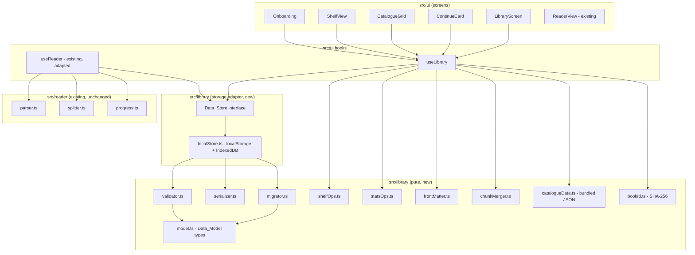
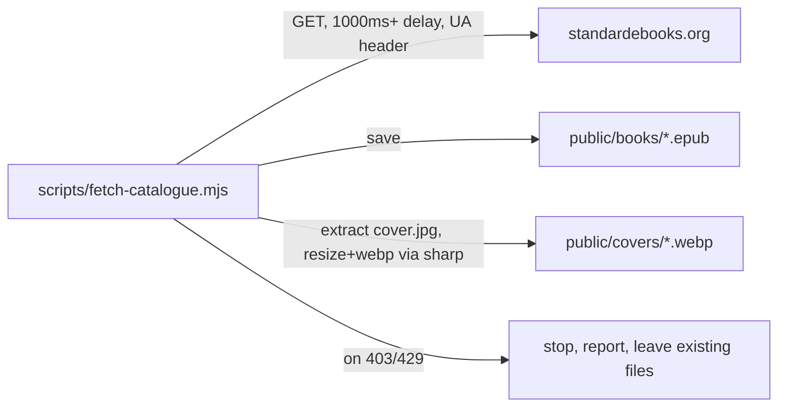

# Design Document

## Overview

Library-v2 replaces the single-book start screen with a library: a bundled catalogue of 16 public-domain classics, a "Continue reading" card, three shelves, a local profile, and a one-time onboarding. Underneath, it replaces the two ad hoc storage keys (`rod_state`, `rod_pace_guide` in localStorage, and the single `current` record in the `rod_books` IndexedDB database) with one versioned, validated `Data_Model`, read and written only through a small `Data_Store` interface. Front-matter skipping and paragraph-chunk merging change where a book opens and how much text one click reveals; neither changes how paragraphs are stored or parsed today.

This design keeps the existing `src/reader/` pipeline (`parser.ts`, `splitter.ts`, `stripHtml.ts`, `gutenberg.ts`, `fileIO.ts`, `title.ts`) untouched. It adds a new `src/library/` folder for the model, catalogue, validator, migrator, store, and shelf/stats logic, and a `src/library/catalogue-data.ts` file generated by a new one-off script. `src/reader/library.ts` (the current hard-coded two-book list) and `src/reader/storage.ts`/`src/reader/bookStore.ts` (the current localStorage/IndexedDB adapters) are superseded by `src/library/catalogueData.ts` and `src/library/localStore.ts` respectively; the old files are removed once `useReader`/`useLibrary` no longer reference them.

### Current code this builds on

- `src/reader/types.ts` — `Book`, `Chapter`, `Paragraph`, `Position`, `StoredState`. `Position` already has `chapterIndex`, `paragraphIndex`, `savedAt`; this spec adds `progress` to it (Requirement 5.6) inside the new `Position` type in `src/library/model.ts` (not the reader-core one, to avoid breaking reader-core's own tests — see Components below).
- `src/reader/position.ts` — `resolvePosition` clamps an out-of-range saved position to chapter 0 / paragraph 0. Library-v2's position restore (Requirement 5.5) reuses this clamp behavior but changes the "no saved position" default from chapter 0 / paragraph 0 to the computed `Story_Start`.
- `src/reader/progress.ts` — `calculateProgress`, `absoluteIndex`, `countTotalParagraphs` are pure and already property-tested in reader-core (`progress.prop.test.ts`). Library-v2 reuses them unchanged for Requirement 5.6; see Correctness Properties for why no new property is written for progress itself.
- `src/reader/bookCodec.ts` / `bookStore.ts` — EPUB chapters are serialized as JSON for IndexedDB storage; txt books are stored as stripped source text. Library-v2 keeps this encoding but keys records by `Book_Id` instead of the fixed `'current'` key (Requirement 18.6).
- `src/ui/useReader.ts` / `src/ui/loadSource.ts` — own loading, position-save-on-advance, and pace-guide toggling. Library-v2 introduces `useLibrary` (new) for the Library_Screen and keeps `useReader` for the reading view, now taking a `Book_Id` and a `Data_Store` instead of talking to `storage.ts`/`bookStore.ts` directly.
- `src/ui/LibraryScreen.tsx` — currently a flat two-book list plus an upload control. This spec's `Library_Screen` replaces its contents (grid, shelves, continue card, welcome header) but keeps the "Open your own book" control and the file-input wiring from `loadSource.ts`.
- `src/ui/theme.css` — already defines `--bg`, `--surface`, `--text`, `--text-dim`, `--accent`, `--danger`, `--shadow`, `--glow`. This spec adds `--candle-amber`, `--candle-rose`, `--candle-violet`, `--candle-teal`, `--candle-ash`, `--candle-moss` (the six `Candle_Colour` values) to this same file, each checked for ≥3:1 contrast against `--surface`.
- `src/attention/index.ts` — exposes only `AttentionSignal` (`present`/`away` + timestamp) via `createAttention`. Stats' look-away count and away seconds (Requirement 20.4, 20.9, 20.13) subscribes to this signal exactly as `AttentionLayer` already does; no new camera access is added.

## Architecture



### Scripts (build-time, not bundled)



## Components and Interfaces

### `src/library/model.ts` (pure types, no DOM)

```ts
export interface DataModel {
  schemaVersion: 2;
  profile: Profile;
  shelves: { reading: string[]; 'want-to-read': string[]; finished: string[] };
  books: Record<string, BookEntry>;   // keyed by Book_Id
  positions: Record<string, Position>; // keyed by Book_Id
  stats: Record<string, Stats>;        // per-book, keyed by Book_Id
  daily: Record<string, Stats>;        // per calendar day, keyed by Local_Date 'YYYY-MM-DD' (device time zone); kept 90 days
}

export type CandleColour = 'amber' | 'rose' | 'violet' | 'teal' | 'ash' | 'moss';
export type PaceGuideSetting = boolean; // reuses existing on/off semantics from reader/storage.ts

export interface Profile {
  displayName: string;       // '' means none; 1-40 chars after trim when set
  candleColour: CandleColour;
  onboardingCompleted: boolean;
  paceGuideEnabled: PaceGuideSetting;
  averagePace: number;       // 50-1000
}

export interface BookEntry {
  bookId: string;
  title: string;
  author: string;            // '' allowed
  fileName: string;
  source: 'catalogue' | 'upload';
  format: 'txt' | 'epub';
  catalogueSlug?: string;    // present only when source === 'catalogue'
  addedAt: number;
}

export interface Position {
  chapterIndex: number;
  paragraphIndex: number;   // first paragraph of the active Reading_Chunk
  savedAt: number;
  progress: number;         // 0-100 integer
}

export interface Stats {
  paragraphsRead: number;
  chaptersFinished: number;
  activeReadingSeconds: number;
  awaySeconds: number;      // whole seconds `away` while a book is open, excluding reader-started breaks
  lookAwayCount: number;
  sessionCount: number;
}

export const EMPTY_DATA_MODEL: DataModel = { /* First_Visit_State */ };
```

### `src/library/validator.ts`

`validate(input: unknown): { ok: true; value: DataModel } | { ok: false; problems: string[] }`. Pure function. Checks, in order (Requirement 16):

1. Shape: exactly one `schemaVersion`, one `profile`, the three built-in shelves, a `books` map, a `positions` map (≤1 per Book_Id by construction of the map type), one `stats` entry per book.
2. No book text fields anywhere (type-level guarantee plus a runtime key-list check, since this validates `unknown`).
3. Referential integrity: every Book_Id in `shelves`, `positions`, `stats` has a matching entry in `books` (16.4).
4. Shelf exclusivity: no Book_Id appears twice across or within the three shelves (16.5).
5. Position range: integer, non-negative `chapterIndex`/`paragraphIndex`; finite `savedAt`; `progress` a whole number 0–100 (16.6).
6. Stats: every count a non-negative finite integer (16.7), in both `stats` and `daily`.
6a. Daily: every `daily` key is a real calendar date written `YYYY-MM-DD`; a malformed date is rejected and reported by name (16.11, 16.12). `daily` keys need no matching Book_Entry, because daily records outlive removed books.
7. Profile: `candleColour` in the fixed set; `displayName.length <= 40` (16.8).

Rejected input never mutates the caller's stored data (16.9); the Local_Store only calls `save` with the validator's accepted value (see `localStore.ts`).

### `src/library/serializer.ts`

`serialize(model: DataModel): string` (JSON.stringify with a stable key order) and `parse(text: string): unknown` (JSON.parse, catching exceptions into `undefined`). `localStore.ts` always pipes `parse` through `validate` before use (18.4).

### `src/library/bookId.ts`

```ts
export async function hashBytes(bytes: ArrayBuffer): Promise<string | null>
```
Uses `crypto.subtle.digest('SHA-256', bytes)`, lowercased hex. Returns `null` if `crypto.subtle` is unavailable or throws (15.5 — caller shows the "could not be added" message and makes no model change). Catalogue Book_Ids are the catalogue slug string directly (no hashing) per Requirement 15.2.

### `src/library/shelfOps.ts` (pure model updates — Requirement 21.2)

```ts
export function addBookEntry(model: DataModel, entry: BookEntry): DataModel        // 6.1
export function moveToShelf(model: DataModel, bookId: string, shelf: ShelfName): DataModel  // 6.3, 6.4
export function removeBook(model: DataModel, bookId: string): DataModel            // 6.5
export function savePosition(model: DataModel, bookId: string, position: Position): DataModel // 5.1, 5.4
```

Each takes a `DataModel`, returns a new one, and does not mutate its input (structural sharing is fine; only the touched branches are copied). `moveToShelf`/`removeBook`/`savePosition` on an unknown `bookId` return the input model unchanged (21.6). `moveToShelf` always removes the Book_Id from whichever shelf currently holds it (if any) before adding it to the target, in one returned value, so no caller can observe an intermediate state (6.4) — there is no separate "remove" step the caller must sequence.

`currentBook(model): BookEntry | null` picks the `reading`-shelf entry with the latest `positions[id].savedAt`, falling back to the latest `addedAt` when none has a position (4.6).

### `src/library/statsOps.ts`

```ts
export function recordParagraphsRead(stats: Stats, count: number): Stats
export function recordChapterFinished(stats: Stats): Stats
export function addActiveSeconds(stats: Stats, seconds: number): Stats
export function addAwaySeconds(stats: Stats, seconds: number): Stats
export function recordLookAway(stats: Stats): Stats
export function recordSession(stats: Stats): Stats
export function overallStats(perBook: Record<string, Stats>): Stats // 20.6, sum of the six fields

// Per-day recording. `today` is the injected Local_Date ('YYYY-MM-DD'); the functions never read the clock.
export type StatEvent =
  | { kind: 'paragraphs'; count: number } | { kind: 'chapter' }
  | { kind: 'active'; seconds: number }   | { kind: 'away'; seconds: number }
  | { kind: 'lookAway' }                  | { kind: 'session' };
export function recordEvent(model: DataModel, bookId: string, event: StatEvent, today: string): DataModel // 20.1-20.5, 20.13, 20.15
export function pruneDaily(daily: Record<string, Stats>, today: string): Record<string, Stats>            // 20.16
```

All pure and additive. `recordEvent` updates `stats[bookId]` and `daily[today]` in the same returned model, then calls `pruneDaily`, which drops only records more than 90 days before `today` and keeps every record within 90 days (20.16). An unknown `bookId` returns the model unchanged. The reader decides whether an event is recorded: it sends no away event while a reader-started break is in progress (20.14).

`removeBook` deletes a book's `Stats` entry before `overallStats` resums the rest (20.10), and leaves `daily` unchanged, so the history of days read is kept. The "Daily totals sum to per-book totals" property (20.18) therefore covers event sequences with no removal and no pruning.

The reader gets the Local_Date from one small helper in the UI layer (built from `getFullYear`, `getMonth`, `getDate`, which use the device's local time zone), and passes it into `recordEvent`.

### `src/library/frontMatter.ts`

```ts
export interface LandmarkData {
  bodymatterHref?: string;                 // from EPUB landmarks nav, if present
  chapterTypes: Record<string, string[]>;  // href -> epub:type tokens, if present
}
export function findStoryStart(landmarks: LandmarkData, chapters: { href: string }[]): { chapterIndex: number }
```

Pure, no DOM (9.9). `useLibrary`'s EPUB-opening path extracts `LandmarkData` from epub.js's already-parsed `book.navigation` (the same `nav.toc`-reading code path `parser.ts` uses for TOC labels) and the spine items' `epub:type` properties, then hands plain data to `findStoryStart`. Resolution order (9.1–9.3):

1. If `bodymatterHref` matches a chapter, that chapter is the Story_Start.
2. Else, the FRONT_MATTER_TYPES set (`titlepage`, `halftitle`, `frontmatter`, `toc`, `epigraph`, `dedication`, `copyright-page`, `imprint`) is used to classify each chapter by its `epub:type`; the first chapter not in that set is the Story_Start.
3. Else (no landmark, no markers, or no match found), Story_Start is chapter 0.

### `src/library/chunkMerger.ts`

```ts
export interface ReadingChunk { chapterIndex: number; firstParagraphIndex: number; paragraphs: Paragraph[] }
export function mergeIntoChunks(chapters: Chapter[], splitFn: typeof splitIntoParagraphs): ReadingChunk[]
```

Pure (10.9), built on the existing `splitIntoParagraphs`/`Paragraph` types from `src/reader/`. Algorithm per chapter: walk paragraphs in order, accumulate a running chunk until its word count (via the existing `countWords` from `paceCalc.ts`) reaches 40, then close it (10.1, 10.3); never splits a paragraph (10.2); if trailing paragraphs end a chapter under 40 words and an earlier chunk exists in that chapter, append them to the last chunk (10.5); a whole chapter under 40 words becomes one chunk (10.6); chunks never span chapters (10.4). `Position.paragraphIndex` continues to store the absolute paragraph index of the chunk's first paragraph, so positions saved before this spec (pointing at a single paragraph) remain valid — they simply now open whichever chunk contains that paragraph (10.10, 9.6).

### `src/library/catalogueData.ts` (generated, bundled data — not hand-edited)

```ts
export interface CatalogueEntry {
  slug: string;
  title: string;
  author: string;
  description: string;     // exactly two sentences, no spoilers
  readingMinutes: number;
  moodTags: [string] | [string, string];
  coverPath: string;       // '/covers/<slug-with-slashes-as-dashes>.webp'
  epubPath: string;        // '/books/<slug-with-slashes-as-dashes>.epub'
}
export const CATALOGUE: readonly CatalogueEntry[]; // exactly 16 entries (Req 1.1, 1.11)
```

This file holds the 16 entries listed in Requirement 1.11, with `slug` exactly as specified there (e.g. `john-william-polidori/the-vampire`, `h-g-wells/the-invisible-man`). `description`, `readingMinutes`, and `moodTags` are hand-written editorial content (Requirement 1.9), not scraped from Standard Ebooks. The Poe entry keeps the slug `edgar-allan-poe/short-fiction` but is shown with the title "Short Fiction", and the Polidori entry (slug `john-william-polidori/the-vampire`) is shown as "The Vampire", both matching the title printed on the cover. `coverPath`/`epubPath` use the file stem the fetch script writes (the book's own slug segment, for example `dracula`, `short-fiction`, `the-invisible-man`; see `scripts/catalogue-slugs.mjs`). Paths are case-sensitive: the Dracula file is exactly `public/books/dracula.epub` (Requirement 1.13).

### `src/library/localStore.ts` (the only Data_Store implementation — Requirement 17)

```ts
export type Result<T> = { ok: true; value: T } | { ok: false; kind: FailureKind };
export type FailureKind = 'unavailable' | 'quota' | 'invalid' | 'not_found' | 'newer_version';

export interface DataStore {
  load(): Promise<Result<DataModel>>;
  save(model: DataModel): Promise<Result<void>>;
  clear(): Promise<Result<void>>;
  getText(bookId: string): Promise<Result<string>>;
  putText(bookId: string, text: string): Promise<Result<void>>;
  deleteText(bookId: string): Promise<Result<void>>;
}
export function createLocalStore(): DataStore;
```

`localStore.ts` is the only file that touches `localStorage` or the `rod_books` / future `library_books` IndexedDB database (17.10). It wraps every operation in try/catch so nothing throws or rejects to the caller (17.2); `load()` on first run returns `EMPTY_DATA_MODEL` wrapped as success (17.5); `getText` for a missing key returns `{ ok: false, kind: 'not_found' }`, never an empty-string success (17.4); `deleteText`/`clear` on already-absent data return success (17.6). Internally it reuses the IndexedDB transaction helper pattern already in `bookStore.ts` (open → transaction → close, never throw), generalized to a `Book_Id`-keyed store instead of the fixed `'current'` key, and the JSON parse/validate pattern already in `storage.ts`, generalized to the full `DataModel` via `serializer.ts` + `validator.ts`. On `save`, if `schemaVersion` in storage is greater than 2, `load()` returns `{ ok: false, kind: 'newer_version' }` and `save()` is refused for the rest of the session (19.10); `useLibrary` keeps an in-memory model and shows the "newer version" message.

`createLocalStore()` is the single creation point (17.8); `useLibrary` and `useReader` receive a `DataStore` via one React context (`src/ui/dataStoreContext.ts`, new), so tests can supply an in-memory fake store without touching any screen (21.1, 21.3).

### `src/library/migrator.ts`

```ts
export interface LegacyInput {
  rodState: unknown;        // raw value from localStorage['rod_state'], or undefined
  rodPaceGuide: unknown;    // raw value from localStorage['rod_pace_guide'], or undefined
  legacyBookId: string | null; // SHA-256 of the 'current' IndexedDB text, computed by localStore.ts, or null if that text is missing
}
export function migrate(legacy: LegacyInput, current: DataModel): DataModel
```

Pure (19.5 — the Book_Id is computed by `localStore.ts`, a side-effecting caller, and passed in). If `current.schemaVersion === 2` and is already a valid model with no legacy indicators relevant, `migrate` returns a value deeply equal to `current` (19.8's idempotence). Otherwise it validates `rodState` (non-empty filename ≤255 chars, non-negative integer position ≤ paragraph count, finite `averagePace` > 0 — 19.2) and `rodPaceGuide` (one of the supported `PaceGuideSetting` values — 19.3) independently; an invalid one is ignored while a valid one still contributes (19.9). On a valid `rodState` with `legacyBookId === null` (text missing), it still creates the `BookEntry`/`Position` using a `legacy-<fileName>` Book_Id (19.13). The produced `Profile` is `First_Visit_State` except for the carried-over `paceGuideEnabled`/`averagePace` (19.4).

`localStore.ts` orchestrates the side-effecting steps around this pure function: read legacy keys → hash legacy text → call `migrate` → write the v2 model → read it back → only then copy the legacy book text to the new Book_Id key, confirm the readback, and only then delete the legacy keys (19.6, 19.7, 19.12). If any step fails, legacy keys are left untouched and migration retries on the next start (19.12).

### UI components (new, under `src/ui/`, each < 200 lines per Requirement 11.9)

| File | Responsibility |
|---|---|
| `LibraryScreen.tsx` | Composes `WelcomeHeader`, `ContinueCard`, `CatalogueGrid`, `ShelfView`, "Open your own book". Replaces current flat list. |
| `WelcomeHeader.tsx` | Greeting + `Avatar` (4.1–4.3). |
| `ContinueCard.tsx` | Hero card or empty state (4.4, 4.7–4.9). |
| `CatalogueGrid.tsx` | Centred grid of `CoverCard`s: two columns at 360 px, about 5 to 6 per row at 1440 px, covers about 130–200 px wide (2.1–2.7, 14.2–14.3). |
| `CoverCard.tsx` | One cover, title, author, hover/focus lift (3.1, 12.1–12.2). |
| `HoverCard.tsx` | Spoiler-free preview (3.1–3.10). |
| `ShelfView.tsx` | Three shelves, move buttons, empty-shelf message (6.7–6.10, 13.4). |
| `Onboarding.tsx` | ≤3 steps, skip button, name/colour step (8.1–8.12). |
| `ProfileSettings.tsx` | Name/colour edit, delete profile, clear data (7.6–7.9, 22.6–22.9). |
| `ReaderBanner.tsx` | Small, dismissible, non-blocking banner in the reader view shown when a Position save fails. It sits outside the active Reading_Chunk, never blocks reading, and clears on the next successful save (5.11, 5.12). |
| `Skeleton.tsx` | Shared placeholder shape (13.1–13.3, 13.5). |

`useLibrary.ts` (new, in `src/ui/`) owns the `DataStore` calls, the `currentBook`/shelf selectors, onboarding/profile state, and debounced saves (within the 500 ms/1 s/1000 ms windows in Requirements 5.1, 7.3, 7.12, 18.1). `useReader.ts` changes to accept a `bookId` and the `DataStore` from context instead of calling `storage.ts`/`bookStore.ts` directly; it calls `savePosition`/`recordParagraphsRead` etc. through `useLibrary`'s exposed update functions rather than owning model state itself.

## Data Models

See `src/library/model.ts` above for the full `DataModel` shape. Key invariants enforced by the Validator and by construction of the pure update functions:

- Exactly one `Position` per `Book_Id` (map keyed by Book_Id — structurally impossible to have two).
- A `Book_Id` is on at most one of the three shelves at a time (enforced by `moveToShelf`'s remove-then-add and checked by the Validator for any model loaded from storage).
- `Stats` and `Position` reference only existing `Book_Entry` records (Validator check; `shelfOps`/`statsOps` never create a dangling reference because they always add the `BookEntry` in the same call as the shelf placement in `addBookEntry`).

## Correctness Properties

*A property is a characteristic or behavior that should hold true across all valid executions of a system — essentially, a formal statement about what the system should do. Properties serve as the bridge between human-readable specifications and machine-verifiable correctness guarantees.*

### Property 1: Position save/restore round trip

For any valid `DataModel` and any `Book_Id` present in it, calling `savePosition` with a valid `Position` and then reading that `Book_Id`'s position back from the resulting model returns a `Position` equal to the one saved, in `chapterIndex` and `paragraphIndex`.

**Validates: Requirements 5.3**

### Property 2: Saving one Position leaves every other Position unchanged

For any `DataModel` with two or more `Book_Id`s that each have a `Position`, calling `savePosition` for one `Book_Id` leaves every other `Book_Id`'s stored `Position` deeply equal to its value before the call.

**Validates: Requirements 5.4**

### Property 3: Shelf moves are atomic

For any `DataModel` and any `Book_Id` present on exactly one shelf, calling `moveToShelf` with a target shelf results in a model where that `Book_Id` is on the target shelf and on no other shelf.

**Validates: Requirements 6.4**

### Property 4: Shelf invariant holds across any sequence of operations

For any sequence of shelf operations (add, finish, move, remove) drawn from `shelfOps` and folded over a `DataModel` starting from the empty model, after every step in the sequence each `Book_Id` appears on at most one shelf, and any `Book_Id` that has been removed appears on none.

**Validates: Requirements 6.11**

### Property 5: Front-matter detection never skips the story and is conservative without markers

For any set of chapters with a designated `bodymatter` landmark or a set of `epub:type` front-matter markers, `findStoryStart` returns a `chapterIndex` at or before the designated chapter, and every chapter index less than the returned `chapterIndex` is one of the chapters the input marked as front matter. For any set of chapters with no landmark and no markers, `findStoryStart` returns chapter index 0.

**Validates: Requirements 9.3, 9.4, 9.9**

### Property 6: Reading-chunk merging preserves text and respects chapter and size rules

For any chapter list, joining the paragraphs of all `ReadingChunk`s produced by `mergeIntoChunks`, in order, reproduces exactly the original paragraphs of all chapters, in their original order, with no paragraph split across two chunks and no chunk spanning two chapters; additionally, every chunk holds at least 40 words except a chunk that is the only chunk of a chapter whose total word count is under 40.

**Validates: Requirements 10.1, 10.2, 10.3, 10.4, 10.5, 10.6, 10.7**

### Property 7: The Validator accepts exactly the well-formed Data_Models

For any generated `DataModel` built to be well-formed, the Validator accepts it. For any well-formed `DataModel` mutated to introduce exactly one of: a shelf/position/stats entry referencing a missing `Book_Id`, a `Book_Id` duplicated across or within shelves, a `Position` with a negative, fractional, non-finite, or out-of-range field, a negative or non-finite `Stats` count, or a `Profile` with an out-of-set `candleColour` or an over-length `displayName`, the Validator rejects it and reports a problem naming the offending field or `Book_Id`.

**Validates: Requirements 16.4, 16.5, 16.6, 16.7, 16.8, 16.10**

### Property 8: Serialization round trip

For any valid `DataModel`, parsing the text produced by the Serializer returns a `DataModel` deeply equal to the original.

**Validates: Requirements 18.5**

### Property 9: Migration preserves legacy position, pace, and book identity

For any generated valid legacy `rod_state` record and `rod_pace_guide` value, `migrate` produces a `DataModel` containing exactly one `BookEntry` for that record's file name, a `Position` equal to the legacy position with `progress` 0, an `Average_Pace` equal to the legacy value, that `Book_Id` on the `reading` shelf, and the `Profile`'s `paceGuideEnabled` equal to the legacy pace-guide value.

**Validates: Requirements 19.2, 19.3**

### Property 10: Migration is idempotent on current-version data

For any `DataModel` already at schema version 2, `migrate` returns a value deeply equal to its input.

**Validates: Requirements 19.8**

### Property 11: Daily totals sum to per-book totals (optional)

For any sequence of stat events recorded with `recordEvent` over one or more books and one or more local dates, with no book removal and no pruning in the sequence, for each of the six Stats fields the sum of the `daily` values equals the sum of the per-book `stats` values.

**Validates: Requirements 20.18**

### Redundancy Review

Requirement 9.3 ("no usable landmarks" falls back to chapter 0) is folded into Property 5 rather than given its own property: the same generator produces chapter lists both with and without landmarks/markers, and the "no markers → chapter 0" case is one branch of the same assertion, not a distinct universal statement. Requirement 10.1–10.6 (minimum chunk size, no splitting, no cross-chapter merges, short-chapter exception) are folded into Property 6 alongside the round trip, since all of them are invariants checked against the same generated chapter list and the same function call — testing them as separate properties would re-run the identical generator for no added confidence. Requirement 5.6 (progress is 0–100) is not restated as a new property because it is `calculateProgress` from `src/reader/progress.ts`, already covered by `progress.prop.test.ts` in the reader-core spec; library-v2 only adds a call site. Requirement 20.7 (stats never decrease) is covered by a small number of example tests rather than a property. The only Stats property is Property 11, which Requirement 23.4 lists as optional ("where time allows... MAY").

## Error Handling

All error paths follow `design.md`'s "state what happened and what to do next" tone and the Local persistence rules in the requirements:

- **Load failure (startup)**: `Data_Store.load()` returns a failure → `useLibrary` keeps an empty in-memory model, shows the Library_Screen with an empty shelf state, and shows "Your saved books could not be loaded. You can still open a book below." (21.5, 13.6).
- **Save failure (position)**: position write fails → stay on the current Reading_Chunk, show "Your place could not be saved. It will try again." and keep the previously saved Position (5.10). The same failure also shows the `ReaderBanner` in the reader view, which `useReader` clears when a later save succeeds (5.11, 5.12).
- **Save failure (profile)**: show "Your changes could not be saved. Try again." and keep previous saved values plus current in-session values (7.13).
- **Newer schema version**: `load()` returns `kind: 'newer_version'` → show "Your saved data comes from a newer version of this app." and make no writes for the session (19.10).
- **Missing book text**: `getText` returns `not_found` for an existing `BookEntry` → show "This book's file needs to be opened again," offering "Reopen the file" / "Choose the book again," leaving the model unchanged (6.12).
- **Removal failure**: any step of the atomic removal (entry + position + stats + text) fails → no partial state is written (the removal is implemented as one `DataStore` call sequence that only commits the model write after the text delete succeeds, and rolls back to showing the error otherwise) → "This book could not be removed. You can try again." (6.6).
- **Hash failure on upload**: `crypto.subtle` unavailable or throws → book is not added, model unchanged, "This book could not be added. Try a different file or browser." (15.5).
- **Catalogue data load failure**: fetch/parse of bundled catalogue JSON fails → "The library could not be loaded," with "Try again," while still showing Shelf_View and "Open your own book" (13.6).

## Testing Strategy

**Property tests** (fast-check, ≥100 runs each, tagged `Feature: library-v2, Property N: <text>`) cover the ten properties above (and the optional Property 11), placed as:

- `src/library/__tests__/shelfOps.p1.prop.test.ts` — Property 1 (position round trip, via `savePosition`)
- `src/library/__tests__/shelfOps.p2.prop.test.ts` — Property 2
- `src/library/__tests__/shelfOps.p3.prop.test.ts` — Property 3
- `src/library/__tests__/shelfOps.p4.prop.test.ts` — Property 4 (model-based: random op sequence folded over the model)
- `src/library/__tests__/frontMatter.p5.prop.test.ts` — Property 5
- `src/library/__tests__/chunkMerger.p6.prop.test.ts` — Property 6
- `src/library/__tests__/validator.p7.prop.test.ts` — Property 7
- `src/library/__tests__/serializer.p8.prop.test.ts` — Property 8
- `src/library/__tests__/migrator.p9.prop.test.ts` — Property 9
- `src/library/__tests__/migrator.p10.prop.test.ts` — Property 10
- `src/library/__tests__/statsOps.p11.prop.test.ts` — Property 11 (optional)

**Unit/example tests** (a few representative cases each, per Requirement 23.5), kept to roughly 30 minutes per file:

- `localStore.unit.test.ts` — write failure and unavailable storage leave prior data unchanged and report failure (not a default value); newer-schema-version refuses writes and reports unsupported; `getText` on a missing key returns `not_found`, not an empty string.
- `catalogueData.unit.test.ts` — exactly 16 entries; every entry's description is exactly two sentences; every entry has one or two mood tags; every entry's `coverPath`/`epubPath` resolves to a file that exists under `public/`.
- `README.unit.test.ts` (extends the existing `readmeAssets.unit.test.ts` pattern) — every bundled EPUB and cover listed with source and licence.
- `LibraryScreen` / `CatalogueGrid` / `CoverCard` component tests — title/author shown, "Open your own book" present, selection by click and by keyboard (Enter/Space), accessible name contains title + author.
- `HoverCard` component test — shows on hover (after 200ms) and on focus, hides on Escape and on blur/pointer-leave.
- reading-time formatter unit tests — a few boundary examples (under 90 min rounds to nearest 5; 90+ min rounds to nearest hour).
- `Profile`/`Onboarding` component tests — display-name length rule rejection message; onboarding has at most three steps and "Skip introduction" works; "Delete my profile" keeps `books`/`shelves`/`positions`/`stats` untouched.
- `bookId` unit test — two uploads with equal name/size but different bytes get different Book_Ids; an identical re-upload reuses the existing entry.
- Reduced-motion CSS/style unit test — hover/focus lift and tilt are absent under `prefers-reduced-motion: reduce`.
- `statsOps` unit tests — a few examples demonstrating counts never decrease across a short fixed event sequence, a per-day record for an injected local date, away seconds, 90-day pruning (a record 91 days old is dropped, one 90 days old is kept), and `removeBook` leaving `daily` unchanged.
- `ReaderBanner` example test — a failed position save shows the banner, it can be dismissed, it does not cover the active chunk, and the next successful save clears it.

Counterexamples, when found, are recorded in `docs/BUILD_LOG.md` with the failing property, the shrunk input, and the seed, before any test or code change (Requirement 23.10). After each test task, the properties added, iteration counts, and any counterexamples are reported (23.11). No test under this spec mocks the function it is testing, weakens an assertion to pass, or wraps logic in a catch that returns a default (per the workspace testing rule).

## Catalogue Fetch Script

### `scripts/fetch-catalogue.mjs` (new, build-time only; not imported by the app)

Run manually by the maintainer (`node scripts/fetch-catalogue.mjs`), not from `postinstall` or `prebuild`, since it makes network requests and the app itself never does (Requirement 1.4, 22.4).

```js
// Pseudocode structure (full implementation at task time)
const USER_AGENT = 'ReadOrDread-catalogue-script/1.0 (+contact in README)';
const MIN_DELAY_MS = 1000;

for (const entry of CATALOGUE) {
  await sleep(MIN_DELAY_MS); // politeness delay before every request, including the first
  const res = await fetch(downloadUrl(entry.slug), { headers: { 'User-Agent': USER_AGENT } });
  if (res.status === 403 || res.status === 429) {
    console.error(`Stopped: HTTP ${res.status} fetching ${entry.slug}. Files already saved are unchanged.`);
    process.exit(1);
  }
  if (!res.ok) { report(entry.slug, res.status); continue; }
  await fs.writeFile(`public/books/${slugToFileStem(entry.slug)}.epub`, Buffer.from(await res.arrayBuffer()));
  await extractAndSaveCover(entry); // unzip epub, find the cover-image item from content.opf, sharp -> webp
}
```

**Download URL shape** (verified against Standard Ebooks' current site, November 2026): `GET https://standardebooks.org/ebooks/{slug}/downloads/{slug-with-slashes-as-underscore-then-dash}.epub?source=download` — the `?source=download` query parameter is required; without it the server returns an HTML redirect-confirmation page (`content-type: application/xhtml+xml`) instead of the EPUB binary (`content-type: application/epub+zip`). The script checks `res.headers.get('content-type')` includes `application/epub+zip` before writing, and treats any other content type as a fetch failure to report rather than silently writing an HTML page as a `.epub` file.

**robots.txt**: `standardebooks.org/robots.txt` disallows `/ebooks/*/downloads/*` and `/ebooks/*/text*` for crawlers, but these are the book's own direct-download links a human reader clicks, not a crawled listing; the script fetches only the 16 specific URLs the maintainer has chosen, at a rate far below any crawler, matching the site's own "download this ebook" action. The script still identifies itself with a descriptive `User-Agent` per Requirement 1.5 so Standard Ebooks can identify and, if they prefer, block the traffic.

**Cover extraction**: the EPUB's `epub/content.opf` lists the cover image item via `properties="cover-image"` (confirmed against the downloaded Dracula EPUB: `<item href="images/cover.jpg" id="cover.jpg" media-type="image/jpeg" properties="cover-image"/>`). The script unzips the EPUB in memory (reusing `jszip`, already a project dependency), extracts that item's bytes, and passes them through `sharp`:

```js
await sharp(coverBytes)
  .resize({ width: 400, withoutEnlargement: true })
  .webp({ quality: 80 })
  .toBuffer();
```

`sharp`'s `webp()` quality defaults to 80; the script starts there and steps quality down in increments of 10 (to a floor of 40) while the output exceeds ~100 KB, reporting the book's slug if even the floor quality does not fit, per Requirement 1.6's "report any book whose cover could not be extracted."

**New dev dependency**: `sharp` (`^0.35`), licence **Apache-2.0** (confirmed via `node_modules/sharp/package.json` and the [sharp documentation](https://sharp.pixelplumbing.com/)), added to `devDependencies` only — it runs in the Node-only fetch script, never in the browser bundle, so it does not affect the app's privacy or bundle-size posture. It is listed in the README dependency table like every other dependency, per `tech.md`.

**Landmarks for front-matter detection**: the same Dracula EPUB's `toc.xhtml` contains an `epub:type="landmarks"` nav with `epub:type="frontmatter"` and `epub:type="bodymatter"` entries, confirming Standard Ebooks EPUBs expose the landmarks `findStoryStart` (Requirement 9.1) reads. `epubjs`'s `Navigation` class (`node_modules/epubjs/src/navigation.js`) already parses an EPUB 3 landmarks nav into a `landmarksByType` map; `useLibrary`'s EPUB-opening path reads `book.navigation.landmarksByType.bodymatter` the same way `parser.ts` already reads `book.navigation.toc` for chapter titles, so no new EPUB-parsing code is needed beyond the pure `findStoryStart` function.

## Open Questions for Review

- The six `Candle_Colour` names (`amber`, `rose`, `violet`, `teal`, `ash`, `moss`) and their hex values are a proposal; exact hues will be tuned during implementation to clear the 3:1 contrast bar against `--surface` (#1d1916).
- `fetch-catalogue.mjs` is specified to run manually; if the maintainer wants a CI check that catalogue files exist, that would be a follow-up, not part of this spec.
